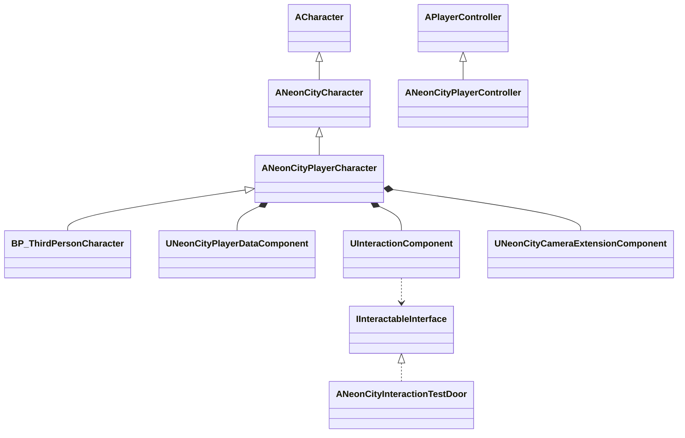
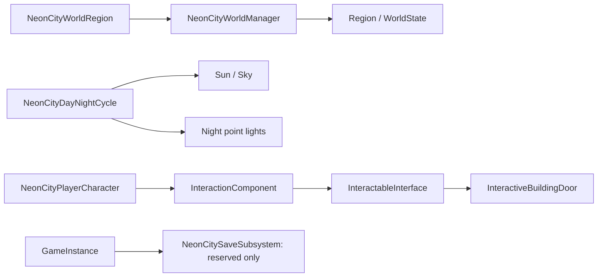

# NeonCity 架构（Phase 5）

## 项目目标与当前范围

基于 UE 5.8 Third Person Template，通过继承、组件组合和领域接口建立长期可扩展的第三人称城市游戏。
当前仍是一个 NeonCity Runtime 模块；Core、Player、World、Interaction、AI、Vehicles 是责任目录，
不是独立 UBT 模块。保持依赖无环，待边界稳定后再拆模块/插件，不提前实现城市系统。

Phase 3 只接入玩家框架、基础数据、F 键交互和摄像机扩展合同。
Phase 3 未创建地图、美术资源、车辆、武器、NPC AI、任务或 UI；Phase 4 的世界与 Phase 5 的车辆范围见下文。

## Core 与 World

- UNeonCityGameInstance：会话初始化/关闭入口，调用 Super，提供 IsFrameworkReady。
- UNeonCityGameInstanceSubsystem：抽象持久系统基类；UE 管理 Initialize/Deinitialize，
  依赖通过 Collection.InitializeDependency 声明。
- ISystemInterface：统一 IsSystemReady 状态查询，不提供可被任意重复调用的初始化入口。
- UNeonCityWorldManager：每个 Game/PIE 世界独立创建的 WorldSubsystem，不 Tick、不生成 Actor，
  不在编辑器/预览世界中创建。Ready 表示初始化完成，不等于 BeginPlay。
- ANeonCityGameMode：保留现有规则/流程基类，默认 Pawn/Controller 继续由 BP_ThirdPersonGameMode 配置。
- EnvironmentSystemInterface、WeatherSystemInterface：未来环境/天气身份接口，没有具体系统逻辑。
- NPCInterface 为未来领域身份合同；VehicleInterface 已由 Phase 5 车辆实现身份查询。

## 玩家系统结构



### 默认角色接入

通过 UE 编辑器 BlueprintEditorLibrary 重设现有 BP_ThirdPersonCharacter 的父类为
ANeonCityPlayerCharacter，并编译/保存该蓝图；不进行二进制字节补丁，不复制模板实现。
现有 GameMode 的 Pawn 资源引用和玩家蓝图路径保持不变，运行时 Pawn 正式继承 NeonCityPlayerCharacter。
原 ANeonCityCharacter.h/.cpp 保持原样，继续提供 Enhanced Input、CharacterMovement、跳跃和摄像机逻辑。
蓝图原有网格、Animation Blueprint、输入 Action 和移动/摄像机默认值在迁移前后校验。

NeonCityPlayerCharacter 只创建三个扩展组件，并在 SetupPlayerInputComponent 调用 Super 后绑定交互。
原 PlayerController 的输入映射与触屏模板行为不变。没有调用 ClearAllMappings，没有接管模板移动或镜头。

### PlayerData

UNeonCityPlayerDataComponent 是不 Tick 的 ActorComponent，提供 Blueprint/C++ Get/Set：

| 数据 | 类型/默认值 | 约束 |
| --- | --- | --- |
| Health | float，100 | 0 到 MaxHealth |
| MaxHealth | float，100 | 不小于 0；降低时约束 Health，增加时不自动治疗 |
| Stamina | float，100 | 不小于 0，本阶段不隐含上限 |
| Money | int64，0 | 不小于 0，使用整数单位 |

NaN/Inf 浮点 setter 输入被忽略。属性只读展示，写入经过 setter。
组件跟随当前 Pawn 生命周期；暂不跨死亡/重生/换图保存，不提供存档、复制、自动恢复、伤害或经济交易。
未来若需要持久化，应由 PlayerState/会话系统/存档层明确承接，不能把 Pawn 数据误认为永久存档。

### 摄像机扩展

UNeonCityCameraExtensionComponent 默认被动，不 Tick、不改变视角、SpringArm、FOV、碰撞或相机变换。
提供 Default/Vehicle/Aim/Indoor 等上下文的接口与变更通知，保留显式 UpdateCameraExtension 事件。
Phase 3 的上下文仅为合同；Phase 5 新增显式 Vehicle 镜头更新，Aim/Indoor 仍为预留。

## Interaction

IInteractableInterface：
- CanInteract(Interactor)：默认 false。
- GetInteractionName()：默认空 FText，支持本地化。
- Interact(Interactor)：默认无操作；实现方在执行时重新验证资格。

UInteractionComponent：
- 局部玩家每 0.1 秒从 Pawn 眼部沿控制器视线检测，默认距离 250 cm，默认 Visibility 通道。
- 只取第一个 blocking hit，忽略自己，不穿过墙体寻找后方目标。
- 目标必须是实现接口并通过 CanInteract 的 Actor；不绑定门、NPC、车辆等具体类型。
- Focus 使用弱引用，目标销毁后安全失效；无合法玩家、世界或距离时清空。
- TryInteract 重新检测并校验，再使用 Execute_Interact 分发；true 表示已分发，不承诺业务成功。
- DetectInteractable(Start, End, OutHit) 保留为显式通用查询，调用者控制线段；
  自动焦点和 TryInteract 路径才统一使用 InteractionDistance。
- 非交互物体阻挡时返回 nullptr，OutHit 仍保留物理命中。
- 不产生 UI，不自动执行交互，不缓存强 Actor 引用。

F 键使用 Pawn 私有的瞬态 Boolean InputAction + InputMappingContext，按 Started 触发一次。
不新增输入 .uasset，不修改原 IMC_Default。失去控制/EndPlay 时只移除自身映射与绑定，
重新 Setup 时先清理自身旧绑定，避免积累。

当前为单机基础。多人模式下还需服务端重新验证射线、距离和权限以及数据复制，不能把客户端焦点视为授权。

## 测试门与验证方法

ANeonCityInteractionTestDoor 位于 Interaction/Examples，使用 /Engine/BasicShapes/Cube。
自身实现 IInteractableInterface，近距离交互旋转门扇 90 度，再次交互关闭；无 Tick、动画资产或 UI。
它独立检查执行者有效性、世界一致性及 300 cm 距离，不依赖具体玩家类。
250 cm 的玩家射线范围仍是正常玩家交互的主要限制。

测试门不会在游戏启动时自动生成，也没有永久放入模板地图。
自动化测试在现有 ThirdPerson 地图的临时 PIE 世界中生成门和遮挡体，退出时销毁，不保存地图。
人工验证时可从 C++ Classes 将 NeonCityInteractionTestDoor 临时拖入现有关卡，
靠近至约 2.5 m 内并面向门板，按 F；测试后撤销放置即可，无需新地图或 UI。

## 测试与构建

关闭编辑器后，使用引擎随附 .NET/UBT，分别构建：
- NeonCityEditor Win64 Development
- NeonCity Win64 Development

参数保留 -WaitMutex -NoHotReloadFromIDE -NoEngineChanges，不修改引擎安装文件。

开发自动化测试：
- NeonCity.Architecture.ThirdPersonPIE：确认原 Pawn 蓝图已继承新玩家类、GameMode 保留，
  Enhanced Input/动画/摄像机可用，实际移动、转向、跳跃正常；
  在临时 PIE 世界验证自动焦点、遮挡、超距、F 键开门与已销毁目标清理。
- NeonCity.Player.DataInvariants：默认值、边界、MaxHealth 调整、非有限浮点和大额 int64 Money。

可通过 Session Frontend 运行上述测试；先保存当前工作，建议独立测试编辑器。
无渲染自动化不替代最终画面质量、物理键鼠/手柄或多人联网验收。
Saved 下的构建/自动化/迁移日志是生成内容，不提交。

## 目录和依赖

| 目录 | 责任 |
| --- | --- |
| Core | GameInstance、GameMode、系统合同与 Subsystem 基类 |
| Player | Character、Controller、PlayerData、Camera 扩展 |
| World | 世界生命周期与环境/天气合同 |
| Interaction | 通用检测/执行合同及可选测试门 |
| AI / Vehicles | AI 预留接口；Vehicles 已接入 Phase 5 单机 Chaos 原型 |
| Tests | 数据边界测试、仅 Editor 的 PIE 验证 |

现有 GameMode/PlayerController 在 Phase 2 原样迁入 Core/Player，反射路径保持不变。
新代码使用带目录的 include 和 NEONCITY_API；UnrealEd 仅为 Editor 目标的私有测试依赖。
游戏目标不依赖 UnrealEd；不增加第三方插件的持久依赖。

## 未来方向（未实施）

- Vehicle：组件化物理与进出合同，复用 Interaction，独立镜头策略。
- NPC AI：感知、导航、StateTree，通过 NPC 身份合同访问。
- Combat：伤害/能力合同，不反向依赖 UI、警察。
- Economy：持久数据与交易合同，不持有裸世界 Actor。
- Mission：订阅领域事件，世界目标使用稳定标识与适配器。
- Wanted/Police：订阅 Combat/Traffic 事件并调度世界响应。
- 保存/玩家状态：先定义 Pawn、PlayerState、GameInstance 和存档的所有权边界，再实现持久化。

不让 WorldManager 成为全系统管理器；领域系统依赖基础合同，通过事件/接口协作，表现层读取领域状态。
本阶段完成后停止，下一阶段需单独确认。

## Phase 3 验收记录

- Development Editor Win64：编译、链接成功（Saved/Phase3-EditorBuild.log）。
- Development Game Win64：编译、链接成功（Saved/Phase3-GameBuild.log）。
- 自动化：2 项成功，0 项失败；数据边界测试与 ThirdPersonPIE 均通过。
- PIE 实际验证：NeonCity 派生玩家、原 GameMode/输入映射/动画/相机、移动/转向/跳跃、
  自动近距离焦点、遮挡拒绝、超距拒绝、真实 F 键事件经 Enhanced Input 开门、已销毁目标清理。
- 蓝图迁移前后比较 27 项资源/参数，保留 SKM_Quinn_Simple 与 ABP_Unarmed、四个原输入 Action、
  网格变换、移动与摄像机参数。仅玩家蓝图由 UE API 重存。
- 使用 NullRHI，未做画面质量或物理键盘人工验收；构建保留基线已有的 MSVC 版本/引擎弃用警告。

迁移工具：Tools/Editor/ActivatePlayerExtension.py。该脚本是一次性、可重复校验的编辑器工具，
不属于游戏运行逻辑；通过命令行临时启用引擎自带 Python 插件，不修改 .uproject。
原资产备份和参数快照在 Saved/Phase3Migration，正式回滚依赖 Git 中的 Phase 2 提交及蓝图版本。

```powershell
& 'C:\Program Files\Epic Games\UE_5.8\Engine\Binaries\Win64\UnrealEditor-Cmd.exe' `
  'D:\UnrealProjects\NeonCity\NeonCity.uproject' `
  -EnablePlugins=PythonScriptPlugin -run=pythonscript `
  '-script=D:\UnrealProjects\NeonCity\Tools\Editor\ActivatePlayerExtension.py' `
  -unattended -nop4 -NullRHI -nosound
```

Phase 3 未自动放置测试门或重存地图；Phase 4 保留模板角色/Controller/GameMode，仅将默认地图切换为新街区。

## Phase 4：World Prototype + Environment Foundation

### South Beach 原型地图

默认启动/游戏地图：
/Game/NeonCity/Maps/NeonCity_SouthBeach_Test。

- 126 米沿海道路、两侧人行道/海滨步道、一个空停车区。
- 4 栋不同体量和配色的建筑：Coral Cafe、Visitor Hall、Seabreeze Hotel、Ocean Apartments。
- Visitor Hall 是唯一可进入建筑，包含简单门厅、通行净空及可交互门；其他建筑只有外观。
- 9 盏夜间点光源，12 种基础材质，使用引擎 Cube/Cylinder 原型网格。
- 地图通过 UE 编辑器 API 创建，原 Third Person 地图、角色资产及移动代码保留。
- 使用非 World Partition 的单个小地图验证基础体验，不声称已实现开放世界分区流送。
- 海面为视觉几何，不含水体、游泳、潮汐或浮力。街区边界明确，不生成大型城市。

生成器：Tools/Editor/CreateSouthBeachPrototype.py。
拒绝覆盖已有地图，避免重建时丢失人工修改；所有 .umap/.uasset 由 UE API 保存。
生成时使用显式 Rotator(pitch=..., yaw=..., roll=...)，避免 Python 结构体位置参数顺序差异。
后续手工编辑应在现有地图上进行，不通过删除地图来强行重跑生成器。

### 世界生命周期与区域入口

UNeonCityWorldManager 新增：
- GetCurrentRegion / SetCurrentRegion，以及 OnRegionChanged。
- GetWorldState：Initializing → Active（OnWorldBeginPlay）→ ShuttingDown。
- 清理时重置区域和委托；不管理 NPC、交通、任务或经济。

ANeonCityWorldRegion 是地图级区域元数据 Actor，BeginPlay 注册 RegionId=SouthBeach，
EndPlay 注销自身区域。当前每个地图只放一个区域标记；它不是空间重叠体、区域流送器或多人区域管理器。
未来多区域跨界检测需要明确优先级与位置规则后再扩展，不能依赖多个标记竞争设置同一个字段。

### 基础昼夜

ANeonCityDayNightCycle 是当前世界的时间来源：
- TimeOfDay 采用 0–24 小时，默认 10:00；SetTimeOfDay 归一化超范围值，忽略 NaN/Inf。
- DayLengthSeconds 默认 600 秒；bCycleEnabled 可暂停。每 0.1 秒更新一次。
- 太阳旋转按时刻变化；日间照度、色温感随太阳高度变化。
- 可移动 SkyLight 与 SkyAtmosphere 提供基础天空/环境光。
- 太阳落下时，显式引用的 9 盏城市点光源渐亮；白天关闭。
- 不添加重度后处理、天气仿真、网络时间同步或持久化。
- 此为简化太阳轨迹，未绑定真实经纬度/季节，不模拟月相。

### 建筑入口

AInteractiveBuildingDoor 实现 IInteractableInterface，使用现有玩家 F 键入口，
没有新增直接绑定具体门类的玩家代码。默认 160cm 宽、240cm 高，绕门铰链开合 90 度。
门厅预留 200cm 门洞，并保留实际碰撞；PIE 验证必须能走过门洞进入门厅，而不只是状态改变。
门自行校验执行者/同一世界/300cm 距离；玩家侧继续使用 250cm 视线检测与遮挡校验。

### Save 接口预留

UNeonCitySaveSubsystem 继承现有 GameInstanceSubsystem 基类，跟随会话初始化。
GetPlannedDomains 返回 PlayerData、Vehicles、Properties、Missions。
IsPersistenceImplemented 始终为 false。当前无 SaveGame 对象、槽位、序列化、文件 IO、自动保存或假成功返回。
这些领域仅为未来保存范围，不表示相应玩法系统已经实现。

### 关系与验证



新增 NeonCity.World.SouthBeachPIE：
- 加载并进入新地图，确认玩家、区域、世界状态及 Save 框架。
- 实际步行、时间跨午夜推进、太阳旋转及昼夜灯光强度。
- 用 F 键打开地图中放置的门，并让角色实际走进门厅。
- 可选 -NeonCityCapture 在有渲染的 PIE 中输出日/夜概览截图到 Saved/Phase4。

原 ThirdPersonPIE 和 Player.DataInvariants 回归继续保留。
验证日志/报告位于 Saved/Phase4-*.log 与 Saved/Automation/Phase4，生成内容不提交。

### Phase 4 最终验收（2026-09-18）

- Development Editor Win64 与 Development Game Win64 均编译、链接成功，无 Compile Error / Link Error。
- D3D12 SM6 实际渲染的自动化 PIE：3 项成功、0 项失败、0 项未运行。
  ThirdPersonPIE 保留模板移动/转向/跳跃回归，DataInvariants 检查玩家数据，
  SouthBeachPIE 验证进入新地图、实际移动、跨午夜时间推进、昼夜灯光及 F 键开门后走入门厅。
- 日/夜实际渲染截图已检查：Saved/Phase4/SouthBeach-Day.png、SouthBeach-Night.png。
  测试使用程序注入输入；未声称完成物理键盘人工游玩或打包发行验收。
- 已知非阻断警告：MSVC 14.51 非引擎首选工具链、引擎 Character.h 的 GetMovementBase 弃用提示；
  ThirdPersonPIE 有 1 条 r.MotionVectorSimulation 渲染线程控制变量警告。其余两项测试无警告。
  未通过修改引擎安装文件消除这些警告。
- 原模板 Character、玩家输入、动画资产和 GameMode 未改动；配置仅切换默认地图。
- 当前交付为小型街区原型：未实现世界分区流送、实际存档、水体模拟或受限制的玩法系统。

## Phase 5：Vehicle Prototype System

### 范围与组成

South Beach 停车区放置一辆 NeonCity Starter Sedan，定位普通城市轿车。
沿用现有玩家、GameMode、InteractionComponent/InteractableInterface。
驾驶逻辑不进入 PlayerCharacter；没有购买、车库、改装、赛车或 NPC 交通。

- ANeonCityBaseVehicle：AWheeledVehiclePawn + InteractableInterface，车辆 Enhanced Input 与组件装配。
- UVehicleComponent：将驾驶输入/参数转换为 Chaos 油门、档位、转向、制动；不直接移动 Actor。
- UVehicleData / DA_StarterSedan：可编辑参数资产，明确单位与安全范围。
- UVehicleInteraction：保存/恢复原角色，执行 possess、低速下车和地面/胶囊体通行检查。
- ANeonCityStarterSedan：独立三厢原型外壳及读取 Chaos 轮胎旋转/悬挂的视觉表现。
- UNeonCityCameraExtensionComponent：仅在 Vehicle context 且车辆显式调用时应用镜头策略，
  平滑臂长 550–700cm、FOV 90–96°；不改变默认角色镜头。

### 参数与控制

| 数据 | 默认值 | 含义 |
|---|---:|---|
| MaxSpeed | 100 km/h | 正向软限速，通过油门/制动控制，不截断物理速度 |
| Acceleration | 3.5 m/s² | 用于计算起步峰值发动机扭矩的目标加速度，实际加速受轮胎/坡度/变速影响 |
| BrakeForce | 14000 N | 四轮合计制动力，以轮半径换算各轮制动扭矩 |
| Mass | 1450 kg | 车体质量，初始化时重算 Chaos 悬挂载荷 |
| Steering | 32° | 前轮最大转角，另有随速度衰减曲线 |
| Grip | 2.0 | Chaos 轮胎摩擦系数乘数 |

键盘：面向车辆靠近，显示世界空间 F 提示；F 上车。
W 前进、S 制动至接近静止后倒车、A/D 转向、Space 独立制动。
低速且有安全位置时 F 下车；倒车限速约 21.6 km/h。
切换使用独立高优先级 Enhanced Input context，等待已按下按键释放后激活，
下车清理车辆映射并恢复原角色控制。角色数据实例保留。

### 物理及资源来源

启用引擎自带 ChaosVehiclesPlugin，依赖 ChaosVehicles 模块。
物理使用四轮悬挂、轮胎接地与摩擦、发动机/变速箱/制动，非运动学模拟。

仅复制 Epic 安装模板的三个相互依赖物理骨架资产到原引用路径：
Content/Vehicles/SportsCar/SKM_SportsCar.uasset、SK_SportsCar.uasset、PA_SportsCar.uasset。
它们来自 UE_5.8/Templates/TemplateResources/Standard/Vehicles/Content/SportsCar；
保持原名称用于来源追溯与内部引用。骨架代理隐藏，可见车身为本项目普通三厢灰盒，
未引入官方跑车车身、车辆蓝图、HUD、输入或驾驶参数。
未修改引擎安装文件。资产属于 Epic 模板资源，沿用相应 Unreal Engine 使用条款。

参考：[Epic Chaos Vehicles 设置文档](https://dev.epicgames.com/documentation/unreal-engine/how-to-set-up-vehicles-in-unreal-engine)；
实现 API 以本机 UE 5.8 头文件和实际编译为准。

Tools/Editor/PlaceStarterSedan.py 经编辑器 API 创建数据资产、放置唯一车辆并保存现有地图，
同时增加停车区的低坡道。脚本拒绝存在多辆目标车时继续修改；不重建街区。
当前为单机车辆原型，不实现联机占座/复制、乘客、驾驶员坐姿动画、损坏或音效系统。

### Phase 5 物理与验证补充

- PA_StarterSedan 是通过 UNeonCityVehicleAssetTools 的 UE 编辑器 API 生成的独立副本，
  车体碰撞改为贴合三厢外壳的底盘与座舱两个盒体；保留官方轮骨和悬挂约束。
  源资产不重写。原生 StarterSedan 默认引用该碰撞资产及 DA_StarterSedan。
- 参考轮距 180cm、轴距约 264.2cm，四轮物理/可见半径统一 32cm。
- 显式关闭 Pawn 默认自动 AI possession，停放车辆保持无人占用。
- 开启有限物理子步（1/120s，最多 8 步），减少渲染帧时波动对车辆悬挂的影响；
  原第三人称回归继续验证，未改模板移动源代码。
- NeonCity.Vehicle.DrivingPIE 通过真实 Enhanced Input 按键验证 F 进出两轮、
  从停车位越过坡道驶上道路、四轮接地、W 加速位移、A/D 转向、Space 制动、S 倒车、
  行驶中拒绝退出，以及下车后同一个角色/玩家数据/镜头/输入映射恢复。
- 测试中的道路定位仅用于为后续转向与刹车断言提供足够空间；实际停车位驶出已单独验证。
- 可选 -NeonCityVehicleCapture 输出真实渲染截图 Saved/Phase5/StarterSedan.png。
  验证使用自动注入键盘事件，不等同于人工长时间驾驶验收或打包发布验证。

### Phase 5 最终验收（2026-09-18）

- Development Editor Win64：Succeeded，无编译/链接错误。
- Development Game Win64：Succeeded，无编译/链接错误。
- D3D12 SM6 渲染 PIE：原有 ThirdPersonPIE、DataInvariants、SouthBeachPIE 回归通过；
  修正坡道后 DrivingPIE 独立最终复测通过。四项测试的最新结果均成功。
- 最终车辆实测：从停车位行驶约 8.9m 到道路；道路加速 3 秒后约 27.5km/h，
  四轮接地；Space 将约 25km/h 刹至 0；S 倒车约 -15.1km/h。
- 包括两次 F 上下车及输入映射清理、角色数据实例与默认镜头恢复。
- 报告：Saved/Automation/Phase5Rendered/index.json 中三个原有测试结果，
  Saved/Automation/Phase5VehicleFinal/index.json 中最终车辆结果。
  最终车辆报告 0 error，1 条引擎 r.MotionVectorSimulation 警告。
- 构建仍有 MSVC 非首选版本及引擎头文件弃用警告；未改引擎安装内容。
- Saved/Phase5/StarterSedan.png 为实际渲染截图；截图与生成日志不纳入 Git。
- 本阶段完成后停止，不开展车辆购买、车库、改装、赛车或交通系统。

## Phase 6 — Living City Prototype

South Beach 在现有街区内加入 12 名行人和 2 辆环境交通车。保留玩家 Third Person
移动、Enhanced Input、GameMode 和 Chaos 车辆驾驶。没有新增地图、战斗、武器、警察、
任务或经济系统。当前为单机、小规模、显式路线的验证版本。

### 职责与依赖

| 类型 | 职责 |
| --- | --- |
| ANeonCityNPCCharacter | 独立 ACharacter；胶囊碰撞、CharacterMovement、现有 Quinn 模型及待机/行走动画；实现 NPCInterface 身份 |
| ANeonCityNPCController | 路线决策、停留观察、邻近社交、玩家/车辆感知；不使用行为树或导航网格 |
| UNPCData | 数据资产：步速、停留/社交时间、观察距离、危险速度、避让距离；单位 cm、cm/s、秒 |
| UNPCStateComponent | Idle / Walk / Social / React / Return 状态、计时及 OnStateChanged 事件；不承担移动 |
| APedestrianSpawnPoint | 编辑器可调本地路线与固定随机种子；BeginPlay 生成一名 NPC，全世界生成上限 20 |
| ANeonCityTrafficRoute | 闭合道路 spline 节点，生成少量车辆；全世界生成上限 3 |
| ANeonCityTrafficVehicle | 道路节点运动、碰撞 sweep、前方障碍停车与恢复、轮胎视觉旋转；不提供玩家交互 |
| FNeonCitySedanVisuals | 仅复用 Starter Sedan 原有灰盒外观构建；不包含 Chaos 物理或驾驶输入 |

### 行人状态与感知

Idle 停留并随机转身观察，邻近且可见的空闲同伴可以进入 Social，短暂相向站立后 Walk。
Walk 按作者指定的安全线段往返；到达节点进入 Idle。玩家在约 3 米内且可见时进入
React 观察玩家；约 1.4 秒后 Return 回到路线。观察有冷却，车辆危险优先。

每 0.2 秒感知 Vehicle 碰撞对象，并通过 VehicleInterface 识别车辆；结合真实速度、
预测接近时间和横向距离判断危险。默认危险阈值 600 cm/s（21.6 km/h）。
避让前检查地面、坡度、胶囊通路和目标位置；安全时侧移约 2.2 米，之后 Return。
无安全位置时不强制穿墙或瞬移。React 是原型级预警，不保证所有高速碰撞都能避开。
Return 返回当前路线目标；路线受阻会等待重试，没有动态绕路、群体寻路或人群模拟。
社交仅体现停留和朝向，不含对白、手势动画或 UI。NPC 动画复用项目已有模板序列，
独立于玩家 Animation Blueprint；当前不增加角色美术或外观变化。

### 环境交通与场景配置

交通原型采用运动学 Actor 沿显式闭合 spline 移动，默认 280 cm/s（10.08 km/h）。
它与玩家可驾驶 Chaos Pawn 分离：保留唯一可驾驶 Starter Sedan，环境车辆不能上车。
前方 sweep 检测玩家、其他车辆和场景阻挡，停车等待，障碍清除后继续。
这是道路活动验证，不包含交通灯、车道选择、复杂导航、交通规则或物理驾驶 AI。

Tools/Editor/PopulateSouthBeach.py 通过 UE 编辑器 API 更新现有地图，创建
Content/NeonCity/AI/DA_SouthBeachPedestrian.uasset，布置六组双人路线和八个道路节点。
生成点保存在地图，NPC 与交通车辆在运行时生成，结束 PIE 不写回运行时角色。
再次运行脚本复用同名生成点并校验数量，不重建街区；不直接改写二进制资产内容。

### 验证方式

NeonCity.AI.LivingCityPIE 检查 12 名行人/控制器、2 辆环境车及原有唯一 Chaos 车；
通过实际时间推进和位移验证自然 Idle/Walk/Social、靠近玩家观察、React/Return。
高速避让场景只给真实 Chaos 车设置测试初始位置/速度，不直接设置 NPC 状态。
另验证交通遇到玩家停车，移开后恢复，并以测试速度完成闭环道路两端转弯。
-NeonCityLivingCapture 输出实际 PIE 渲染截图 Saved/Phase6/LivingCity.png。
同时回归 ThirdPersonPIE、DataInvariants、SouthBeachPIE、DrivingPIE。
这些为自动 PIE 验证，不代表人工长时间游玩、打包发布或联机验收。

测试场景会在避让断言后恢复临时移动的行人，避免返回原路线时人为横穿道路，
干扰后续闭环计时。原 DrivingPIE 也增加了驶出停车位前等待交通空隙；保留原来的
实际按键、行驶距离、轮胎接地和控制恢复断言，不禁用交通碰撞。

### Phase 6 最终验收（2026-09-18）

- Development Editor Win64 与 Development Game Win64：编译/链接成功。
- D3D12 渲染 PIE 五项全部 Success，0 error：LivingCityPIE、ThirdPersonPIE、
  DataInvariants、DrivingPIE、SouthBeachPIE。
- 12 名行人生成、路线位移、自然社交与五种状态、玩家观察、高速车辆实际避让通过。
- 两辆交通车验证让行/恢复，各行驶约 280 米，完成两端转弯和道路闭环。
- 玩家原 Chaos 车等待交通空隙后从停车位驶出约 8.97 米，上下车/驾驶回归通过。
- 最新报告：Saved/Automation/Phase6-Verified/index.json；截图：Saved/Phase6/LivingCity.png。
- 剩余警告：已存在的 MSVC 非首选版本、引擎头文件弃用，以及一条引擎
  r.MotionVectorSimulation 渲染线程警告。未修改引擎安装文件。
- 本阶段结束，不继续实现战斗、武器、警察、任务、经济或复杂交通 AI。

## Phase 7 — Player Economy + Phone Foundation

当前只实现单机现金、手机消息和一单运输验证，不实现商店、公司、房产、枪械或警察。
玩家初始现金 1850，Marcus 运输单奖励 350，正常完成后余额为 2200。

### 经济系统

- `UNeonCityEconomySubsystem : UGameInstanceSubsystem` 是当前单个本地玩家的唯一运行时钱包。
  `AddMoney / RemoveMoney / GetBalance` 使用 int64 整数单位；拒绝非正数、透支和加法溢出。
- `UCurrencyComponent` 附加在 NeonCityPlayerCharacter，只作为钱包访问适配器，不保存另一份余额。
- PlayerData 原 `GetMoney / SetMoney` 保持兼容，运行时委托钱包并记录差额交易。
  不带游戏世界的独立 PlayerData 实例保留原本的本地数据行为；此值不参与实际玩家经济。
- `FTransactionData` 记录 GUID、正负金额、操作后余额、来源和 UTC 时间；可见日志保留最近 256 条。
- `CreditOnce` 使用稳定业务回执键防止重复奖励；回执独立于截断日志，并在广播前登记，
  避免回调重入重复付款。地图内重建任务对象不会重复发钱。

### 手机和消息

- PlayerController 拥有 `UPhoneComponent`，独立 Enhanced Input 映射使用 P 和 Enter。
  Possess Vehicle / 恢复 Character 时，手机组件、余额和消息不会随 Pawn 切换而丢失。
- `UPhoneSubsystem` 管理应用注册和弱 UObject 操作委托；没有运输任务或车辆具体类型依赖。
- `IPhoneAppInterface` 预留 Contacts、Bank、Map、Vehicles、Properties、Messages 六种应用槽。
  当前只有 Messages 的简易视图，其他槽没有实现对应功能。
- `UMessageSystem` 提供 NPC/游戏代码可调用的 `SendMessage`，保存 Sender、Content、Timestamp、
  GUID 和可选 ActionId；会话内保留最近 100 条。Marcus 是此次原型的逻辑消息联系人，
  不额外生成专属 NPC 模型或对白系统。
- `UPhoneWidget` 是代码创建的简洁文本面板，显示余额和最新消息；没有复杂应用页面或鼠标导航。
  关闭手机时用开发版短提示通知新消息。打开手机不暂停游戏，不改变移动/驾驶输入或鼠标焦点。

### 第一单运输

`ANeonCityTransportTest` 位于 Missions/Prototype，局限于这一个作者配置的运输测试，
不是通用任务系统。现有 South Beach 地图新增一个无碰撞交付标记，引用原有唯一 Starter Sedan。
`Tools/Editor/PlaceTransportTest.py` 经 UE 编辑器 API 放置/更新此对象，不直接改二进制地图。

操作流程：

1. 进入 South Beach 后收到 Marcus 的消息，按 P 打开手机。
2. 按 Enter 接受运输单；接受后黄色交付区域显示。
3. 到东侧停车区按 F 进入 Starter Sedan，等待道路空隙，再向西行驶。
4. 驶入西侧道路黄色区域（中心约 X=-4000、Y=280），按 Space 刹车并停车一秒。
5. 钱包增加 350，手机收到完成消息；P 关闭手机，F 下车。

交付必须已经接受、使用配置的那辆车、由接受者实际控制、车体原点位于交付盒内，
且速度低于 80 cm/s 连续一秒。未接受、空车停放、驶过未停稳均不付款。
同一回执键在同一 GameInstance 内只奖励一次。交付标记在接受前和完成后隐藏。

### 生命周期与范围

钱包、回执、消息属于 GameInstance 会话；上下车和普通地图切换保留，退出游戏/重新 PIE 重置。
没有写入 SaveGame，也没有银行账户、真实支付或联机钱包权限实现。
未完成的运输进度属于世界对象，重新加载该地图会重新提供运输单；已经付款则不再提供。
后续真正的存档和多人模式需要单独设计持久化、玩家身份与服务器权威，不能直接使用此单机钱包。

### 验证设计

- Economy.Invariants：初始余额、加减、拒绝非法金额/透支/溢出、交易记录、日志截断后的重复奖励保护。
- Economy.PhoneDeliveryPIE：真实 P/Enter/F/W/Space 输入，消息接收、接受、未接受/空车/高速条件拒绝，
  实际 Chaos 最后接近和制动、1850→2200、单笔奖励、重复领取及对象重建防重、上下车手机/余额保留。
- 自动测试会把车辆定位到交付区的接近道路，然后真实驾驶超过 8 米完成交付；
  不冒充人工从停车区一路开到交付点的完整游玩。原 DrivingPIE 继续验证真实停车位驶出。
- 可选 `-NeonCityPhoneCapture` 输出 Saved/Phase7/Phone-Offer.png 和 Phone-Reward.png。

### Phase 7 最终验收（2026-09-18）

- Development Editor Win64 与 Development Game Win64 最终编译、链接均 Succeeded。
- 七项渲染自动测试全部成功，0 error：LivingCityPIE、ThirdPersonPIE、Economy.Invariants、
  PhoneDeliveryPIE、DataInvariants、DrivingPIE、SouthBeachPIE。
- 完整回归报告：Saved/Automation/Phase7-Rendered/index.json。
  调整手机排版后，Economy.Invariants 和 PhoneDeliveryPIE 再次渲染复测通过，
  最新报告：Saved/Automation/Phase7-PhoneFinal/index.json。
- 已查看带实际 UMG 的 Phone-Offer.png / Phone-Reward.png，验证接单提示完整、奖励 350、余额 2200。
- 保留原模板移动、车辆物理和世界光照配置；未修改引擎安装内容。
- 仍有已有的 MSVC 非首选版本/引擎弃用警告、r.MotionVectorSimulation 渲染线程警告。
  带 UI 截图还显示当前街区的 Lumen/实时天空缓存光照曝光裁剪提示；本阶段未更改光照参数。
- 本阶段结束，不开展下一阶段。


## Phase 8 — Combat Foundation v2

### 通用战斗边界

Combat 是 NeonCity 游戏模块内的独立代码目录，目前不额外拆分 DLL。其武器、伤害层不引用
PlayerCharacter、PlayerController、玩家输入或相机。所有平台通过组合与接口接入：

```text
Character / Vehicle / Future Aircraft / Ship
 ├─ CombatComponent → WeaponBase → HitscanWeapon → NeonCityPistol
 │                                 ProjectileBase（抽象弹体扩展基础）
 ├─ ICombatInterface：Attack / TakeCombatDamage / GetCombatState
 ├─ IDamageInterface：GetDamageHealth
 └─ HealthComponent ← DamageSystem（WorldSubsystem）← DamageEvent

PlayerCombatAdapter → 输入、视线、CameraExtension、反馈
DamageableCharacterComponent → 生物受击状态与移动锁定
```

`TakeCombatDamage` 用于避开 AActor 原有 TakeDamage 签名。新的 NeonCity 伤害必须调用
DamageSystem.ApplyDamage、ICombatInterface.TakeCombatDamage 或 HealthComponent.TakeDamage；
三者最终通过同一 DamageSystem 提交。不要直接扣减生命值，也不要混用旧模板 Variant_Combat
的独立伤害接口；该 Epic 示例变体保留但未接入 South Beach，当前没有 NPC 战斗行为。

### 生命值与伤害事件

- 玩家、行人、Starter Sedan 和环境交通车辆均组合同一个 HealthComponent，初始 100/100。
  PlayerData 的 Health/MaxHealth 访问兼容转发到它，不再维护运行时第二份生命值。
- HealthComponent 提供 TakeDamage、Heal、Die、GetCurrentHealth、GetMaxHealth、IsDead。
  非有限数、非正伤害/治疗被拒绝；生命值限制在 0..MaxHealth；实际伤害不超过剩余生命值。
- DamageEvent 包含 DamageAmount、DamageType、Instigator（Controller）、SourceActor、HitLocation。
  DamageSystem 的 OnDamage 发布已应用的实际伤害；HealthComponent 发布 OnDamageTaken、
  OnHealthChanged、OnDeath。重复伤害不会重复触发死亡，Heal 不会复活已死亡对象。
- 当前类型：Ballistic、Impact、Environmental、Administrative。兼容管理接口降低生命值时也产生
  Administrative 事件。未来观察者应按类型筛选，不能把所有生命值管理操作都视为犯罪。
- 玩家和 NPC 使用独立 DamageableCharacterComponent；NPC 原有 Idle/Walk/Social/React/Return
  行为状态机保留。非致命受击进入 HitReaction 0.35 秒，再依据血量进入 Normal（>50%）、
  Injured（20%..50%）、Downed（>0..20%），零生命值进入 Dead。
- Downed/Dead 停止移动，暂停行人行为和交互/攻击；治疗 Downed 可恢复原移动模式。
  退出载具时补回应恢复的步行模式，避免治疗后仍处于载具挂接时的 MOVE_None。
- 受伤/死亡对象不 Destroy，不自动消失；死亡车辆停止动力，环境交通停车。未来医疗、关系、
  警察响应可观察上述事件，本阶段没有实现这些系统。枪械回收和弹体命中销毁只影响武器/弹体。

### 武器生命周期与射线

- CombatComponent 接收任意所属 Actor 的 SceneComponent/Socket 作为武器挂点，负责装备、收起、
  攻击与换弹；死亡立即收起并取消换弹。普通 Actor 挂载同一 Pistol 的 PIE 测试验证平台独立性。
- WeaponBase 统一维护弹匣、备用弹药、射速和换弹计时；不同平台提供同一个 CombatAttackRequest，
  包含 ViewOrigin、Direction、Instigator，不要求某种 Pawn 或玩家控制器。
- HitscanWeapon 先从调用方视线确定目标，再从真实枪口检测遮挡，避免相机越过墙边直接穿墙射击。
  使用独立 NeonCityWeapon 查询通道（ECC_GameTraceChannel1），忽略武器与所属平台；
  玩家/NPC 胶囊开启此查询响应，无骨骼部位倍率。原 Visibility 保持不变，避免改变行人视线检测。
- MuzzleFlash、Recoil、ImpactEffect 通过委托提供扩展接口。玩家适配器实现轻微控制视角后坐力、
  开发版枪口/命中点和短暂命中标记；没有复杂 Niagara 效果。
- ProjectileBase 是抽象、一次发射的扫掠弹体基础，通过同一 DamageSystem 结算一次命中。
  当前手枪只用 Hitscan；没有具体弹体武器、导弹、制导、爆炸或飞机武器。
- 唯一测试武器 NeonCity Pistol 使用 DA_NeonCityPistol：伤害 25、射速上限 4 发/秒、
  射程 100 米、弹匣 12、备用弹药 48、换弹 1.2 秒、后坐力 0.65 度。
  半自动输入一次点击一发，收起/死亡取消换弹，取消不会提前补弹或扣备用弹。

### 玩家使用与地图夹具

- `1` 装备/收起，右键按住瞄准，左键开火，`R` 换弹。手机打开时暂停战斗输入。
- PlayerCombatAdapter 独立 Enhanced Input 映射；PlayerCharacter 仅创建组件并转发输入生命周期。
  未修改 Epic NeonCityCharacter 原始移动代码、GameMode、原动画蓝图和基础输入资源。
- 瞄准通过 CameraExtension 的 Aim Context 平滑进入肩部视角：FOV 65、臂长 220cm、
  SocketOffset (0,65,15)。结束瞄准、收起、受击或失去控制时恢复原相机及角色旋转设置。
  上下车会移除/重建玩家战斗映射，车辆相机仍使用原 Vehicle Context。
- 手枪使用简单几何占位并挂接 hand_r；当前保留原 Unarmed 动画蓝图，没有专用持枪、换弹、
  受击或倒地动画，Downed/Dead 目前是状态与移动反馈。这是功能原型，不是完成的动画表现。
- South Beach 东侧海滨步道新增一个 Combat Test Target，中心 (3300,-800,130)，朝西。
  建议在 (2200,-800) 附近向东测试，避开原行人路线。目标显示生命值与 DEAD，死亡后保留。
  重新 PIE 重置测试目标；没有额外地图、NPC、任务或警察系统。
- Tools/Editor/PlaceCombatPrototype.py 使用 Unreal 编辑器 API 创建数据资产并更新唯一测试目标；
  不直接修改二进制资产字节。

### 当前范围与验证

这是单机原型，HasAuthority 守卫不等于已支持多人：没有 RPC、复制、预测或存档。
未来车辆/飞机/船只只需要添加武器挂点及输入/瞄准适配器；当前没有为它们实际装备武器。
DamageEvent/OnBodyStateChanged 预留给后续 AI、医疗、任务、犯罪系统，但本阶段不实现其业务。

FoundationPIE 使用真实 1/RMB/LMB/R 输入检查装备、肩部相机、命中 100→75、弹药、后坐力、
反馈事件、换弹与收起恢复；并验证普通 Actor 武器挂载、枪口遮挡、非法伤害、治疗上限、
玩家/NPC 生物状态、死亡车辆、死亡保留、防重复死亡和控制权切换。
可选 -NeonCityCombatCapture 输出 Saved/Phase8/Combat-Hit.png。

回归测试的临时高速车辆在躲避验证后恢复原停车变换并清零速度，防止测试夹具残留在道路上阻挡绕行。


### Phase 8 v2 最终验收（2026-09-19）

- Development Editor Win64 与 Development Game Win64 编译、链接均 Succeeded，无编译/链接错误。
- 最终八项自动测试全部 Success，0 error：LivingCityPIE、ThirdPersonPIE、FoundationPIE、
  Economy.Invariants、PhoneDeliveryPIE、DataInvariants、DrivingPIE、SouthBeachPIE。
- FoundationPIE 额外验证四次实际命中进入死亡、空弹匣拒绝开火、退出载具后的受伤移动恢复。
- 完整报告：Saved/Automation/Phase8-Final/index.json；构建日志：Saved/Phase8-EditorBuild.log、
  Saved/Phase8-GameBuild.log。生成的日志和截图继续由 .gitignore 排除。
- 已查看 Saved/Phase8/Combat-Hit.png：实际肩部视角、命中 X、目标 HP 75/100、弹药 11/48、换弹提示。
- 已修复独立武器查询与 AI 视线兼容问题，复测保留行人观察/避让与完整交通闭环断言。
- 保留已有 MSVC 非首选工具链及引擎弃用警告；渲染回归有一条原有 r.MotionVectorSimulation 警告，
  截图仍显示原街区 Lumen 曝光缓存提示。未修改引擎安装内容或原模板移动/动画资产。
- 验证为自动 PIE，不代表人工长时间游玩、打包发布或多人验收。完成本阶段后停止。


## Phase 9 — NPC Combat Reaction + Crime Event Foundation

### 事件流与模块职责

```text
WeaponBase 成功开火 ──────────────→ ThreatSubsystem: Gunshot
DamageSystem.OnDamage ───────────→ ThreatSubsystem: Attack
世界危险发起者.EmitNearbyDanger ─→ ThreatSubsystem: NearbyDanger
                                     ├→ CrimeSubsystem: 事件账本
                                     └→ NPCThreatComponent: 感知与平民反应
                                            └→ ReportEvent(CrimeId, Witness)
                                                  └→ OnReportEvent（未来消费接口）
```

Combat/ThreatSubsystem 是 WorldSubsystem，只有通用 Actor/Controller 与 DamageSystem 依赖，
武器仍不引用 PlayerCharacter、NPC 或 CrimeSubsystem。成功开火才发出一次枪声刺激；
空弹匣、换弹中或射速冷却拒绝的开火不产生刺激。枪声是逻辑感知事件，本阶段没有新增音效资源。
应用成功的非 Administrative 伤害产生 Attack 刺激；无效伤害和重复死亡不会再产生事件。

Crime/CrimeSubsystem 订阅危险事件，记录 CrimeType、Location、Instigator、Victim、Timestamp、
Id 与首次实际报警的 Witness。记录代表世界事实与危险，不代表判刑或 Wanted 等级。
普通闲逛、社交、玩家靠近观察和原车辆避让不会自动生成犯罪记录。

### NPC 感知与反应

NPC 组合 NPCThreatComponent，原 NeonCityNPCController 继续负责 Idle/Walk/Social/React/Return；
只有存在有效危险时让出决策。五个原状态枚举值保持不变，新增 Alert、Flee、Fight、CallHelp、Recover。
所有原有行人自动接入，不增加地图 NPC 数量，不改原生成点、道路或资源。

- Gunshot 基础听觉半径 22 米，不受墙遮挡；Attack/附近危险默认范围 12 米且要求可见。
  直接受害者不需要额外距离或视线检查；自身发出的危险不会使自身惊慌。
- 视线使用原 Visibility 查询，不改 Phase 8 的独立武器命中通道。
  对射手的身份识别另外要求 12 米以内可见；只听到枪声时，报警中的 Instigator 可以为空。
  世界事件账本保留已知实际来源，但不会把听觉证据自动转换成目击身份。
- Alert 观察约 0.4 秒，然后沿作者配置的路线选择远离危险的可达点，Flee 速度 320 cm/s。
  最大一次逃跑距离 6.5 米，进行胶囊扫掠及每 75cm 地面检查；道路落差、墙体和缺口会拒绝该段。
  无安全点则原地 CallHelp，不穿墙、传送或强行生成导航。
- 到达或逃跑满 3 秒后呼救；CallHelp 约 0.8 秒提交报警并进入 Recover。
  连续 6 秒没有新危险后 Return，恢复原行走速度和日常路线。
- 连续枪声刷新危险时间但不反复重置正在进行的 Alert/Flee/CallHelp，避免一直来不及报警。
  Recover 时新危险会重新触发观察和逃离。每个 NPC 保留最近 32 条感知，当前事件在响应结束前保留。
- Fight 是明确保留的扩展状态，当前平民不会主动进入，不装备武器、不攻击任何对象。
  当前危险反应中的 Fight 会转为 CallHelp，未实现对战或复杂行为树。

### 生命值、车辆与报警

继续使用 Phase 8 的 HealthComponent 和 DamageableCharacterComponent：HitReaction、Injured、
Downed、Dead 与日常行为状态分离。受击短暂停顿后仍可逃跑；倒地/死亡停止行为与报警，Actor 保留。
本阶段没有复制另一套 Health，也没有新增受击、逃跑或报警专用动画；沿用现有行人移动动画。

车辆沿用统一 DamageInterface/HealthComponent；普通攻击改变生命值。生命值归零时记录一次
DestroyVehicle（逻辑失能）事件，车辆仍保留，不炸毁、不变形、不换破坏模型。
NPC 的 Ballistic/Impact 伤害记录 DamageNPC（未知施害者保留空 Instigator）；其余危险记录 ThreatEvent。
Administrative 管理/测试生命值变更不进入犯罪账本，环境伤害作为危险处理。

ReportEvent 验证事件仍存在、目击者属于本世界且为 NPC、确实感知过该 Id，并且尚能行动。
同一事件/同一目击者只接收一次；不同目击者可分别报警。不存在的、已过期的、未感知的事件不能上报。
OnReportEvent 可供未来 Wanted/Police 等系统订阅；当前仅记录事件，不触发任何执法响应。

事件及报警日志各保留最近 256 条，每个在册事件最多 64 个不同目击者回执；事件淘汰时同步清理回执。
Actor/Controller 使用弱引用，不通过日志延长其生命周期。时间是当前世界秒数，切换世界或重新 PIE 重置。
这是单机基础，没有存档、联机复制、警察 AI、Wanted Level、直升机、导弹或大规模战斗。

### 验证设计

Crime.ReactionPIE 在现有 South Beach 中临时生成两个确定路线的测试行人，结束 PIE 时清理，
不保存地图改动。使用真实 1/RMB/LMB 输入射中 NPC，验证实际生命值下降、身体受击状态、
逃跑超过 150cm 且远离玩家、受害者及旁观者报警、重复拒绝、恢复日常行为与车辆伤害/失能事件。
另验证远处 NPC 不知情、墙体遮挡视觉但不阻隔基础听觉、只听见时身份未知、倒地无法上报、
连续刺激不丢失当前事件、事件与报告溢出后的上限及过期事件拒绝。
-NeonCityCrimeCapture 输出 Saved/Phase9/Crime-Flee.png，未新增犯罪 UI 或报警动画。


### Phase 9 最终验收（2026-09-19）

- Development Editor Win64 与 Development Game Win64 最终构建、链接均 Succeeded。
  日志：Saved/Phase9-EditorBuild.log、Saved/Phase9-GameBuild.log。
- 渲染回归报告 Saved/Automation/Phase9-Verified/index.json 中，ThirdPersonPIE、FoundationPIE、
  ReactionPIE、Economy.Invariants、PhoneDeliveryPIE、DataInvariants、DrivingPIE、SouthBeachPIE
  八项通过，0 error。此轮 LivingCityPIE 的旧固定 35 秒断言未通过：车辆正常让行后仅行驶 23656cm。
- 仅修正交通测试等待条件：等待两车实际行驶都超过原 25000cm 门槛，最多等待 50 秒。
  保留道路边界、碰撞、玩家让行及两端转弯验证，不改交通实现或禁用碰撞。
  最终单独渲染复测通过：Saved/Automation/Phase9-LivingFinal/index.json，0 error；
  两车实际行驶 25010cm / 25015cm。合计九项自动回归最终均通过。
- 已查看 Crime-Flee.png：受伤行人与目击行人沿步道远离玩家；报警的数据事件由 PIE 断言验证，
  截图不代表已实现报警动画或警察响应。测试是自动 PIE，不替代人工长时间游玩或联机验收。
- 未修改 Content、Config、原 Third Person 移动核心、GameMode 或引擎安装目录。
  保留原有 MSVC 非首选工具链、引擎弃用、r.MotionVectorSimulation 和 Lumen 曝光缓存提示。
- 所有运行日志、报告、截图仍在忽略的 Saved 目录；代码、文档与测试纳入本阶段提交。
- 本阶段完成后停止，不继续开发 Wanted 或 Police AI。


## Phase 10 — Wanted System + Police AI Foundation

在 Phase 9 的犯罪与报警账本之上新增 `Wanted/` 和 `AI/Police/`。这是单机、单嫌疑人的
基础响应循环。原 Third Person Character、GameMode、行人生态、玩家 Chaos 驾驶和统一伤害接口保持不变。

### 证据与通缉

`CrimeSubsystem -> WantedSubsystem -> SearchSystem -> PoliceController / PoliceVehicle`。
CrimeEvent 是世界事实；只有警方实际看见事件和施害者，或收到识别了施害者的 NPC 报告，才计入玩家通缉。
未识别的报告仅产生 12 秒的地点调查，不将账本里的真实 Instigator 偷渡为已知身份。
当前确认对象是 PlayerController；不会给每个 NPC 建立个人通缉档案。

`DA_WantedLevels` 数据化六级阈值、车辆预算、搜索半径、脱离视线宽限和降级间隔。
默认分数阈值为 0 / 1 / 3 / 6 / 10 / 15。已确认 ThreatEvent +1、DamageNPC +3、DestroyVehicle +4。
同一个 Crime Id 无论几人报告，只评估一次；一般威胁两秒内合并，严重伤害后两秒内的枪声不重复加分。
新的独立伤害仍计分，最高 Level 5；保留最近 256 个已评估 Id，与原账本容量一致。

| 等级 | 当前响应 | 扩展接口 |
| --- | --- | --- |
| 0 | 原定路线巡逻；无通缉 | 未识别报告可触发地点调查 |
| 1 | 步行警员调查、附近搜索 | 无新警车派遣 |
| 2 | 一辆警车响应 | 基础追赶、跟随 |
| 3 | 最多两辆警车 | OnRoadblockRequested，仅事件，无实体路障 |
| 4 | 保持两辆警车上限 | OnSpecialUnitRequested，无特殊单位 |
| 5 | 保持两辆警车上限 | OnHighIntensityRequested，无额外重型单位 |

`OnWantedLevelChanged` 提供等级变化通知。上跨 3、4、5 级时分别发出扩展请求，带当前等级和最后已知位置。
HUD 只有一行等级与 IN SIGHT / SEARCHING 反馈，不接管输入或暂停状态。

### 最后已知位置与逃脱

`PoliceSensorComponent` 注册到 `SearchSystem`；只有感知层可读取候选 Pawn 坐标并进行视线验证。
默认 25 米、170 度视野，使用 Visibility 遮挡查询。无效、隐藏、死亡或倒地的观察者不提供视线；短暂 HitReaction 不会使清醒警员失去感知。
警员受击可直接感知自己的伤害，但识别施害者仍须通过方向、距离和视线检查。
读取候选位置不等于确认：距离、方向、墙体任一检查失败都不会更新 LastKnownLocation。
导航控制器和响应生成器没有读取玩家实时位置的代码，只获取公开的证据快照。

观察者搜索时转动视野；警车可朝已知证据方向观察。成功看见当前受控 Pawn（步行角色或驾驶车辆）才更新位置。
较旧的 NPC 报告不能覆盖更新的警察目击。搜索使用最后位置周围四个点；没有穿墙跟踪或向玩家位置传送警察。
连续失去视线后，默认宽限 8 秒，再过 6 秒降一级，之后每 6 秒继续降级。重新目击或确认新犯罪重置计时。
Level 0 清空嫌疑人和位置记忆，已生成警车停止警报并恢复巡逻。
进入建筑本身没有免罪开关；只有实际墙体遮挡并持续未被发现才能逃脱，开放门口仍可能被看见。

### 警员与警车

`PoliceCharacter : ACharacter` 组合共享 Health、DamageableCharacter、Combat 和 PoliceSensor；
实现 NPC、Damage、Combat 接口。没有另建血量系统，不装备武器、不自动开火，也不在死亡时删除 Actor。
`PoliceController` 使用 Patrol / Investigate / Search / Chase 小型状态机。移动交由 CharacterMovement 的碰撞扫掠，
前方地面探测防止走入缺口；本阶段未引入复杂导航、战术行为树、逮捕或拦截策略。

`PoliceVehicle` 是道路节点驱动的响应 Actor，复用现有轿车可视组件和统一伤害接口。
沿原有 TrafficRoute 行驶，基础速度分别为巡逻 220、调查 650、追赶 1500 cm/s，带加减速、前方障碍让行及实际移动扫掠。
车道附近的已知位置优先在当前车道接近，避免把路边目标投影到对向车道而无谓绕街区。
这不是新增可驾驶 Chaos 警车，也不是全城寻路器：它不能驶离既有道路，遇到堵塞会让行，可能被玩家成功甩脱。
`SetSiren / OnSirenChanged` 是警报音效扩展接口；当前只有简易闪烁灯条，没有新增警笛音频资源。

地图只加入一个 `PoliceResponseDirector`，固定巡逻起点和两个固定道路出车点，永不使用玩家位置决定生成点。
每个地图会话最多一名步行警员、两辆警车；碰撞阻挡生成时两秒后重试，已生成且失能的车不无限补充。
3–5 级接口不会偷偷增加单位。本阶段不创建直升机、特警、军队、导弹或大规模交火。

### 地图与验证入口

`Tools/Editor/PlacePoliceFoundation.py` 通过 Unreal Editor API 创建通缉配置及地图响应点，可重复运行并拒绝重复响应点。
没有手工二进制补丁；原地图、12 名平民、两辆环境交通车、可驾驶轿车、访客大厅及其他原型均保留。

- `NeonCity.Wanted.EvidencePIE`：未识别报警、未上报警情不升级、识别后升级、多目击者去重、
  新目击优先、车辆 Pawn 控制切换、遮挡/方向/距离、警员自身受击与失能观察者、隐藏路线不泄漏位置、0–5 上限与最多两辆警车。
- `NeonCity.Wanted.PursuitEscapePIE`：统一伤害触发 NPC 自动报警，警车实际追赶，真实 F 输入打开大厅门，
  原角色移动进入建筑，F 关门并改变路线，最后位置冻结，警车搜索，通缉 2 -> 1 -> 0、恢复巡逻。
  犯罪位置与起始追捕位置使用确定性 PIE 测试布置；大厅进入和隐藏行走使用真实 CharacterMovement。
- `-NeonCityWantedCapture` 输出追捕、建筑搜索、逃脱画面到 `Saved/Phase10/`。
  自动 PIE 验证不替代长期人工驾驶、完整开放世界导航、联网或存档测试。


### Phase 10 最终验收（2026-09-19）

- Development Editor Win64 与 Development Game Win64 最终构建及链接均 Succeeded。
  日志：`Saved/Phase10-EditorBuild.log`、`Saved/Phase10-GameBuild.log`。
- 原有九项渲染回归在 `Saved/Automation/Phase10-Final/index.json` 全部通过，包括行人生态、
  第三人称移动、战斗、犯罪、经济、手机运输、玩家数据、Chaos 驾驶和 South Beach 地图。
- 新增两项最终渲染复测在 `Saved/Automation/Phase10-WantedVerified/index.json` 均 Success、0 error。
  EvidencePIE 验证警员受到轻伤仍可识别可见攻击者、倒地/死亡停止感知，以及实际车辆 Pawn 的控制切换。
  PursuitEscapePIE 验证真实 F 开门、行走进入、F 关门、遮挡后改变路线、警车 Search、通缉逐级清零和巡逻恢复。
- 首次全量运行的逃脱用例在入口保持开放时超时；最终用例补充真实关门操作以建立持续遮挡，随后通过。
  进入建筑仍依赖实际视线条件。最终日志记录：搜索期间位置快照固定，警车在道路上搜索，随后等级 2 -> 1 -> 0。
- 已查看追捕、搜索与逃脱截图：警车标识和灯条、等级/视线状态、室内隐藏及清零反馈均已显示。
  保留已有 Lumen 曝光缓存画面提示/室内光照瑕疵、r.MotionVectorSimulation 渲染线程提示及 MSVC 非首选工具链警告。
  引擎启动阶段已有 Condition failed 自检日志不属于上述测试结果；验收以导出的逐项报告为准。
- 没有改动 Epic 原移动核心、GameMode、Config 或引擎安装目录。地图只经编辑器 API 加入响应点。
  日志、报告、截图保存在忽略的 Saved 目录；新增代码、测试、编辑器脚本、地图和 Wanted DataAsset 纳入 Git。
- 本阶段未进行打包发布、联机、存档或长时间人工游玩验收。完成提交后停止开发。


## Phase 11 — Vehicle Expansion Foundation

沿用 Phase 5 的 Chaos 驾驶、Phase 8 的统一 Health/Damage，以及现有交互、手机和 Save 边界。
玩家 Character 不包含新增车辆逻辑，Epic 移动核心和 GameMode 不变。

### 车辆资料与四种原型

`UVehicleData` 为每种车型独立的 DataAsset，配置完整性由 `IsValidProfile()` 检查。
Weight 使用 kg，Handling 表示前轮最大转角（度）；原 Mass / Steering 字段通过 CoreRedirects 迁移，
原 Starter Sedan 的驾驶参数保持不变。Acceleration 是用于计算峰值扭矩的目标值，实际加速仍取决于
Chaos 轮胎、传动、阻力、接地和车况；MaxSpeed 使用原有油门/制动软限速，不直接设置车辆位置或速度。

| DataAsset | MaxSpeed km/h | Acceleration m/s² | Weight kg | Handling ° | Grip | Durability HP | BrakeForce N |
| --- | --- | --- | --- | --- | --- | --- | --- |
| DA_StarterSedan | 100 | 3.5 | 1450 | 32 | 2.0 | 100 | 14000 |
| DA_SportsCar | 140 | 5.8 | 1250 | 36 | 2.5 | 85 | 16000 |
| DA_SUV | 110 | 2.8 | 2100 | 27 | 2.2 | 160 | 20000 |
| DA_Pickup | 95 | 2.4 | 2400 | 25 | 1.8 | 200 | 23000 |

`ANeonCityPrototypeVehicle : ANeonCityStarterSedan : ANeonCityBaseVehicle` 复用已经验证的骨架、轮胎和物理资产。
车身使用现有基础几何体与材质，提供低车顶跑车、高车顶 SUV、短驾驶室 Pickup 三种可辨认轮廓。
这四辆是可驾驶的参数原型，仍共用轿车轴距与近似碰撞体；正式车型的独立底盘、悬架和美术不属于本阶段。

`Tools/Editor/ExpandVehicleFoundation.py` 通过 Unreal Editor API 创建/更新数据资产与停车车辆，
检查车型、数量和持久 GUID，并保存到原 South Beach 地图。现有 Sedan 保留位置和运输任务引用；
三辆试驾车停在同一停车区域。出入口拓宽并收紧到路缘附近，避开原道路转弯处车辆的前方扫掠，
保留碰撞与交通让行；SUV 与 Pickup 避开 X=5200 的既有灯柱，灯柱所在车位保持空置。
四车 X 坐标为 4475 / 4825 / 5525 / 5875，Y=950；没有创建地图或大型城市。
脚本可重复执行，清单输出到忽略的 `Saved/Phase11/fleet_manifest.json`。

### 统一损伤与驾驶反馈

`UVehicleDamageComponent` 组合现有 `UHealthComponent`，没有另一份车辆生命值。
Durability 初始化最大生命；武器仍沿 `DamageSystem -> DamageInterface -> HealthComponent` 传递。
车况由剩余生命比例驱动：Normal > 70%，Damaged > 30%，Critical > 0%，Destroyed = 0%。
对应油门系数为 1 / 0.8 / 0.45 / 0；失能车辆制动、引擎 Stalled，保留 Actor、GUID 和所有权记录。
不生成爆炸，不销毁车体，也不允许普通 Heal 复活失能车辆。

Chaos 刚体 OnComponentHit 的法向冲量除以实际模拟的主刚体质量，得到碰撞速度变化量（cm/s）。
小于 2m/s 不反馈，低于 5m/s 不扣血；伤害为 `0.22 * max(0, deltaSpeed_mps - 5)^2`，
单次上限为最大生命。骨骼组件及各刚体均开启碰撞通知，并在物理状态重建后恢复；
质量读取主刚体，避免把非模拟轮胎代理的质量累加进来。开始时 0.75 秒保护及 0.4 秒碰撞间隔避免生成接触、静止接触和持续挤压重复扣血。
真实碰撞经统一 DamageSystem 扣血；已知对方施加者使用 Impact，静态环境使用 Environmental，
不会凭一次撞墙伪造可识别的犯罪嫌疑人。伤害事件继续供既有 Crime/Wanted 订阅。

`OnCollisionFeedback`、`OnConditionChanged`、`OnEngineStateChanged` 与实时 RPM 为未来音效/表现扩展点。
当前增加短促车辆镜头缓冲和驾驶时的车型、速度、引擎、车况、生命值及短暂扣血文字；
离车移除车辆状态显示，默认步行/肩部瞄准相机不变。没有新增引擎音频或复杂车体变形。
环境交通和警车也组合车况组件，复用武器伤害/生命状态；它们仍是原节点移动 Actor，
没有改成 Chaos 驾驶，因此当前物理冲量碰撞扣血只针对实际模拟的车辆。

### 所有权与保存边界

`UVehicleOwnershipSubsystem` 是 GameInstance 内的单玩家车辆登记表，上限 256 辆。
`FNeonCityOwnedVehicle` 保存值字段：VehicleID（FGuid）、VehicleType、Location、Condition（0–1）。
编辑器放置车辆具有稳定 GUID，复制导入时生成新 ID；PIE 复制保留 ID，运行时生成车辆在注册前生成 ID。
活跃车辆用弱引用绑定；重复注册同一对象是幂等的，不会用旧记录治疗车辆；重复 ID 拒绝注册。

原 Starter Sedan 设置 bStartsOwned，初始只有它属于玩家；新车型是试驾车辆，进入/驾驶不会赠予所有权。
未来系统显式调用 GrantVehicle；同一 ID 不重复授予。BuildSaveSnapshot 捕获已拥有车辆的当前位置及车况，
车辆 EndPlay 时保留最后记录。RestoreRegistrySnapshot 在车辆注册前完整验证输入，重复 ID、无效数值、
无效车型和超限数量均整体拒绝，不损坏旧登记表；不允许覆盖正在运行的车队。
匹配 ID 再次注册时恢复车况，世界加载层将来负责位置放置，登记表不会瞬移活跃车辆。

`NeonCitySaveSubsystem::BuildVehicleSnapshot()` 暴露上述值快照，IsPersistenceImplemented 仍为 false。
当前没有磁盘存档、跨启动持久化、车辆购买、车库或修理系统；这是后续保存与成长系统的接口边界。
车辆种类枚举目前只有四个原型；扩展正式车型目录时需要引入稳定的车型资产标识及保存版本迁移。

### 手机 AutoMarket

`UAutoMarketSubsystem` 实现 `IPhoneAppInterface` 并注册到 PhoneSubsystem 的 Vehicles 槽位，
载入四份车辆资料。`P` 打开手机，`V` 在 Messages / AutoMarket 间切换，左右方向键浏览车型。
复用现有简单文本面板，展示六项车辆属性及已拥有数量，不包含价格、购买、扣款或商城布局。
AutoMarket 中 Enter 不会误接运输任务；返回 Messages 后原 Marcus 接单流程仍有效。
目录当前固定四个资产路径，资产也由地图中的车辆引用；未来扩展再改为可配置目录/AssetManager。

### 验证入口

- `NeonCity.Vehicle.RegistryInvariants`：合法快照往返与无效数据的原子拒绝。
- `NeonCity.Vehicle.ExpansionPIE`：四份独立数据、唯一 GUID、真实物理质量、F 上下车、W 加速、D 转向、
  Space 制动、等待真实交通间隙后四辆车从实际停车位经坡道无伤驶上道路及同条件驾驶差异；P/V/方向键浏览手机，保持现金与试驾所有权；实际刚体撞击、统一武器伤害、
  车况与引擎状态、保留失能 Actor、显式授予和保存值快照。
- 碰撞用例临时生成障碍并设置入射速度以重复验证真实刚体碰撞；不保存障碍，也不把测试速度设置用于驾驶实现。
- 原 DrivingPIE 继续验证基础 Sedan；已有生态、战斗、犯罪测试精确选择原 Sedan，保留原断言，避免新增派生车型改变用例对象。
- 行人车辆躲避用例将临时来车置于无灯柱、无其他行人重叠的路段，观察到躲避后停车；
  保留真实感知、侧向移动、状态恢复、交通让行和双向完整道路循环断言，并检查测试来车没有意外撞击。
- `-NeonCityFleetCapture` 输出 AutoMarket、四车型驶出停车区、碰撞反馈和失能状态截图到 `Saved/Phase11/`。

### Phase 11 最终验收（2026-09-19）

- Development Editor Win64 与 Development Game Win64 最终编译、链接均 Succeeded。
  日志为 `Saved/Phase11-EditorBuild.log` 和 `Saved/Phase11-GameBuild.log`。
- `Saved/Automation/Phase11-Acceptance/index.json` 中原有十一项回归及新增 RegistryInvariants 共十二项通过，0 error。
  覆盖第三人称移动、行人生态、双向道路循环、战斗、犯罪、经济、运输任务、原 Sedan 驾驶、警察追捕与逃脱。
- 同轮 ExpansionPIE 的原 Sedan 停车驶出断言遇到真实交通阻挡。现场截图确认来车挡住出口，车辆未受损；
  仅为新测试补入原 DrivingPIE 已采用的等待交通间隙策略，不移走交通、不关闭碰撞。
  最终 `Saved/Automation/Phase11-FleetFinal/index.json` 中 ExpansionPIE Success、0 error。合计十三项最终均通过。
- 四车均通过真实 F/W/D/Space 操作、无伤驶出各自停车位、上下车恢复原角色和不同驾驶参数验证。
  同条件 2.5 秒 W 输入下分别为 Sedan 24.12、Sports 40.41、SUV 18.64、Pickup 15.75 km/h；
  主刚体质量分别为 1450 / 1250 / 2100 / 2400 kg。真实障碍撞击使 Sedan 生命 100 -> 31，之后验证武器伤害、
  Damaged / Critical / Destroyed、引擎 Stalled、保留 Actor 与失能所有权快照。
- 回归中修正了扩展坡道阻挡原道路转弯、SUV 车位与既有灯柱重叠两处布局问题；没有删除路灯或关闭交通碰撞。
  行人躲避用例使用不与街具及其他行人重叠的来车路径，并在完成感知后停止测试来车，原躲避与生态断言保留。
- 已查看四车型驶出、AutoMarket、碰撞反馈和失能状态的实际渲染截图。测试及截图均使用自动 PIE；
  本阶段没有做打包发布、联网或长期人工驾驶验收。存档仍是值快照接口，没有磁盘持久化。
- 保留既有 MSVC 非首选工具链、引擎头文件弃用、r.MotionVectorSimulation 渲染线程警告和 Lumen 曝光缓存提示。
  两份验收报告各有一次既有渲染线程 warning；未把引擎启动阶段的自检日志算入测试通过项。
- 未修改 Epic 原移动核心、GameMode、uproject 或引擎安装文件。所有资产修改均经 Unreal Editor API。
  代码、数据资产、地图、编辑器脚本与文档进入本阶段 Git 提交；运行日志、报告和截图保留在忽略的 Saved 目录。
  完成本阶段后停止，不继续开发改装、赛车任务、飞机或游艇。

## Phase 12 — Property and Life Foundation

### 房产、住所与保存边界

`Property/PropertyData.h` 的 `UNeonCityPropertyData` 是只读房产目录 Data Asset，包含稳定 PropertyID、
Type、DisplayName、Price、Location、Address、初始所有权及 GarageSlotCount。使用 NeonCity 前缀避免
与 UE 5.8 Interchange 的 FPropertyData 反射名称冲突。运行时 Owned 和车位登记保存在
`UPropertySubsystem` 的值记录中，不修改共享资产，也不从玩家现金扣款。

`UPropertySubsystem` 为单玩家 GameInstance 房产目录和会话登记表，上限 128 项、每处最多 8 个车位。
验证空 ID、无效类型、负价格、非有限位置、车位数量与重复 ID；重复注册同一资产幂等。
活跃 `UPropertyComponent` 使用弱引用，提供本地到世界的出生点和车位位置。组件组合到房产 Actor，
不依赖 PlayerCharacter；注册、卸载和车位核对由组件处理。GetHomeSpawnTransform 供未来出生/读档选择使用。
`BuildSaveSnapshot` 和 `NeonCitySaveSubsystem::BuildPropertySnapshot` 导出值记录；没有磁盘写入、
自动存档、读取恢复或跨启动持久化，IsPersistenceImplemented 仍为 false。

首套 `DA_StarterApartment` 位于 Ocean Apartments / South Beach，PropertyID 为
`NeonCity.Property.StarterApartment`，标价 $45,000，初始归玩家所有。价格只展示，现金仍从 $1,850 开始。
只把 South Beach 中原有唯一 PlayerStart 移到住所；不更换 GameMode、不增加竞争出生点，原 ThirdPerson 地图不变。
目前只有一个固定首套住所，未来多套房产的购买、选择主住所及存档恢复需要单独设计。

### 进入和离开

`ANeonCityStarterApartment` 实现现有 `IInteractableInterface` 与新的 `IInteriorInterface`，组合房产组件。
F 键在门附近执行进入/离开，仍由 InteractionComponent 的视线检测分发。入口同时验证本地受控步行角色、
所有权、可行动状态、门距离和无遮挡视线；目标胶囊位置有阻挡则拒绝移动。
通过门时只把同一个 Character 移至门另一侧的安全位置，不重生、不切换 Pawn、不重写移动或相机。
室内状态按实际边界判定，外部传送不会遗留错误布尔状态；OnInteriorChanged 是后续 Interior 扩展点。
进入住所不清空犯罪或通缉记录；物理墙体继续参与既有警察视线检测。

编辑器脚本 `Tools/Editor/CreateStarterApartment.py` 用 Unreal API 改造原 Ocean Apartments 的实心体块：
保留原 Actor 作为后墙，保留窗、阳台和外观，补充侧墙、门洞及小型地面层房间。复用现有材质和引擎基础网格，
放置床/桌体块与室内灯；没有新地图、下载美术或装修系统。室内灯独立于原九盏夜灯，默认第三人称相机碰撞仍有效。
脚本检查原建筑的预期位置/尺寸、唯一 PlayerStart 和资产类型；已有同名本阶段对象可以重跑更新。

`IInteriorInterface::RequestHomeService(Sleep / SavePoint)` 仅在住所内验证并发送 OnHomeServiceRequested。
返回 true 只代表请求发出，不代表睡眠或存档完成；当前不会推进时间、治疗、恢复体力或写磁盘。
未来医疗、睡眠、保存服务可订阅该接口，无需把具体生活逻辑写入角色。

### 车位登记与手机

首套住所提供一个 Garage Slot，复用原 Starter Sedan 所在停车位 (4475, 950, 66)，并放置小型交互立柱。
将已拥有车辆停在车位附近后，下车面向立柱按 F 登记。车位值记录包含 SlotIndex、世界位置和 VehicleID；
车辆类型、车况仍由 VehicleOwnershipSubsystem/HealthComponent 持有，避免产生第二套权威数据。
StoreVehicle 验证房产所有权、活跃房产、有效车位、同世界/权威车辆、车辆登记身份和所有权，
要求无驾驶员、无控制器、未失能、速度低于 50 cm/s、水平距离不超过 250 cm、垂直距离小于 150 cm。
拒绝占用其他车辆的车位、跨车位重复登记和试驾车登记。同车重复登记幂等；ReleaseVehicle 可显式释放。
每 0.5 秒核对活跃车辆，进入驾驶、驶离或失能时清除车位登记；卸载的车辆保留值记录供未来持久化使用。
登记不传送、不隐藏、不销毁、不修理车辆，仍可正常驾驶。没有封闭车库地图、购买流程或车辆召回。

`URealEstateSubsystem` 实现 IPhoneAppInterface，注册到 Properties 槽位。P 打开现有手机，H 进入 Real Estate，
显示名称、价格、地址、世界坐标、所有权及车位登记数量；左右方向键预留多房产浏览，H 返回消息。
沿用原文本面板，没有复杂购买 UI。V 的 Messages / AutoMarket 流程、Marcus 接单、驾驶时手机入口保持可用。
房产页面 Enter 不接任务、不购买房产；房产变化通知刷新当前页面，消息到达不会强制切换页面。

### 验证入口

- `NeonCity.Property.RegistryInvariants`：数据边界、重复身份拒绝、幂等注册、值记录隔离。
- `NeonCity.Property.HomePIE`：默认住所出生、原角色与动画、室内移动、真实 P/H/F 输入、进出与阻挡拒绝、
  生活服务预留、只读资料、车位登记、保存快照、同车重复登记、驾驶后释放及上下车恢复。
- `-NeonCityHomeCapture` 输出住所、入口、Real Estate 和车位登记截图到 `Saved/Phase12/`。
- 原第三人称、世界、生态、经济、运输、战斗、犯罪、追捕逃脱和车辆测试继续作为回归验证。

本阶段不实现公司经营、装修、豪宅、游艇、房产购买或完整生活模拟。

### Phase 12 验收（2026-09-19）

- 最终 Development Editor Win64 与 Development Game Win64 编译、链接均 Succeeded；日志为
  `Saved/Phase12-EditorBuild.log`、`Saved/Phase12-GameBuild.log`。
- `Saved/Automation/Phase12-Acceptance/index.json`：十五项自动化测试全部 Success、0 error，包含上述两项新测试
  和原有十三项回归；第三人称、世界、行人、交通、经济运输、战斗、犯罪、车辆及追捕逃脱均通过。
- 完整回归后补充检查门内侧边界、登记通知前的引用生命周期及多房产目录的 Home 标识。
  最终 `Saved/Automation/Phase12-HomeFinal/index.json` 两项房产测试再次 Success、0 error；
  新增真实移动贴近内侧门板后按 F 离开，确认不会错误显示为门外或反复进入。
- 已查看最终独立 PIE 的室内、Real Estate 与登记后 Garage 1/1 画面；修正原型门板未封满门洞的缝隙，
  没有改动模板相机。实际现金保持 $1,850，首套房产 Owned，登记车辆可见、可进入，上车后车位记录释放。
- 本轮为自动 PIE 验证，没有打包发布、联网或长期人工游玩验收。Sleep/SavePoint 仅发送请求，
  保存仍为值快照，不代表磁盘持久化。保留既有 MSVC 非首选版本、引擎头文件弃用、
  r.MotionVectorSimulation 渲染线程 warning 及户外 Lumen 曝光缓存提示；未修改引擎文件。
- 原 ThirdPerson 地图、Epic 移动代码、PlayerCharacter、GameMode、Config、uproject 均未改动。
  本阶段资产改动只有 South Beach 地图和新房产 Data Asset，全部经 Unreal Editor API 保存。
  日志、报告、截图和验证摘要在忽略的 `Saved/`；可回滚代码、地图、数据、脚本、文档进入 Phase 12 提交。


## Phase 13 — Persistence Architecture

本节替代前述各阶段“仅快照、无磁盘存档”的历史限制。当前采用 UE 正式 `USaveGame` 值模型，
由 `UNeonCitySaveSubsystem` 统一编排；GameInstance 不承担序列化实现，不保存整个 Actor、裸指针、
UObject/Class 引用或 PIE 名称。本阶段没有新增玩法、UI、地图、美术或输入绑定。

### 数据模型和稳定身份

`Core/Persistence/NeonCitySaveGame` 保存 FormatID、SaveID、SavedAt、SaveVersion，以及各域存在标记。
`NeonCitySaveTypes.h` 定义下表中的值契约。存在标记区分“旧数据缺少域”和“明确保存空列表”。

| 域 | 持久化内容 | 快照边界 |
| --- | --- | --- |
| Player | Transform、Health、MaxHealth、Stamina、Money | PlayerDataComponent / PlayerCombatAdapter |
| Economy | 权威现金余额、CreditOnce 收据 ID | EconomySubsystem |
| Vehicles | VehicleID、VehicleType、DataAssetID、Owned、Transform、Condition、StoredPropertyID、GarageSlot | VehicleOwnershipSubsystem |
| Property | PropertyID、Owned、车位索引、VehicleID、存放位置 | PropertySubsystem |
| Weapons | WeaponID、DataAssetID、Owned、弹匣、备弹、Equipped | 通用 CombatComponent / WeaponBase |
| Phone | MessageID、Sender、Content、Timestamp、ActionID、机会 ID/状态/指定 VehicleID | PhoneSubsystem / MessageSystem / 既有运输测试适配 |
| World | WorldID、TimeOfDay | WorldManager / DayNightCycle |

- 车辆实例使用已写入地图的 FGuid；四辆现有车的身份不在每次启动时重建。动态拥有车辆须先分配一次
  GUID 并写入存档；恢复时先赋相同 GUID、资产，再 FinishSpawning，不能用 Actor 名称匹配。
- 车辆资料使用明确白名单 `DA_StarterSedan / DA_SportsCar / DA_SUV / DA_Pickup`，与类型一起验证。
  存档不提供任意 Actor 类或资产路径。匹配现有车；缺少的已拥有车辆通过受控 native factory 恢复。
- 房产使用 `NeonCity.Property.StarterApartment`；车位使用 PropertyID + SlotIndex，车辆关联用 GUID。
  车位真实位置来自当前房产定义，只有拥有、可用、仍在车位附近的车辆保留登记。
- 武器使用 `NeonCity_Pistol` 与 `DA_NeonCityPistol`。当前一把武器，以 Owned/Equipped 显式描述库存；
  不保存瞄准、开火、换弹中的定时器。工厂仍位于通用 CombatComponent，Player 适配器只提供挂点/既有反馈。
- 运输机会使用 `SouthBeach.Marcus.Transport.001`，消息使用 FGuid。完成收据与 Completed 状态协调，
  读档不能重复加钱；Accepted 状态重新绑定当前本地 Controller，避免保存临时控制器引用。
- WorldID 为 `NeonCity.SouthBeach`。当前只支持既有 South Beach 原型；不对原 ThirdPerson 测试地图应用存档。

各域提供 `BuildPersistenceSnapshot` / `ApplyPersistenceSnapshot`，需要身份验证的域还提供
`NormalizePersistenceSnapshot`。SaveSubsystem 处理顺序和错误，注册表、弹药、消息和场景恢复由各域负责。
Player.Money 仅为完整玩家快照镜像，以 Economy.Balance 为权威；不允许两份余额分歧。
旧 `BuildVehicleSnapshot / BuildPropertySnapshot / GetPlannedDomains` 接口保留兼容既有调用方。

### 槽位和磁盘可靠性

统一入口为 `SaveGame()`、`LoadGame()`、`DeleteSave()`、`DoesSaveExist()`、`CreateNewGameSave()`。
默认槽 `NeonCity_Autosave_01`，UserIndex=0，开发环境存放于 `Saved/SaveGames/`，由 .gitignore 排除。
`ConfigureSlot(Name, EnableAutosave)` 可显式选择隔离槽；只接受 1–64 字符的字母、数字、下划线和连字符，
拒绝路径及内部保留后缀。其他系统不直接调用 UE 的磁盘保存函数。

存储层使用 `UGameplayStatics::SaveGameToMemory / LoadGameFromMemory` 的正式 GVAS 序列化，再使用
官方 `SaveDataToSlot / LoadDataFromSlot / DeleteGameInSlot`。GVAS 后添加完整性摘要与格式尾标，
读入后先校验再交给 UE 反序列化；MD5 在这里检测意外损坏，不作为加密或防作弊。
当前单份文件限制 4 MiB；值列表限制车辆 256、房产 128、武器 32、消息 100、机会 128、奖励收据 1024。
当前使用同步、小体量保存，未来扩大量级应增加异步队列、平台适配与性能验收。

写入顺序：`Slot_Pending` 写入并读回验证 → 上一有效代保存为 `Slot_Backup` 并验证 → 主槽写入并验证 →
删除 Pending。主槽失败时依次尝试 Backup、Pending；不是文件系统原子替换，也不宣称断电下绝不丢失最新进度，
但保留上一有效代，校验失败不会直接把坏数据应用到游戏。
不存在任何代时 Load 创建默认新游戏；存在但所有代损坏时安全失败，保留文件并保护槽位，禁止自动覆盖。
未来版本也不会降级读取旧备份后覆盖。显式 Delete 删除三代，取消自动保存；再 ConfigureSlot(..., true)
可重新启用。CreateNewGameSave 拒绝覆盖已有任意代，避免误清空进度。

### 版本、校验和加载顺序

当前 `SaveVersion = 1`；`MigrateToCurrent` 为显式逐版本迁移入口。首版没有已发布的更旧磁盘格式，
版本 0 与未来版本均拒绝并保留文件，不猜测转换。将来新增 V2 时在此写清 V1 → V2 的转换规则与测试。
版本相同但可选域缺失时填入当前设计默认值；已有域中的未知/重复车辆、房产、武器、消息或机会记录独立跳过，
通过 GetLastDetail 报告。无效顶层值、世界不匹配和无安全玩家落点则在任何业务值写入前失败。

1. GameInstance/Core Subsystem 初始化。
2. WorldManager 通知世界 BeginPlay；原地图资源及注册目录就绪。
3. 等待世界 HasBegunPlay 与本地 Player 生成。未就绪调用返回 Deferred，0.1 秒检查，最多等待 15 秒；
   这是初始化重试，不是定时自动保存。结果通过 GetLastResult/GetLastDetail/OnSaveOperation 获取。
4. 校验版本、世界和所有域，补默认值、规范化 ID、核对车位与收据，先检验玩家胶囊与可行走地面。
   保存位置被阻挡则回退原 PlayerStart；两处都不安全就拒绝，禁止半加载。
5. 当前在车辆内时，要求停车并存在安全出口；退出车辆，停止瞄准，恢复玩家 Transform/Health/Stamina。
6. 恢复 Economy 现金和收据。
7. 恢复 Property 所有权及车位。
8. 恢复 Vehicle 注册、Transform 与 Condition，清除瞬时物理速度/输入；短暂抑制恢复传送的碰撞伤害。
9. 恢复通用 Weapon 库存、弹药及装备，再接入玩家原有挂点和反馈。
10. 恢复 Phone 消息及机会，最后恢复 World Time。
11. 清理暂态 Crime/Report，Wanted 重置 Level 0 / 清除搜索信息。

世界就绪时默认尝试恢复主槽，首次运行创建新档。开发自动化通过 `GIsAutomationTesting` 与
`-NeonCityDisableAutomaticPersistence` 双重隔离，所有测试显式使用 `NeonCity_Test_` 槽，不接触玩家默认档。
读档不重建 GameMode、不修改模板移动、不改变地图资产。生命恢复直接设置有效生命并广播健康变化，
不会重新发送伤害、犯罪、死亡奖励或经济收入事件。

### 新游戏与自动保存

新游戏从设计默认快照创建，而非把当前已玩的值冒充默认：Money $1,850，Health/MaxHealth/Stamina 100，
Starter Apartment Owned，原住所 PlayerStart，Starter Sedan Owned，其他试驾车型未拥有，初始车况，
默认 Pistol（收起、12/48 弹药），Marcus Offered，空车位，原世界 TimeOfDay 10。
车辆初始值在注册时捕获、世界时间在 BeginPlay 捕获，恢复生成的车辆不污染设计默认快照。

仅在现有运输完成、成功进入住所、住所 SavePoint 请求或调用者明确请求时使用
`RequestAutosave(TransportCompleted / EnteredHome / SavePoint)`。玩家死亡、无法行动、下落、Wanted 非零、
高速驾驶或存档操作进行中时拒绝；进门事件允许传送后的短暂下落，至少延迟 0.5 秒并在真正写入时重新要求安全落地。
安全请求合并为单个计时器，距上次写入至少 15 秒，
到期不安全则取消，之后需下一次安全事件。没有每 Tick 保存、常规定时保存或新按键/UI；未来周期策略可调用同一入口。
手动 `SaveGame` 为明确操作，可绕过自动保存冷却，但须在地面或停车且有安全出口。在车内保存的是可安全退出的
步行玩家位置，车辆独立保存；读档回到步行状态，不恢复临时驾驶座引用。
Delete 会取消排队自动保存，避免删档后立即被旧事件重建。Sleep 仍仅为生活接口，不推进时间或治疗。

### 当前不持久化的数据和边界

- NPC/交通/Police AI Actor、临时感知/路线/追捕、Crime Witness/Instigator 引用、Wanted 等级与搜索区域。
  当前 Crime 只有会话事件，没有独立长期犯罪记录；因此整个暂态账本清空，未来长期记录必须另设稳定 ID 值契约。
- 物理速度、正在播放的反馈、临时投射物、输入、瞄准、换弹进度、手机页面、UI、调试对象。
- 完整交易展示日志（保留现金与防重复支付收据）、完整任务平台、云存档、多人服务器或跨地图恢复。
- 这是当前固定 South Beach 布局的保存版本；玩家落点有阻挡预检，车辆位置只验证有限值与身份，
  后续地图地形大改需增加车辆落点迁移/重定位策略，不能假定旧位置在任意新地图中仍有效。

### 自动化复验

`Tools/RunPersistenceVerification.ps1` 默认先编译 Development Editor/Game Win64，再运行全套 `NeonCity.`，
随后在两个先后退出/启动的独立 Editor 进程中分别运行 Session A 和 Session B。`-SkipBuild` 只供二进制已编译时使用。
输出写到带时间戳的 `Saved/Automation/Phase13-*`，报告必须全部 Success；不会仅凭进程返回 0 判断通过。

- `NeonCity.Persistence.Schema`：版本、缺省域、数值一致性、所有反射字段不含对象指针。
- `RoundTripPIE`：默认新游戏、经济/生命/车况/所有权/车位/弹药/消息/Accepted/时间往返、幂等读取、删档及缺档创建。
- `RecoveryPIE`：主槽损坏恢复备份、未来版本保护、缺域默认、无效 ID 隔离、全损坏不改游戏状态、路径拒绝。
- `AutosavePIE`：进入住所、真实运输完成触发磁盘保存、停驶后读档恢复步行、完成收据防重复、
  不安全请求拒绝、冷却合并、无 Player 延后读取、删档后不重建。
- `CrossSession.A / B`：仅在 `-NeonCityPersistenceSession=A/B` 指定时枚举，使用独立进程 ID、同一 SaveID 核验。
  A 修改 Money、Health、车辆状态、房产车位、武器、消息与时间后落盘；B 重新加载地图再 Load，逐项核对后删除测试档。

原 15 项回归测试保留；其中三处旧“磁盘存档未实现”的阶段断言改为实现成立，其余功能断言不删减。


### Phase 13 验收（2026-09-20）

- `Tools/RunPersistenceVerification.ps1` 已完整运行成功；Development Editor Win64 / Development Game Win64
  均编译、链接 Succeeded。主要复验输出为 `Saved/Automation/Phase13-20260920-002722/`。
- `Regression/index.json`：19/19 Success、0 error；逐名对比 Phase 12 报告，原 15 项全部保留并通过，
  新增 4 项 Persistence 测试全部通过。只有一次既有 r.MotionVectorSimulation 渲染线程 warning。
- `SessionA/index.json` 与 `SessionB/index.json` 各 1/1 Success、0 error，确实使用先退出再启动的独立进程。
  A PID=19428，B PID=20592，同一 SaveID=`F770934449682232F1D8D693662A7393`。两份 JSON manifest
  均为 Money=6100、OwnedVehicles=2、Health=73、Stamina=42、TimeOfDay=19.25、Marcus Accepted；
  测试同时断言 MaxHealth=125、Sedan Health=60、Sports Health=42.5、固定车辆 GUID、车位中的 Sedan、
  房产 Owned、Pistol Equipped/弹匣7/备弹31、消息内容与玩家/车辆 Transform 相同。
- AutosavePIE 使用现有住所实际进入和既有运输完成事件触发写入；发现并修正进门传送短暂 Falling
  导致拒绝保存的问题：允许该事件排队至少 0.5 秒，落盘前仍必须安全。没有放宽死亡/通缉/高速驾驶检查，
  没有更改角色移动实现。测试还验证冷却合并、驾驶读档退出、收据防重复和 Player 未就绪时延后恢复。
- 测试档均使用隔离 NeonCity_Test_ 槽并已清理三代文件，默认玩家槽未被测试读写。全套自动 PIE 渲染运行，
  本阶段未做打包发布、联网或长期人工游玩验收。保留既有非首选 MSVC 版本与引擎头文件弃用警告；未修改引擎。
- 最终整理只修正注释、测试文字和已有文件换行风格；对应最终构建日志为
  `Saved/Phase13-EditorFinal.log`、`Saved/Phase13-GameFinal.log`。没有内容资产、地图、Config、uproject、
  GameMode 或 Third Person 移动代码改动。提交包含源码、架构文档与复验脚本，Saved 结果继续忽略。


## Phase 14 — Combat AI Architecture

### 组合、能力与状态

`AI/Combat/NeonCityCombatAIComponent` 只负责决策，复用现有 `CombatComponent → WeaponBase → DamageSystem → HealthComponent`。
NPCCharacter 仅增加组件和 Profile 注入，NPCController 在战斗接管时转交移动，原路线、观察、社交、车辆躲避保持可用。
`NPCData.CombatProfile` 默认空；现有 12 名行人未改成战斗人员，也没有新增永久地图 Actor 或二进制资产。

| 能力 | 行为与更新 |
| --- | --- |
| Civilian / CanFight=false | 禁止进入 Fight；保留 Flee / CallHelp / ReportEvent；Combat Tick 关闭 |
| ArmedCivilian / Security / CanFight=true | 被感知的危险唤醒；空闲时 Combat Tick 关闭 |
| Hostile / CanFight=true | 在限定感知范围和 ProactiveEnemies 阵营表内主动获取目标 |
| Police | 仅赋 Police 阵营；保留原 PoliceController / Search / Chase，不挂新战斗决策 |

Profile 使用 UDataAsset，包含武器类、能力、阵营、追击/后撤策略、反应/精度/连发、距离与更新频率。
非法枚举、NaN、无武器的战斗配置、Civilian+CanFight、零反应时间和完美精度均拒绝。
战斗组件依赖通用 ACharacter/Combat/Health，未来 Police 可以另加移动适配，不需要复制射击实现。

主流程：`Inactive → AcquireTarget → MoveToCover → Engage`。探身、射界受阻时进入 Reposition；
超出交战距离或失去视线时按配置进入 Chase，或退出战斗。低血量可 Retreat；回到生态时恢复原移动速度。
最大连续交战时间、出生区域距离限制、无新证据的搜索超时和耗尽备弹均能结束追击。

Health 状态分为 Healthy（>50%）、Injured（30–50%）、Critical（20–30%）、Downed（≤20%但未死亡）、Dead。
受击仍由既有 DamageableCharacterComponent 触发短暂 HitReaction；它不意味着目标消失或掩体空闲。
可配置受伤后继续战斗或在 RetreatHealthFraction 后撤；后撤只选择有地面且胶囊可通过的方向。
Downed/Dead 立即释放目标和掩体，取消武器装备/换弹，停止移动、战斗 Tick 与呼救；死亡保留 NPC Actor。
恢复生命允许重新参与生态。玩家短暂 HitReaction 仍暂停输入与瞄准，但不再强制收枪；倒地/死亡仍收枪。

### Target Acquisition、LastKnownLocation 与阵营

CombatTargetComponent 统一提供 Neutral / Player / Civilian / Hostile / Police 身份和存活筛选。
未显式配置身份的玩家控制 Pawn 自动识别为 Player；同一非 Neutral 阵营不可互相选为敌人。
AI 开火前还检查实际散布射线，命中友军则放弃该次射击。

主动获取使用有上限的 Pawn overlap、视距、视锥及 Visibility Trace；最多评估 64 个候选。
被动获取接入已有 ThreatSubsystem：看见攻击者的枪声/近处危险、自己受击、同阵营角色受击。
只有成功视觉感知才能把目标当前坐标写入 CombatPerceptionData；移动/射击决策读取捕获的值。
被未看见的攻击者击中时，可记住事件中的攻击者身份，但位置只使用受击事件发生点，不读取攻击者实时位置。
不明且不可见的枪声会驱动普通市民逃离；本版安全人员不会凭声音直接锁定墙后的攻击者。

`LastKnownTargetLocation / LastKnownAimPoint / LastEvidenceTime / LastSeenTime / HasVisualContact` 是暂态感知快照。
失去视线后停止开火，仅尝试去最后已知点；遮挡后的玩家改变路线不会更新该点。
SearchSeconds 默认 7 秒无新证据即退出，ChaseLeash 默认 2200 cm，MaximumCombatSeconds 默认 45 秒，退出后冷却 3 秒。
在这段短暂搜索中重新看见目标才刷新位置；当前无复杂逐房间搜索，也不使用玩家 Controller 坐标捷径。

### Cover System

CoverPoint 是无碰撞锚点，位置使用站立胶囊中心，+X 朝敌方，包含 Standing/Crouched 与 PeekDistance。
实际遮挡由既有墙体或测试几何体提供；CoverQuery 不把另一个 Pawn 视为稳定掩体。
查询检查与敌人的夹角/距离、占用者、敌人到站立/蹲伏高度的真实视线遮挡、地面坡度、胶囊 sweep、
整段地面采样和可见的侧向探身点，再在半径内选最近可达锚点。

Reserve/Release 由所有者管理弱引用；已有占用不能抢占，非所有者不能释放，失能/死亡/销毁会释放。
低掩体实际调用 Character Crouch；探身前 UnCrouch，使用站立胶囊验证通路，防止穿模。
抵达探身点后留出重新朝向目标的反应窗口，避免因行走朝向暂时离开视锥而错误抛弃掩体。
目标不可见时沿最后已知位置短暂搜索；视觉仍在但枪口射界被挡时，节流选择另一个掩体。
本版只走通过几何校验的直线段，无 NavMesh 全城寻路；路线不安全则等待/退出，不瞬移穿墙。

### 武器、精度与性能

默认复用 NeonCity Pistol 和既有数据资产；AI 不自行扣血或生成另一套弹药系统。
瞄准由 WeaponMount 提供，FireRate / Ammo / Reload / Range 仍由共享 WeaponBase 强制执行。
开火需要新的可见性证据，另外检查眼睛与枪口到目标的遮挡；失去视线不做穿墙压制射击。
Accuracy 默认 .55、AimError 默认 5°，散布锥为 `max(.25°, AimError × (1-Accuracy))`，种子化随机方向；
ReactionTime 默认 .8 秒，BurstLength 默认 3，BurstPause 默认 .9 秒。Accuracy 最大 .95，不允许零误差。

活跃近处决策 Tick 0.1 秒，感知默认 0.2 秒，掩体查询默认 1 秒，追击路径重算至少间隔 .75 秒。
被动空闲不运行 Combat Tick；Hostile 空闲扫描默认 1 秒。最后已知目标超出交战距离，或显式调用
`SetDistantLOD(true)` 时决策降到 FarUpdateInterval（默认 1 秒）。每帧只由原 Controller 做轻量移动和朝向插值。
掩体最多检查 64 个；没有每名市民每帧全世界扫描。未来空间索引、导航和可见性预算仍需单独设计。

市民 DangerCooldown 默认 6 秒；连续枪声（至少 3 次且跨越 1 秒，间隔不超过 2 秒）延长到默认 12 秒。
新危险不断推迟结束时间，逃离规划也有节流，危险期间不能重新参与 Social。原独立事件的安静恢复行为保留。

### Crime / Wanted 与 Persistence 边界

CombatContextSubsystem 是有界、暂态的攻击者/受害者关系表（最多 128 对，最后攻击后 20 秒失效）。
共享 DamageSystem 在提交伤害时生成权威 CombatContextID、OriginalAggressor 和
InitiatingAttack / ResponseToAggression；替换调用者提供的注释。AI 实际开枪即使未命中也记录初始敌对行为。
这些值随 Damage → Threat → Crime → Report 传递。所有受伤仍进入现有 Crime 账本。

Wanted 只增加一个有限规则：对原始攻击者的反击不再作为新主动袭击加分。公共开枪、攻击无关市民仍走原规则；
这不是完整自卫法律判定，也不保证反击时 Wanted 永远为零。既有 Police 的目击、报告、搜索、车辆追逐保持原实现。

Combat Target、掩体占用、感知快照、战斗状态、NPC 弹药/生命和攻击上下文不进入磁盘存档。
SaveVersion 仍为 1；Load 在既有恢复顺序末尾清理战斗上下文和活动 NPC 交战，然后清理 Crime / Wanted。
不会重建/治愈所有 NPC，也不会覆盖普通市民的生态状态。跨会话恢复仍使用 Phase 13 的正式 SaveGame 数据模型。

### 临时遭遇与复验

`ANeonCityCombatEncounter` 只在 South Beach 有效，自动化显式生成；手工开发运行可添加
`-NeonCityCombatEncounter -NeonCityDisableAutomaticPersistence` 后进入现有 South Beach。
位置在 Coral Cafe 西侧空地（两名敌人约 X=-6250/-5470, Y=3100）；玩家测试入口约 (-6100,1750,98)。
两名 Hostile 使用现有 Quinn、测试手枪、引擎 Cube 和既有青色材质；两个障碍分别提供站立/蹲伏掩体。
不带参数时不生成该遭遇。测试销毁遭遇会清理测试设施；NPC 死亡本身不 Destroy。

新增 `NeonCity.CombatAI` 下 5 项测试：

- ProfileInvariants：能力配置、非零反应/误差和查询节流参数的边界。
- CoverPIE：普通市民 Fight 拒绝、真实高/低遮挡、方向、可达探身点、独占与释放。
- EncounterPIE：两敌真实获取/掩体/开火/伤害/换弹；原玩家 1/RMB/LMB 输入反击，Crime 上下文；
  建筑遮挡、最后已知位置、超时退出、重获目标、Critical/Retreat/Downed/Dead、保存接口。
- CivilianDangerPIE：持续枪声驱动逃跑，安静 6.5 秒仍保留危险冷却，最终恢复生态。
- ReactiveCapabilityPIE：被动安全人员、友军过滤、反应延迟、受伤继续战斗配置、LOD 降频，
  读档清理活动交战且不改市民状态，不可见攻击者只提供事件位置。

`Tools/RunCombatAIVerification.ps1` 编译 Development Editor/Game Win64，运行完整 `NeonCity.`（至少 24 项），
再启动两个独立进程运行原 Persistence Session A/B 并比较存档身份与内容。
测试采用隔离槽和真实渲染 PIE；验证报告中的每项 Success/错误数，不能仅凭进程退出码 0。
`-SkipBuild` 仅在对应源码已编译时使用。日志位于 `Saved/Automation/Phase14-<时间戳>/`，
三张交战/反击/隐藏截图位于 `Saved/Phase14/`；生成证据继续被 Git 忽略。

当前限制：单机 authority 原型、两名敌人和有限几何寻路；不含掩体/持枪 IK 或完整瞄准动画、战术协作、
复杂掩体动画、联网同步、全城 AI LOD 或完整自卫法律系统。原模板移动、地图、GameMode 和资产未改动。


### Phase 14 文件清单

新增文件：

- `Source/NeonCity/AI/Combat/CombatAIData.cpp`
- `Source/NeonCity/AI/Combat/CombatAIData.h`
- `Source/NeonCity/AI/Combat/CombatPerceptionData.h`
- `Source/NeonCity/AI/Combat/CombatTargetComponent.cpp`
- `Source/NeonCity/AI/Combat/CombatTargetComponent.h`
- `Source/NeonCity/AI/Combat/CoverPoint.h`
- `Source/NeonCity/AI/Combat/CoverQuery.cpp`
- `Source/NeonCity/AI/Combat/CoverQuery.h`
- `Source/NeonCity/AI/Combat/NeonCityCombatAIComponent.cpp`
- `Source/NeonCity/AI/Combat/NeonCityCombatAIComponent.h`
- `Source/NeonCity/AI/Combat/NeonCityCombatEncounter.cpp`
- `Source/NeonCity/AI/Combat/NeonCityCombatEncounter.h`
- `Source/NeonCity/Combat/CombatContextSubsystem.cpp`
- `Source/NeonCity/Combat/CombatContextSubsystem.h`
- `Source/NeonCity/Tests/NeonCityCombatAITests.cpp`
- `Tools/RunCombatAIVerification.ps1`

修改文件：

- `Docs/Architecture.md`
- `Source/NeonCity/AI/NPCData.h`
- `Source/NeonCity/AI/NPCStateComponent.cpp`
- `Source/NeonCity/AI/NPCThreatComponent.cpp`
- `Source/NeonCity/AI/NPCThreatComponent.h`
- `Source/NeonCity/AI/NeonCityNPCCharacter.cpp`
- `Source/NeonCity/AI/NeonCityNPCCharacter.h`
- `Source/NeonCity/AI/NeonCityNPCController.cpp`
- `Source/NeonCity/AI/Police/PoliceCharacter.cpp`
- `Source/NeonCity/Combat/DamageEvent.h`
- `Source/NeonCity/Combat/DamageSystem.cpp`
- `Source/NeonCity/Combat/ThreatEvent.h`
- `Source/NeonCity/Combat/ThreatSubsystem.cpp`
- `Source/NeonCity/Core/Persistence/NeonCitySaveCoordinator.cpp`
- `Source/NeonCity/Crime/CrimeEvent.h`
- `Source/NeonCity/Crime/CrimeSubsystem.cpp`
- `Source/NeonCity/Player/PlayerCombatAdapter.cpp`
- `Source/NeonCity/Wanted/WantedSubsystem.cpp`
- `Source/NeonCity/World/NeonCityWorldManager.cpp`


### Phase 14 验收（2026-09-20）

- `Tools/RunCombatAIVerification.ps1` 完整运行成功，最终源码的 Development Editor Win64 / Development Game Win64
  均 Compile / Link Succeeded；日志分别为 `Saved/Automation/Phase14-20260920-012322/NeonCityEditor-Build.log` 与 `NeonCity-Build.log`。
- `Saved/Automation/Phase14-20260920-012322/Regression/index.json`：24/24 Success，0 error。
  与 Phase 13 报告逐名对比，原 19 项无缺失、未删减原测试；新增 Combat AI 5 项全部通过。
  包含 ThirdPerson、Interaction、Vehicles、NPC/Traffic、Economy/Phone、Combat、Crime、Wanted/Police、Property、Persistence。
- 实际渲染 PIE 使用两个敌人和原玩家输入。两敌从不同掩体开火、消耗备弹并换弹；玩家 1 装备、RMB 肩部瞄准、LMB 命中敌人，
  本次返回命中 `NeonCityNPCCharacter_12`，伤害 25，触发 HitReaction 与 ResponseToAggression。
  随后在现有 Cafe 后变更位置，断言无穿墙射击/伤害、LastKnownLocation 不泄露隐藏路线，并在搜索期限后释放目标与掩体。
  截图 `Saved/Phase14/CombatAI-Exchange.png`、`CombatAI-PlayerReturnFire.png`、`CombatAI-Hidden.png` 已检查。
- 原跨会话测试额外 2/2 Success（总计 26 次成功执行）：Session A PID=8400，Session B PID=28496，
  进程先退出再启动，同一 SaveID=`95DF71564D0933401957D7AAF24D418E`。Money=6100、OwnedVehicles=2、Health=73.0、
  Stamina=42.0、TimeOfDay=19.25 及车辆 GUID/车況/车位、房产、弹药、消息/机会等恢复断言全部成立。
  两份 manifest 和各自报告保存在同一验收目录，隔离测试槽已清理。
- 原有 MSVC 非首选版本、引擎头文件弃用告警仍存在；回归报告只有既有 r.MotionVectorSimulation warning。
  渲染截图中的既有 Lumen 曝光范围提示也未在此阶段调整。本次不是打包、联网、全城压力或长期人工游玩验收。
- 无 Content/地图二进制、Config、uproject、GameMode、Epic 模板移动代码或 UE 安装文件修改。
  提交仅包含源码、架构文档和复验脚本；生成日志、截图与存档继续由 Git 忽略。


## Physical Damage & Collision Architecture — Phase 15

### 统一入口与数据

`UPhysicalImpactComponent` 是车辆的碰撞适配器，接收 Chaos 接触回调，或交通/警车原有运动产生的真实 blocking sweep。
`UPhysicalImpactSubsystem` 按同一套规则结算双方，再调用既有 `UDamageSystem / UHealthComponent`。
角色类只组合组件；没有修改 Epic Third Person 移动代码，也没有新建第二套车辆生命值。
`IImpactResponseInterface::ReceivePhysicalImpact`、OnImpact、车辆 Camera/Audio 反馈委托供后续内容订阅。

`FPhysicalImpactEvent` 包含 SourceActor、TargetActor、Instigator、RelativeVelocity、ImpactSpeed、ImpactDirection、
ImpactNormal、SourceMass、TargetMass、ImpactLocation、SurfaceType、Timestamp、Severity、AppliedDamage。
对象是暂态弱引用；速度 cm/s、质量 kg、位置 cm、时间为 World seconds；世界不可移动结构质量用 0 表示。
不保存这些 Actor 引用或接触事件到磁盘。

`UImpactDamageData` 和 `UPhysicalMaterialResponseData` 是可创建编辑的数据资产类型。
Subsystem 默认生成小型原生配置；`ConfigureProfiles` 拒绝无效曲线、阈值、非有限数及过短冷却。
表面配置提供伤害系数、摩擦和恢复系数，新建原型 Props 使用该物理材质配置；不重写既有建筑/车辆材质。
默认摩擦 .7、恢复系数 .05（安全上限 .15）；表面类别目前为普通结构、轻物体、玻璃占位。

### 伤害计算原则

接触之前缓存双方速度，避免轻物体被 Chaos 加速之后相对速度接近零而漏掉伤害。
`v = max(0, dot(SourceVelocity - TargetVelocity, -ImpactNormal))`：只计朝向接触面的闭合速度，擦碰自然减弱。
默认低于 150 cm/s 不结算，日常轮胎/地面接触和轻微生成落地过滤掉。

- 车辆收到另一动态物体撞击：等效速度 `v * sqrt(SourceMass / (SourceMass + TargetMass))`，
  来自约化质量动能分配；同一碰撞中较轻的接收车辆通常损伤更大。
- 角色/小物体：等效速度 `v * sqrt(clamp(SourceMass / 1450, .4, 2))`。
- 车辆撞不可移动世界：使用完整法向速度，结构本身不扣血/不倒塌。
- 等效速度查分段非线性伤害曲线，再乘表面系数。角色、车辆、小物体使用独立曲线；一次伤害限制为 0–500。
  这些是可调的游戏模型，不声称是人体损伤或车体变形的工程预测。

默认 Medium/High/Extreme 阈值为 500/1100/2200 cm/s（按源质量调整），其余有效接触为 Low。
High 角色碰撞至少降至最大生命的 20%（Downed）；Extreme 可致命。仍由统一 DamageSystem 提交实际伤害和事件。
同一对 Actor 默认 .6 秒去重，双方通知最多形成一次双向结算，避免多刚体回调重复扣血。
驾驶车辆之间的冲量完全由 Chaos 产生；不额外重复 AddImpulse。只有刚从固定支座释放的小物体获得一次有界释放冲量。

### 角色反应与恢复

`UCharacterImpactComponent` 统一接入 Player、NPC、PoliceCharacter：
Normal → Stagger / Knockdown → Recover → Normal，以及由共享生命值驱动的 Downed / Dead。
低速 Stagger 默认锁定 .45 秒，中速以上 Knockdown 1.3 秒，Recover 至少 .35 秒。
`UDamageableCharacterComponent::SetPhysicalLock` 与原 Combat CanAct/移动锁定协作，避免状态恢复覆盖原死亡/倒地限制。
受到伤害仍触发现有 HitReaction/Injured/Downed/Dead、NPC Threat/Flee 等流程。死亡不 Destroy Actor。

本版采用最低可靠物理反馈：骨骼存在有效 spine 物理体时，短暂启动上半身模拟和 .45 混合，最长 .8 秒，
并限制骨骼速度；权威胶囊保持落地位置，只进行最多 100 cm 的水平安全 sweep，不做大力弹射。
停止后恢复 Mesh 原相对 Transform、碰撞设置和动画驱动。提供 Physics LOD 开关及状态委托。
**这不是全身倒地/起身动画；Knockdown/Downed 是有效玩法状态，胶囊和下半身仍保持直立。**
无有效脊柱物理体时安全退化为状态与控制限制，不强制使用未知骨骼。
恢复之前检查 Vehicle 重叠；车辆仍压住胶囊时保持 Recover，等待车辆离开，避免重新开启阻挡后弹飞。
终结状态保持对 Vehicle 忽略以防反复推挤；治愈/正式读档恢复时解除暂态限制。

### 车辆、世界与小物体

车辆原 Normal 名称对应 Healthy，保留已有枚举序号；新增 Disabled 不重排已有存档值。
生命比例：>70% Normal、30–70% Damaged、10–30% Critical、0–10% Disabled、0 Destroyed。
Disabled 发动机 Stalled、油门无效并制动；环境交通/警车也停止移动。没有车辆爆炸或复杂变形。
原驾驶 Camera 使用已有 Damage 反馈；OnImpactFeedback / OnCollisionAudioRequested 提供强度和位置，不添加音频资源。

`ANeonCityPhysicsProp + UDestructiblePropComponent` 复用引擎基本形状和现有颜色材质：
Cone、TrashCan、RoadBarrier 从可休眠动态物体开始；Sign、LampPost、Fence 为固定支座的 Breakable；StaticBlock 不破坏。
小物体有 Normal / Damaged / Broken，低生命触发 Broken；支座破坏后释放动态物理，路灯同时熄灭。
玻璃为最小占位测试物，车辆和原有 Hitscan 武器均走共享 Damage 接口，Broken 隐藏 Mesh 并关闭碰撞。
未引入 Chaos Fracture、大量资源、碎片池或建筑坍塌。

### Crime、Wanted 与性能

责任人来自实际源 Pawn 的 Controller；无人交通事故保持空 Instigator，禁止回退到本地玩家。
玩家撞伤 NPC 沿 Damage → Threat → Crime → Report → Wanted 的已有链路处理。
新增 PropertyDamage 类型用于可破坏设施伤害，现有 Wanted 评估采用有限权重，不重写法律系统。
严重撞击广播附近危险，由既有 NPC Threat 的感知与 DangerCooldown 处理观察、逃跑、呼救，不绕开其冷却。

关键车辆开启 CCD 和角速度限制，模拟重建时重新安装碰撞通知；碰撞后的车辆速度/垂直速度也有安全边界。
小物体用低恢复系数、阻尼与速度上限；接触后的监视器只运行至休眠或最多 4 秒，随后睡眠。
只有醒着的小物体采样碰撞前速度；无全城逐帧扫描。角色计时器只在反应期间运行。
事件历史最多 64 条，配对缓存最多 256 对。提供 SetPhysicsLOD / ResetForPool，回收恢复初始生命、灯光和物理状态。
本版无自动 World Partition 距离调度/对象池管理器，也未做全城压力测试。

### 测试区、存档与复验

开发运行添加 `-NeonCityPhysicsTestArea -NeonCityDisableAutomaticPersistence`，进入原 South Beach 即生成小测试区：
西侧空地区域 X≈-6200…-5390、Y≈900…2600，7 个小物体、2 辆既有车型、1 名 NPC。
默认不带参数不生成额外物体；测试区销毁会清理临时设施。地图资产和正式街区布局未修改。

保存版本仍为 1。玩家/车辆 Health 沿既有快照保存；碰撞历史、物理速度、骨骼模拟、临时物体破坏、
NPC 生命和路灯状态当前不持久化。Load 在恢复玩家 Transform 前先解除物理反应和配对缓存，避免加载时误撞/继续锁住输入。
车辆恢复沿既有恢复入口暂时抑制接触结算。没有写入新 UI 或自动高频保存。

`Tools/RunPhysicalDamageVerification.ps1` 编译 Editor/Game，然后运行完整 NeonCity 测试与两个独立进程的存档 A/B。
新增 `NeonCity.Physics` 测试：ModelInvariants、CharacterImpactsPIE、VehicleContactsPIE、PropsPIE、TrafficPlayerPIE、TestAreaPIE。
测试使用真实渲染 PIE、Chaos 接触和原交通 sweep；固定初始速度用于隔离撞击强度，之后由物理/交通继续运动，
不是调用测试伤害函数代替碰撞。原有回归源文件保留，采用隔离存档槽；报告检查逐项状态而不只看退出码。
渲染截图在 Saved/Phase15，构建/测试报告在 Saved/Automation/Phase15-<时间戳>；生成证据按已有规则忽略。

当前范围是单机原型；未验证联网、打包、长时间全城物理、全身 Ragdoll、最终动画/声音效果。
环境交通和警车仍是原有节点驱动运动，不声称已转为 Chaos 自主驾驶。静态支座释放是状态切换，不是连续金属断裂模拟。


### Phase 15 文件清单

新增文件：

- `Source/NeonCity/Physics/CharacterImpactComponent.cpp`
- `Source/NeonCity/Physics/CharacterImpactComponent.h`
- `Source/NeonCity/Physics/DestructiblePropComponent.cpp`
- `Source/NeonCity/Physics/DestructiblePropComponent.h`
- `Source/NeonCity/Physics/ImpactDamageData.cpp`
- `Source/NeonCity/Physics/ImpactDamageData.h`
- `Source/NeonCity/Physics/ImpactResponseInterface.h`
- `Source/NeonCity/Physics/NeonCityPhysicsProp.cpp`
- `Source/NeonCity/Physics/NeonCityPhysicsProp.h`
- `Source/NeonCity/Physics/NeonCityPhysicsTestArea.cpp`
- `Source/NeonCity/Physics/NeonCityPhysicsTestArea.h`
- `Source/NeonCity/Physics/PhysicalImpactComponent.cpp`
- `Source/NeonCity/Physics/PhysicalImpactComponent.h`
- `Source/NeonCity/Physics/PhysicalImpactEvent.h`
- `Source/NeonCity/Physics/PhysicalImpactSubsystem.cpp`
- `Source/NeonCity/Physics/PhysicalImpactSubsystem.h`
- `Source/NeonCity/Physics/PhysicalMaterialResponseData.h`
- `Source/NeonCity/Tests/NeonCityPhysicalDamageTests.cpp`
- `Tools/RunPhysicalDamageVerification.ps1`

修改文件：

- `Docs/Architecture.md`
- `Source/NeonCity/AI/NeonCityNPCCharacter.cpp`
- `Source/NeonCity/AI/Police/PoliceCharacter.cpp`
- `Source/NeonCity/AI/Police/PoliceVehicle.cpp`
- `Source/NeonCity/AI/Traffic/NeonCityTrafficVehicle.cpp`
- `Source/NeonCity/Combat/DamageableCharacterComponent.cpp`
- `Source/NeonCity/Combat/DamageableCharacterComponent.h`
- `Source/NeonCity/Core/Persistence/NeonCitySaveCoordinator.cpp`
- `Source/NeonCity/Crime/CrimeEvent.h`
- `Source/NeonCity/Crime/CrimeSubsystem.cpp`
- `Source/NeonCity/NeonCity.Build.cs`
- `Source/NeonCity/Player/NeonCityPlayerCharacter.cpp`
- `Source/NeonCity/Vehicles/NeonCityBaseVehicle.cpp`
- `Source/NeonCity/Vehicles/VehicleComponent.cpp`
- `Source/NeonCity/Vehicles/VehicleDamageComponent.cpp`
- `Source/NeonCity/Vehicles/VehicleDamageComponent.h`
- `Source/NeonCity/Vehicles/VehiclePersistence.cpp`
- `Source/NeonCity/Wanted/WantedSubsystem.cpp`
- `Source/NeonCity/World/NeonCityWorldManager.cpp`


### Phase 15 验收（2026-09-20）

- 最终验证脚本完整成功：`Saved/Automation/Phase15-20260920-131600/`。
  `NeonCityEditor-Build.log` 和 `NeonCity-Build.log` 均 Result: Succeeded；Development Editor / Game Win64 编译和链接错误为 0。
- `Regression/index.json`：30/30 Success、0 error。保留并逐名检查原有 24 项，新增物理测试 6 项；旧测试源文件没有修改。
  其中 Combat AI、Wanted/Police、驾驶、交互、城市生态、经济/手机、房产和 Persistence 均通过。
- 渲染 PIE 的 A–E 场景由自动化驱动真实接触并抓图，已查看图像；不是人工持续键鼠游玩验收：
  Sedan 338.9 cm/s 撞 NPC 造成约 7.2 伤害并 Stagger；Sports 1445.6 cm/s 造成 80 伤害并 Downed；
  2696.1 cm/s 极端撞击造成 100 伤害进入 Dead，Actor 保留。
  Sports/SUV 的实际质量为 1250/2100 kg，损伤约 33.31/17.85；Chaos 实际推动 SUV，双向回调未重复计费。
  墙体保持完整、车辆减速受损；Disabled 油门无效、发动机 Stalled。
  路灯 Broken 熄灯，垃圾桶、路障、锥桶物理移动，标牌/护栏释放，玻璃分别被车辆和原有枪械打碎。
  环境车以 800 cm/s 撞玩家造成约 38.3 伤害，经过 Knockdown/Recover 后恢复行走、CanAct 和 Mesh 对齐。
  环境车撞 NPC 同样产生伤害和空责任人事件，玩家 Wanted 保持 0；严重车祸目击者逃离。
- 小型 TestAreaPIE 确认 7 个物体和 2 辆额外可驾驶车辆、设施清理；测试区没有修改地图二进制。
  测试复位使用 Chaos ResetVehicle 清理车辆内部状态；PropsPIE 在隔离场景移除响应导演实体，防止连续设施破坏
  引来的警员挡住测量车道，但保留 Crime/Threat/Wanted 事件层与原有独立警察回归。
- 跨会话额外 2/2 Success（合计 32 次成功执行）。Session A PID=31444、Session B PID=26796，
  SaveID=`B89C2AAD49F3E9CD4EC021B93B9733E0`；两个进程先后运行，Money=6100、OwnedVehicles=2、Health=73、Stamina=42、TimeOfDay=19.25。
  车辆身份/生命/车位、房产、武器弹药、消息/机会等原恢复断言通过，两个 manifest 保存在验收目录，隔离存档已清理。
- 截图 `Saved/Phase15/A-Sedan-Low.png`、`B-Sports-High.png`、`C-Sports-SUV.png`、`D-Lamp-Broken.png`、
  `D-Trash-Physics.png`、`E-Player-Knockdown.png`、`Physics-Test-Area.png`。
  上半身反馈和状态/控制验证成立，但截图中的角色仍为直立胶囊原型；没有完整躺倒/起身动作。
- 既有 MSVC 非首选版本与引擎头文件弃用提示仍存在；测试报告仅有既有 r.MotionVectorSimulation warning，
  渲染仍有既有 Lumen 曝光提示。本次未调整渲染配置或新增 UI、音效、美术资源。
- Content、Config、uproject、GameMode、Epic 模板移动核心、UE 安装文件均未修改。
  提交仅包含项目源码、架构文档和复验脚本；日志、截图、生成二进制及测试存档不进入 Git。


## Wanted & Police v2 Architecture — Phase 16

### Evidence boundary and descriptions

Crime/Threat -> actual Witness, Police or Camera observation -> Wanted evaluation -> Dispatch ->
SuspectDescriptor -> LastKnownLocation -> distributed search -> visual identification.
Navigation and dispatch use evidence snapshots. `SearchSystem.UpdateSight` deliberately does not dereference
its compatibility controller parameter. The controller in Crime/Wanted is attribution, not a navigation target.
Candidate transforms are read inside the range/cone/LOS perception boundary; failed observation cannot refresh a location.
The local player's camera is consulted only to reject unsafe deployment positions, never to provide pursuit goals.

`FSuspectDescriptor` records LastKnownLocation, LastSeenDirection, LastSeenTime, DescriptionTimestamp,
OnFoot/InVehicle, Confidence, source, ClothingDescription and CharacterAppearance.
`FVehicleDescriptor` embeds stable VehicleID, profile VehicleType, AppearanceTag and a LicensePlate hook.
Both are value structs in `Police/SuspectDescriptor.h`; neither contains an actor/controller pointer.
Existing ownership GUIDs identify the four vehicle profiles; color tags describe existing prototype appearances.
The single-player character currently has one explicit prototype appearance tag; this is not a disguise system.

The vehicle description alone does not reveal the concealed driver. An actually observed entry or exit can link
person and car. Entry/exit adapters submit candidates before hiding or after restoring the body; every observer
still verifies LOS and proximity. `PossessedBy` alone is not evidence. Unobserved Sports -> Sedan changes preserve
the Sports GUID and old position. A known person seen later can be identified again, and a subsequently observed
entry can establish the Sedan. The old vehicle clue remains separately available after an on-foot observation.
A motionless known car is still a vehicle clue; by itself it stops renewing reliable suspect contact after a short
motion grace, so watching an abandoned car cannot permanently prevent escape. Occupant recognition through glass
is not implemented; a stationary occupied car can also lose this reliable-presence status.

Identification requires range, cone, unblocked Visibility trace and observation time: known car 0.25 s, person
0.65 s by default. A recently confirmed description can survive a brief identification interruption, but still
requires a fresh successful LOS check. Recognition timers account for both near and distant sensor cadence.
Observation caches are bounded to 64 pairs and 64 pawn candidates per sensor pass; stale/invalid pairs are removed.
This prototype bound is not a spatial perception index suitable for a populated full city.

### Dispatch and response data

`UPoliceDispatchSubsystem` is the sole response-spawn authority. The existing `PoliceResponseDirector` supplies
station/road entry configuration and the existing status widget; `UPoliceUnitManager` owns the unit registry.
No police actor creates reinforcements. `UPoliceResponseData` is a configurable DataAsset class, instantiated with
safe defaults and validated by `WantedSubsystem.ConfigureResponse`; no new binary asset is required.

| Level | Officer budget, including roadblock positions | Total cars, including roadblocks | Roadblocks | Search base radius (cm) | Chase speed (cm/s) |
|---|---:|---:|---:|---:|---:|
| 0 | 1 existing patrol | 0 | 0 | 600 | 1100 |
| 1 | 2 | 0 | 0 | 800 | 1250 |
| 2 | 3 | 1 | 0 | 1000 | 1400 |
| 3 | 4 | 2 | 1 | 1200 | 1550 |
| 4 | 5 | 3 | 1 | 1400 | 1700 |
| 5 | 6 | 4 | 2 | 1600 | 1850 |

Budgets are maxima, not mandatory immediate spawns. One roadblock reserves one car and one officer position.
The dispatcher samples every 0.25 s, attempts roadblocks every 3 s and replacement waves every 4 s. Each wave
adds at most one officer and two patrol cars at configured station/road entries. Minimum distance, camera visibility
and collision tests may defer deployment. Registry ceilings (8 officers and 6 patrol vehicles, including disabled
wrecks) bound repeated replacements. Wrecks remain; there is no unbounded reinforcement loop. The original patrol
is authored at world start; reinforcements are not spawned beside a crime's current player position.

Existing `WantedLevelData` still owns evidence thresholds, decay and the legacy `GetVehicleBudget` compatibility
API. That historical getter describes the original road response (maximum two cars), not the new total dispatch
budget; new callers use `GetResponseProfile().Levels[Level]`. Keeping it preserves the old integration contract.
Higher levels add ordinary units and denser roadblocks only; no special forces or aviation.
`OnPoliceAlert` emits the current description when the response level changes, reserved for future Phone/News.

Crime severity is data driven: Attention/WeaponAttack/PropertyDamage 1, Assault/VehicleHit 3, PoliceAttack 6,
VehicleDestruction 4. A minor police injury below 10 HP is capped at 3. Existing event-ID deduplication, burst
suppression, evidence thresholds, attribution and limited response-to-aggression rules remain. Actual witnessed
police attacks matter more than minor property damage. Unobserved crimes remain in the crime ledger without
perfect police identification; hearing-only reports provide anonymous investigation locations.

### Witnesses, cameras and search

Civilian threat memory stores the actual observation, including escape direction, vehicle and confidence.
The existing Alert/Flee/CallHelp flow supplies a short reporting delay; reports use that historical snapshot,
not a later controller pawn position. Witness incapacity, knockdown, death and reset cancel pending memory/calls.
Observed vehicle transitions can submit a delayed snapshot as well; an older report cannot overwrite fresher sight.

`ASecurityCamera` uses `PoliceSensorComponent` with fixed forward direction, 40 degree half-angle and 2200 cm
range. It cannot turn into a 360-degree sensor or see through walls. Opt-in `-NeonCityPoliceTestArea` adds two
cameras and one witness in the existing South Beach block; it reuses station anchors and road nodes. Default map
population is unchanged. Destroying the test-area actor cleans up its fixtures.

`UPoliceSearchCoordinator` assigns InvestigatePoint, SearchArea, SweepRoute and Perimeter goals around the last
reliable position. Slot-based angular separation and timed sweep offsets distribute units. Ground/overlap checks
reject inaccessible samples; a blocked goal becomes an evidence-derived waiting point, not a hidden-player location.
Search radius grows with wanted level, elapsed evidence time and declining confidence (45 s memory by default).
Ground probes and CharacterMovement sweeps are retained; full navigation around arbitrary interiors is not implemented.

Near perception updates with the 0.2 s Wanted evaluation; observers over 3500 cm from the evidence sample at 1 s.
Far officers reduce controller updates to 0.5 s and use the existing CombatAI distant LOD. Cars over 5000 cm update
at 0.3 s. These distances use evidence, not hidden suspect positions. No city-scale load or long-session stress claim
is made; inactive units remain within the finite registry instead of an automatic streaming pool.

### Road vehicles and roadblocks

Police cars remain the existing swept road-node actors, not new Chaos autonomous-driving pawns. Chase uses a valid
sighting; lost contact projects distributed search goals onto the route. Braking distance, swept obstacle checks and
spacing prevent driving through the lead vehicle. Sustained obstruction permits a bounded 250 cm swept reverse,
with an eight-second retry interval, then continuous forward movement when clear. A blocked reverse waits safely;
there is no teleport back to the route and no general-purpose lane-changing planner.

`URoadblockManager` starts at Level 3, selects road positions ahead of the last observed direction (not the current
player route), requires distance and camera/LOS safety and keeps blocks apart. Each uses one existing police sedan,
two existing Phase 15 barrier props and one officer position. It blocks one lane; the opposite lane, turning around
and other routes remain usable. Phase 15 Health/VehicleDamage continues to disable vehicles; disabled cars stop,
lose perception/response and may be replaced within dispatch limits. Roadblock officer positions count against budgets.
Temporary roadblocks are removed when response falls below their tier or during load reset.

### Police combat and use of force

`PoliceCharacter` composes the existing CombatAI, CombatComponent, weapon, Health, cover and faction systems.
Police profiles also enable `PlayerResponseOnly`: proactive gunfire response is limited to player instigators;
a direct attack on the officer or a police ally still permits defense against an NPC. This phase does not add
autonomous law enforcement against every unrelated NPC fight, preserving the existing opt-in CombatAI encounters.
`RequiresArmedThreat` is an opt-in profile setting: unarmed flight, ordinary nearby danger and collision events
alone do not authorize gunfire. Visible gunfire or ballistic attack can activate the shared combat response.
Observe / Investigate / Pursue / Threatened / Combat distinguish pursuit from force. Police and police vehicles
carry the Police faction, so allied gunfire/accidental friendly hits do not become enemy acquisition.
Existing finite ammo/reload, accuracy, LOS, target memory and physical incapacitation gates remain authoritative.
Behind a solid building, police can investigate last seen evidence but cannot shoot through it or read room positions.
There is no arrest animation, custody, dedicated police weapon, vehicle weapon or new combat AI framework.

### Escape, persistence and verification

Fresh reliable observations postpone decay. Without them the existing grace expires and Wanted descends one tier
at a time until zero; search memory then clears. Load invokes dispatch cleanup and resets Wanted/search, preserving
the Phase 13 rule: Crime, active pursuit, descriptions, police actors and roadblocks are transient. SaveVersion stays 1;
no persistence model or slot policy is changed.

`Tools/RunPoliceV2Verification.ps1` builds Development Editor/Game Win64, runs all historical tests plus nine new
`NeonCity.PoliceV2` cases and performs the existing save Session A/B in separate processes. It checks every expected
name and JSON result, not just process exit code. Old test sources are unchanged.

- ProfileInvariants: bounded response tiers, identification intervals and weighted severity.
- WitnessPIE: unobserved property damage, actual historical sighting, delayed report and interrupted call.
- CameraPIE: cone, solid-wall occlusion, stale snapshots, confidence/radius and timed identification.
- VehicleSwitchPIE: real Chaos Sports/Sedan driving, observed entry/exit, concealed driver identity, hidden switch,
  unchanged old vehicle clue, person reacquisition and positive association of the newly observed vehicle.
- DispatchRoadblockPIE: Level 3, offscreen/distant block, separated goals, bypass clearance, disabled car and finite
  replacement, actual player-driven Sedan bypass and load cleanup.
- CombatDecayPIE: ordinary danger versus actual pistol attack, severity, shared ammo/reload/faction, building LOS,
  no through-wall damage and gradual escape.
- WitnessVehiclePIE: independent civilian observation of entry before the original delayed crime call.
- HighTierBudgetPIE: Level 5 multi-car deployment, two roadblocks and budget reduction on Level 4 decay.
- ChaseRecoveryPIE: opt-in two-camera fixture lifecycle, solid road obstruction, swept reverse and forward recovery.

Rendered PIE is automation driven, not a claim of sustained manual keyboard/controller play. Crime fixtures use
shared DamageSystem for repeatability; the combat scene fires the existing pistol, driving scenes run Chaos inputs,
and the previous Phase 15 suite independently continues to validate actual collision damage. Scene placement uses
controlled starting transforms, including the hidden parking leg; this does not prove a complete manually driven
route from pursuit to concealment. A–F screenshots are saved under `Saved/Phase16`; logs/builds/JSON reports under
`Saved/Automation/Phase16-<timestamp>`. Generated evidence and binaries stay outside Git.

Current limits: single-player prototype appearance/vehicle identity, fixed road network, simple ground search,
stationary-car presence heuristic, finite ordinary unit population, no interior search planner or full disguises.
No new map, art, UI, weapons, aircraft, helicopter, military, missile, jail or large city area was created.

### Phase 16 file manifest

Added (18 files):

- `Source/NeonCity/Police/PoliceDispatchSubsystem.cpp`
- `Source/NeonCity/Police/PoliceDispatchSubsystem.h`
- `Source/NeonCity/Police/PoliceObservation.cpp`
- `Source/NeonCity/Police/PoliceObservation.h`
- `Source/NeonCity/Police/PoliceResponseData.cpp`
- `Source/NeonCity/Police/PoliceResponseData.h`
- `Source/NeonCity/Police/PoliceSearchCoordinator.cpp`
- `Source/NeonCity/Police/PoliceSearchCoordinator.h`
- `Source/NeonCity/Police/PoliceTestArea.cpp`
- `Source/NeonCity/Police/PoliceTestArea.h`
- `Source/NeonCity/Police/PoliceUnitManager.h`
- `Source/NeonCity/Police/RoadblockManager.cpp`
- `Source/NeonCity/Police/RoadblockManager.h`
- `Source/NeonCity/Police/SecurityCamera.cpp`
- `Source/NeonCity/Police/SecurityCamera.h`
- `Source/NeonCity/Police/SuspectDescriptor.h`
- `Source/NeonCity/Tests/NeonCityPoliceV2Tests.cpp`
- `Tools/RunPoliceV2Verification.ps1`

Modified (25 files):

- `Docs/Architecture.md`
- `Source/NeonCity/AI/Combat/CombatAIData.h`
- `Source/NeonCity/AI/Combat/NeonCityCombatAIComponent.cpp`
- `Source/NeonCity/AI/NPCThreatComponent.cpp`
- `Source/NeonCity/AI/NPCThreatComponent.h`
- `Source/NeonCity/AI/Police/PoliceCharacter.cpp`
- `Source/NeonCity/AI/Police/PoliceCharacter.h`
- `Source/NeonCity/AI/Police/PoliceController.cpp`
- `Source/NeonCity/AI/Police/PoliceResponseDirector.cpp`
- `Source/NeonCity/AI/Police/PoliceResponseDirector.h`
- `Source/NeonCity/AI/Police/PoliceSensorComponent.cpp`
- `Source/NeonCity/AI/Police/PoliceSensorComponent.h`
- `Source/NeonCity/AI/Police/PoliceVehicle.cpp`
- `Source/NeonCity/AI/Police/PoliceVehicle.h`
- `Source/NeonCity/Combat/ThreatEvent.h`
- `Source/NeonCity/Combat/ThreatSubsystem.cpp`
- `Source/NeonCity/Crime/CrimeEvent.h`
- `Source/NeonCity/Crime/CrimeSubsystem.cpp`
- `Source/NeonCity/Vehicles/NeonCityBaseVehicle.cpp`
- `Source/NeonCity/Vehicles/VehicleInteraction.cpp`
- `Source/NeonCity/Wanted/SearchSystem.cpp`
- `Source/NeonCity/Wanted/SearchSystem.h`
- `Source/NeonCity/Wanted/WantedSubsystem.cpp`
- `Source/NeonCity/Wanted/WantedSubsystem.h`
- `Source/NeonCity/World/NeonCityWorldManager.cpp`


### Phase 16 验收（2026-09-20）

- 主验证目录：`Saved/Automation/Phase16-20260920-152452/`。
  Development Editor Win64 / Development Game Win64 均构建成功，0 Compile Error、0 Link Error。
  `Regression/index.json` 为 39/39 Success、0 error；逐名核对 Phase 15 的全部 30 项均保留通过，旧测试源文件没有修改。
- 新增 9 项 PoliceV2 测试全部通过。覆盖无观察不锁定、延迟证词、报警中断、摄像头遮挡、已知车辆识别、
  隐藏换车、可见上下车关联、NPC 报警前观察上车、分散搜索、路障、Disabled 与替补、受阻倒车恢复、
  Level 5 多车/双路障、降至 Level 4 收回超额预算、警车受袭不被枪声去重吞掉、战斗弹药/LOS 和通缉消退。
- 跨进程额外 2/2 Success（主验收合计 41 次成功执行）。Session A PID=29908，Session B PID=4116；
  SaveID=`0F47144D45C6A40E2F3EEEB29856B31F`。Money=6100、OwnedVehicles=2、Health=73、Stamina=42、TimeOfDay=19.25，
  Sedan/Sports GUID、StarterApartment 和运输状态一致；旧存档断言中的车辆状态、车位、武器及消息恢复也通过。
  两份 manifest 留在主验证目录，隔离存档由原测试流程清理。
- 主回归后仅修正测试抓图助手：直接读取 PIE viewport，避免全局截图被编辑器 viewport 消费；
  只在临时测试相机禁用运动模糊，并在抓图后恢复玩家视角。游戏逻辑及游戏相机设置不变。
  最终代码再次完成两种构建，日志为 `Saved/Phase16-Capture-NeonCityEditor.log` 和 `Saved/Phase16-Capture-NeonCity.log`。
  最终抓图复验 `Saved/Automation/Phase16-FinalCapture/index.json`：9/9 Success、0 error。
- 已查看最终 A–F 渲染画面：无人目击破坏、Witness、Sports 追捕、隐藏 Sedan、路障及实际驾驶绕行、
  Police Combat、建筑后逃脱。使用自动化驱动真实 PIE；隐蔽停车路段采用受控场景摆位，未声称人工连续驾驶完整逃脱路线。
  图像在 `Saved/Phase16/`，不进入 Git；断言/报告验证身份、伤害、预算和状态变化，静态图片不替代这些断言。
- 本轮修复了远距离感知计时重置、行驶调查时视线锁向旧报警点、预算降级后残留路障及 NPC 转乘证据延迟问题。
  Police 模板的 PlayerResponseOnly 策略将主动武装响应限制在玩家威胁，保留警员/同伴受袭防御；
  不将本期扩展为通用 NPC 犯罪执法，原 CombatAI 测试场景和生态继续成立。
- 回归及跨会话报告仅有既有 r.MotionVectorSimulation warning；MSVC 非首选版本、引擎弃用和 Lumen 曝光提示仍存在。
  未进行城市级性能压力、多人联网、打包、完整室内搜索或全流程手柄人工验收；当前限制见上文。
- 变更范围：18 个新增文件、25 个修改文件。Content、Config、uproject、GameMode、Epic 模板移动核心和 UE 安装代码均未编辑。
  提交仅包含本阶段源码、架构文档和验证脚本，未添加新地图、美术、武器、航空单位或新 UI。


## Phase 17 — Weapon Expansion Architecture

### Scope and responsibilities

The existing `CombatComponent -> WeaponBase -> HitscanWeapon -> DamageSystem -> HealthComponent`
path remains authoritative. Player input/view feedback belongs to `PlayerCombatAdapter`; the
player character adds only the `WeaponInventory` component in its constructor. Epic template
movement, animation assets, map assets and engine files are unchanged.

`UWeaponData` is the common tuning contract. It includes stable WeaponId, DisplayName,
WeaponClass, AmmoType, FireMode, Damage, Range (cm), FireRate (shots/sec), MagazineSize,
StartingReserve, ReloadSeconds, vertical Recoil, HorizontalRecoil, RecoverySpeed,
SustainedFireMultiplier, Spread, AimSpread, HipFireSpread, movement/sprint/crouch multipliers, MovementReferenceSpeed,
PelletCount, DamagePerPellet, MaxShotDamage, Price, InventoryWeight and SlotType.
BurstLength and ProjectileSpeed remain extension fields; burst firing and new projectile types
are not implemented. Sniper/Heavy/Vehicle/Aircraft are enum reservations, rejected by the current
profile validator and absent from the ownership factory.

| Weapon | Mode | Damage | Range | Shots/sec | Magazine / initial reserve | Reload | Price |
|---|---|---:|---:|---:|---:|---:|---:|
| NeonCity Pistol | Semi | 25 | 100 m | 4 | 12 / 48 | 1.2 s | $350 |
| NeonCity SMG | Auto | 12 | 45 m | 10 | 30 / 90 | 1.6 s | $900 |
| NeonCity Rifle | Auto | 32 | 160 m | 6 | 24 / 72 | 2 s | $1,600 |
| NeonCity Shotgun | Semi | 8 x 8 pellets, capped at 64 | 30 m | 1.1 | 6 / 24 | 2.2 s | $1,200 |

The pistol still reads `/Game/NeonCity/Combat/DA_NeonCityPistol`; its original path remains
observable to regression tests. Other weapons have independently configured native `UWeaponData`
default subobjects. Each weapon also retains the editable soft DataAsset override. No binary
asset has been patched. New classes reuse the simple pistol preview geometry; these are functional
weapon archetypes, not final SMG/rifle/shotgun models or animations.

### Ownership, ammo and switching

`WeaponInventoryComponent` owns stable value records; `CombatComponent` owns at most one live
weapon Actor. Stowing retains that current Actor (and its ammo); switching snapshots the previous
weapon, cancels its reload, destroys only that presentation Actor and restores the selected record.
Deaths do not delete ownership. `OnDropWeaponRequested` is a hook only.

Slots 1/2/3/4 select pistol/SMG/rifle/shotgun. Selecting the equipped slot stows it. A missing slot
is a no-op. A valid switch releases the trigger and aim first. RMB aims, LMB fires, R reloads.
The released new-game default remains one owned, stowed pistol with 12/48 rounds; this phase does
not remove the starter weapon to force a purchase.

Ammo pools are PistolAmmo, SMGAmmo, RifleAmmo and ShotgunShell. In this catalog there is one
weapon per ammo type, so each stable weapon record is also that type's reserve pool. Inventory
queries/purchases resolve the pool by AmmoType. A future catalog that shares an ammo type among
several weapons must migrate reserve into a separate shared-pool section rather than duplicating
it per weapon. Reload moves `min(reserve, missing magazine)` rounds after its delay. Full magazines,
empty reserve, disabled hosts and concurrent reloads cannot generate ammunition. Reserve caps at
1,000. Ammo packs are respectively 24/$60, 60/$100, 48/$140 and 12/$90; a full pack requires capacity.

### Fire scheduling, spread, range and feedback

The adapter uses a one-shot timer for held automatic fire. Each callback schedules at most one
next callback, preventing catch-up trace storms after hitches. WeaponBase independently rejects
requests before its cooldown; the maximum supported rate is 10 Hz. Semi-auto has no repeating
timer. Release, reload, switch, possession loss, shop/phone input, disabled/downed/dead states and
load preparation stop held fire. A tiny floating point cooldown tolerance does not permit an
extra shot within a frame. AI retains its own bounded decision interval and burst pauses and must
pass the exact same weapon cooldown/magazine/reload checks.

Cone half angles distinguish aim and hip fire. Normalized movement enlarges spread; speed above
1.1 ordinary-walk units applies the sprint penalty even while aiming. No sprint gameplay is added.
Crouching stabilizes slightly. Sustained shot count decays with elapsed game time and increases
spread and recoil; no weapon Tick is required. Recoil uses a repeatable horizontal pattern and
bounded vertical impulse, then the player adapter recovers only its applied camera offset after
0.2 seconds, preserving normal mouse input. Pistol/SMG/rifle/shotgun vertical base impulses are
0.65/0.3/0.9/2 degrees; their recovery and accumulation differ.

Hitscan retains the view trace followed by a muzzle obstruction trace. Every pellet has its own
cone ray and hit result. Shotguns are clamped to 12 pellets, with a per-shot aggregate damage
budget across all victims; a shell consumes one magazine round. All weapons have hard maximum
range. Shotgun damage additionally falls from full at 30% range to 20% at maximum range. The
footprint grows with distance. Ballistics do not spawn permanent projectiles. AI requests also
check friendly actors on the actual post-spread impact ray.

Existing MuzzleFlash, Recoil and ImpactEffect delegates remain. OnSurfaceImpact adds Character,
Metal, Concrete and Glass categories. Characters, vehicle-damage hosts, `Surface.Metal` tagged
actors and existing Phase 15 breakable-glass components are recognized. Other surfaces default to
Concrete; this is an extension contract, not a complete physical-material taxonomy. Glass damage
continues through DamageSystem and the existing destructible state component.

### Store and economy integration

`WeaponStoreActor` is an F interactable runtime terminal at (1800, 1100, 100) in South Beach only.
It uses existing primitive geometry and a text prompt. F opens/closes the menu; Escape also closes.
While open, keys 1–4 buy weapons and 5–8 buy their ammo packs. The text shows prices, ownership,
cash and purchase result. Leaving range, losing possession or becoming unable to act closes it.
Range, authority, player ownership context and an unobstructed interaction path are checked again
at purchase. The menu suspends combat input.

Purchases use EconomySubsystem.RemoveMoney and its transaction log. The inventory rejects
unknown weapons, duplicate ownership, insufficient cash, missing ammo ownership and reserve
overflow before debit. A transaction guard and compensating refund protect the commit boundary.
The store generates no CrimeEvent. Actual gunshots and hits still emit the existing threat and
damage events, preserving Crime/Wanted evaluation.

### AI and police compatibility

CombatAIData selects a weapon class whose WeaponData supplies ballistics. ConfigureWeapon can
set a loadout before combat without modifying the shared profile asset. Existing LOS, reaction,
accuracy, cover, bounded search and last-known-position rules are unchanged. SMG and rifle share
the existing finite magazines and reload logic; automatic weapons do not create per-frame fire.

Ordinary officers keep pistols. PoliceResponseData allows rifle issue at Level 4 or above to every
third registered officer (including the initial patrol) (configurable, never more frequent than one in three). Existing
patrols and roadblock officers are not silently upgraded. PlayerResponseOnly remains intact, so
patrols do not proactively interrupt unrelated NPC encounters. No SWAT or new unit class is added.

### Persistence and compatibility

The Version 1 disk contract already stores an array of `{WeaponID, DataAssetID, Owned, Ammo,
ReserveAmmo, Equipped}`. Expanding the catalog does not change this wire structure, so SaveVersion
remains **1**. Build/normalize/apply snapshot ownership stays in combat/inventory; SaveSubsystem
continues to be the sole disk boundary and its load order is unchanged.

Stable factory IDs are `NeonCity_Pistol`, `NeonCity_SMG`, `NeonCity_Rifle`, `NeonCity_Shotgun`.
Profile IDs are `DA_NeonCityPistol`, `Native.Weapon.SMG.v1`, `Native.Weapon.Rifle.v1`,
`Native.Weapon.Shotgun.v1`. Save files cannot request arbitrary Actor classes or resolve transient
object names. Empty profile IDs are filled from the allowlist (safe legacy default). Unknown IDs,
inconsistent profile IDs, duplicates and invalid ammo counts are skipped. Unowned entries cannot
be equipped or retain ammo; multiple equipped flags normalize to the first valid one. Missing
weapon sections use the existing starter-pistol default, while an explicitly present empty array
remains empty. A legal equipped record creates only its own Actor after the player exists.

The existing version migration entry remains available for an eventual incompatible schema.
Trigger state, cooldown, recoil buildup, hit effects, shop state, AI actors, temporary crimes and
active Wanted pursuit are not persisted. Load stops input and resets Wanted to Level 0 as before.
There is no automatic permanent weapon loss after death.

### Verification design and current limits

`NeonCity.Weapons` adds seven regular automation tests: ProfileInvariants, StorePIE, InputAmmoPIE,
BallisticsPIE, AIWeaponsPIE, PoliceWeaponsPIE and PersistencePIE. All historical test sources remain
unchanged. Store/input tests send real F/1–8/LMB/R/slot events into Enhanced Input. Ballistics use a
controlled above-map firing lane to isolate actual pellet/range traces from city obstacles. Mixed
AI tests reuse the existing two-NPC encounter, with extended test health so both finite-ammo
reload cycles can be observed. Police tests use an isolated firing lane with existing police
combat decisions active. These fixtures are test-only, not new city gameplay.

Weapon cross-session tests run in two separate UnrealEditor-Cmd processes and compare SaveID,
process IDs, all four ownership records, magazine/reserve counts and equipped rifle. The original
Phase 13 two-process persistence verification also remains. `Tools/RunWeaponExpansionVerification.ps1`
builds Editor and Game, checks all 39 historical + 7 new tests, then runs both pairs of sessions.
Rendered viewport PNGs go to ignored `Saved/Phase17`; reports/build logs go to ignored `Saved/Automation`.

No final gun models, gun animations, weapon wheel, attachments, suppressors, optics, sniper/heavy
weapons, explosions, missiles or vehicle/aircraft weapons are implemented. The system remains
local single-player authority; multiplayer replication and shared-ammo multi-weapon catalogs
require explicit future design.

### Phase 17 file manifest

New files:

- `Source/NeonCity/Combat/WeaponInventoryComponent.cpp`
- `Source/NeonCity/Combat/WeaponInventoryComponent.h`
- `Source/NeonCity/Combat/WeaponStoreActor.cpp`
- `Source/NeonCity/Combat/WeaponStoreActor.h`
- `Source/NeonCity/Combat/Weapons/NeonCityWeaponCatalog.cpp`
- `Source/NeonCity/Combat/Weapons/NeonCityWeaponCatalog.h`
- `Source/NeonCity/Combat/Weapons/WeaponData.cpp`
- `Source/NeonCity/Tests/NeonCityWeaponExpansionTests.cpp`
- `Tools/RunWeaponExpansionVerification.ps1`

Modified files:

- `Docs/Architecture.md`
- `Source/NeonCity/AI/Combat/NeonCityCombatAIComponent.cpp`
- `Source/NeonCity/AI/Combat/NeonCityCombatAIComponent.h`
- `Source/NeonCity/Combat/CombatComponent.cpp`
- `Source/NeonCity/Combat/CombatInterface.h`
- `Source/NeonCity/Combat/CombatPersistence.cpp`
- `Source/NeonCity/Combat/Weapons/HitscanWeapon.cpp`
- `Source/NeonCity/Combat/Weapons/WeaponBase.cpp`
- `Source/NeonCity/Combat/Weapons/WeaponBase.h`
- `Source/NeonCity/Combat/Weapons/WeaponData.h`
- `Source/NeonCity/Player/NeonCityPlayerCharacter.cpp`
- `Source/NeonCity/Player/PlayerCombatAdapter.cpp`
- `Source/NeonCity/Player/PlayerCombatAdapter.h`
- `Source/NeonCity/Player/PlayerCombatPersistence.cpp`
- `Source/NeonCity/Police/PoliceDispatchSubsystem.cpp`
- `Source/NeonCity/Police/PoliceResponseData.cpp`
- `Source/NeonCity/Police/PoliceResponseData.h`
- `Source/NeonCity/World/NeonCityWorldManager.cpp`

### Phase 17 final validation (2026-09-20)

Final verification ran with `Tools/RunWeaponExpansionVerification.ps1`. Evidence is in
`Saved/Automation/Phase17-20260920-164112` (generated artifacts remain ignored by Git).

- Development Editor Win64: succeeded, zero compile/link errors.
- Development Game Win64: succeeded, zero compile/link errors.
- Regular regression: **46/46 passed** (all 39 historical tests plus 7 weapon tests), zero test errors.
- Original persistence Session A/B: **2/2 passed**, in separate processes 29504 and 31424.
  SaveID `30B53212409BC03D7A44E182B7E0C45A` matched across both processes, including money 6100,
  two owned vehicles, player health 73/stamina 42, starter apartment and world time 19.25.
- Weapon persistence Session A/B: **2/2 passed**, in separate processes 35716 and 7524.
  SaveID `036E637848B4CC9C02BA02BD91625014` matched, with pistol 7/31, SMG 19/64,
  rifle 13/52 and shotgun 2/8 magazine/reserve ammo; the rifle remained equipped.
- Total: **50 successful test executions**, including the four cross-process session tests.

Rendered PIE acceptance was automation-driven using the real game viewport and input pipeline;
it was not a manual play session. Scenarios A-G cover store/pistol, automatic SMG/reload, rifle
range, near/far shotgun, mixed-weapon NPCs, police combat and restart/load. Final viewport PNGs
were visually reviewed in `Saved/Phase17`: `A-Store.png`, `A-Pistol.png`, `B-SMG-Reload.png`,
`C-Rifle-Range.png`, `D-Shotgun-Near.png`, `D-Shotgun-Far.png`, `E-Mixed-NPC-Weapons.png`,
`F-Police-Firefight.png`, `G-SessionA-Saved.png`, `G-SessionB-Restored.png`. These captures exclude
Slate UI; shop interaction and purchase outcomes are checked by input/state assertions. Damage,
ammo, fire rate and state transitions are asserted independently of screenshots.

Existing non-blocking warnings remain: installed MSVC 14.51 is not UE's preferred 14.50 toolchain,
engine deprecation notices, and the `r.MotionVectorSimulation` thread-safety warning (one per
report). Some rendered views retain the existing Lumen exposure/cached-lighting message. No
engine files or graphics settings were changed to suppress these. Packaged-game, multiplayer
and extended soak testing are outside this validation; weapon geometry and shop text remain
prototype presentations.


## Patch — Character Vehicle Interaction

### Causes and scope

The template character uses Engine defaults for artificial rigid-body interaction:
InitialPushForceFactor 500, PushForceFactor 750000, StandingDownwardForceScale 1 and
RepulsionForce 2.5. The stock repulsion routine can also zero an overlapping rigid body's
velocity. These helpers treat a heavy mobile floor like a pushable loose object; force applied
at a roof/edge can create torque. Separately, Chaos suspension traces block Pawn by default,
so a capsule near a wheel can be mistaken for road support. Phase 15 previously classified
contacts only by closing speed and normal, with no explicit landing/support distinction.

This patch adds `UNeonCitySurfaceMovementComponent`, derived from CharacterMovementComponent.
The original template constructor only forwards FObjectInitializer so the NeonCity subclass
can substitute the movement default subobject. Template walking/falling/jump/input code,
JumpZVelocity 500, air control and braking, animations, maps and binary assets are unchanged.
NPCs already disable the engine artificial physics-interaction helpers; their movement class
and existing traffic reaction paths are unchanged.

### Dynamic Base and standing surfaces

`IDynamicSurfaceInteractionInterface::QueryStandingSurface` is a contact-local opt-in contract
for cars, future yachts/aircraft and other moving platforms. It returns surface-point velocity,
landing limits, release acceleration and departure-speed limit. The four current cars implement
it on the simulated chassis. Wheel bones, vertical door faces, underside contacts and slopes
outside CharacterMovement's walkable angle are rejected. The current prototype cars share the
existing two-box chassis (lower top local Z=57, cabin top Z=124); normals must face upward locally
(dot >= 0.95), and character/Pawn blocking remains enabled. Production body-specific collision
and future deck/interior providers must supply their own surface policy.

UE performs floor detection, SetBase, relative position/rotation updates, post-physics based
movement and departure velocity inheritance. No actor attachment, per-frame SetActorLocation,
replacement walking/falling solver, global vehicle search or extra floor traces are introduced.
Landing converts horizontal world velocity into the new base's relative velocity before the
standard landed transition; UE continues to perform the actual movement. `OnDynamicSurfaceLanded`
is a separate extension event, not a damage/crime event.

Safe landing requires horizontal relative speed <= 650 cm/s and relative vertical speed between
-900 and +100 cm/s. Surface velocity includes the physics body's angular tangential contribution.
Ordinary based movement carries translation and rotation. A support acceleration above 2200 cm/s^2,
angular speed above 2 rad/s, or a no-longer-valid floor releases the base through standard Falling;
a 0.35-second same-base reacquisition guard avoids immediate reattachment after a violent release.
High relative speed prevents boarding; steady speed alone is not treated as a crash. Departure
inherits standard base velocity, with a default 2200 cm/s horizontal and +/-250 cm/s vertical
safety envelope. The original template air braking still acts afterward.

### Landing versus impact and force rules

PhysicalImpactSubsystem checks provider support before adding a pair cooldown, damage,
feedback or crime event. It converts the source-body contact normal into an outward surface
normal, requires feet-level contact and checks falling/grounded state and relative velocity.
Already-based walking velocity is correctly treated as relative to that platform. Side/front
impacts and severe relative-speed contacts continue through the unchanged Phase 15 damage,
knockdown/downed and threat pipeline, including characters standing on the road.

Only opted-in dynamic surfaces bypass CharacterMovement's artificial push/initial-push,
standing downward force and touch force. The capsule's current overlap list is checked before
stock repulsion; if it contains a dynamic provider, that frame's artificial repulsion is skipped
(including any simultaneous loose-prop overlap). Other ordinary object interactions still call
Super. Actual blocking collision and Chaos simulation are retained. The character is a kinematic
rider; this prototype does not transfer simulated passenger weight to the suspension.

Chaos wheel ground traces now ignore Pawn only. This is a suspension query filter, not a chassis
collision change: the vehicle mesh and player capsule still block each other. No vehicle mass,
center of mass, spring, damping, grip or roll-lock changes were required. Existing four vehicle
profiles and their real tire/suspension dynamics remain; physical rollover is still possible.

### Persistence, performance and future providers

Movement-base references, contact samples and release cooldowns are transient. The component
subscribes to the existing PhysicalImpact reset signal: loading clears any dynamic base before
player/vehicle transforms are restored, without changing SaveVersion or the disk contract.
No platform pointer, bone reference or temporary relative transform is persisted.

Per-character work is limited to the current floor/base and existing capsule overlaps. Distant
vehicles get no new ticking or scans. Future deck/interior implementations supply their legal
surface geometry and point velocity through the interface and use the same movement extension.
This validation targets local single-player synchronous CharacterMovement and Chaos. Network
prediction/replication, asynchronous CharacterMovement, non-Z gravity and production boat/aircraft
interiors require separate validation; no such vehicles or gameplay are added here.

### Tests and reproduction

`NeonCity.VehicleSurface` adds Policy, ParkedPIE, MovingPIE, ConsequencesPIE, DeparturePIE and
LoadWhileBasedPIE. Parked/moving scenarios each cover all four vehicle profiles: real template
jump via Enhanced Input from street to hood and then to roof (the template jump cannot clear
all roofs directly), five seconds standing, walk-off or jump-off, and no damage/flip. Test-only
steering input follows the landing target; it does not attach or teleport the rider during a jump.
Initial fixture placement and a separate repeated-departure setup use one-time teleports.

ConsequencesPIE covers real Chaos steering, angular transport, shock release and a high-speed
Sports Car hit producing Downed through Phase 15. DeparturePIE initializes vehicle velocity once
at 50 km/h, then checks real jump inertia and original air braking. LoadWhileBasedPIE loads an
isolated test save while standing on a car and checks that restoring vehicles cannot drag the
player away from the saved spawn. Test slots are separate from the normal autosave slot.

`Tools/RunVehicleSurfaceVerification.ps1` builds Development Editor/Game Win64, requires all
46 historical tests plus the six new tests, and runs both original and weapon persistence pairs
in four fresh processes. Rendered PIE evidence is captured from the actual game viewport to
ignored `Saved/VehicleSurface`; logs/reports go to ignored `Saved/Automation/VehicleSurface-*`.
The A-E captures are automation-driven rendered PIE, not a manual play session. Assertions
measure base identity, relative drift, velocity, roll, health and impact events independently.

### Patch file manifest

New files:

- `Source/NeonCity/Physics/DynamicSurfaceInteractionInterface.h`
- `Source/NeonCity/Physics/DynamicSurfaceInteractionInterface.cpp`
- `Source/NeonCity/Physics/NeonCitySurfaceMovementComponent.h`
- `Source/NeonCity/Physics/NeonCitySurfaceMovementComponent.cpp`
- `Source/NeonCity/Tests/NeonCityVehicleSurfaceTests.cpp`
- `Tools/RunVehicleSurfaceVerification.ps1`

Modified files:

- `Source/NeonCity/NeonCityCharacter.h` (constructor forwarding only)
- `Source/NeonCity/NeonCityCharacter.cpp` (constructor forwarding only)
- `Source/NeonCity/Player/NeonCityPlayerCharacter.h`
- `Source/NeonCity/Player/NeonCityPlayerCharacter.cpp`
- `Source/NeonCity/Vehicles/NeonCityBaseVehicle.h`
- `Source/NeonCity/Vehicles/NeonCityBaseVehicle.cpp`
- `Source/NeonCity/Physics/PhysicalImpactSubsystem.cpp`
- `Docs/Architecture.md`


### Patch final validation (2026-09-20)

Final run: `Saved/Automation/VehicleSurface-20260920-172855`, executed by
`Tools/RunVehicleSurfaceVerification.ps1` with exit code 0.

- Development Editor Win64 and Development Game Win64 both succeeded: 0 compile errors,
  0 link errors. New code uses the UE 5.8 movement-base object/interface-data accessors.
- Regression report: **52/52 Success**, zero errors (46 unchanged historical tests + 6 new tests).
- Original persistence pair: **2/2 Success** in processes 37988 and 13140; matching SaveID
  `79D73B40476318F551DD90A163EBCD16`, money 6100, two vehicles, property, player state and time 19.25.
- Weapon persistence pair: **2/2 Success** in processes 37872 and 9204; matching SaveID
  `4ECB72B243C824BE0FBA77852A412366`, pistol 7/31, SMG 19/64, rifle 13/52 and shotgun 2/8;
  the rifle remains equipped. Total **56 successful test executions**, including the four sessions.

Measured five-second low-speed standing results:

| Profile | Vehicle travel | Relative rider drift | Maximum absolute roll |
|---|---:|---:|---:|
| Sedan | 671.6 cm | 2.2 cm | <0.01 degrees |
| Sports Car | 690.8 cm | 1.9 cm | <0.01 degrees |
| SUV | 665.1 cm | 1.8 cm | <0.01 degrees |
| Pickup | 661.0 cm | 1.8 cm | <0.01 degrees |

All four parked cases also passed standing, walk-off and jump-off checks without impact damage
or rollover. Steering produced 2.06 degrees of real vehicle yaw with 0.00 cm logged roof-relative
drift. A violent physical impulse released the rider. At a 50 km/h initial vehicle velocity,
actual jump velocity was (1363.890, 0, 483.667) cm/s, followed by the original air braking.
The genuine Sports Car collision closed at 1760.0 cm/s and applied 92.4 damage (7.6 HP, Downed).
Loading from a vehicle roof cleared the previous base and restored the saved player position.

Final A-E viewport captures were visually reviewed: `A-Parked-Roof.png`, `A-Walked-Off.png`,
`B-Moving-Landing.png`, `C-Riding-City.png`, `D-Jump-Departure.png`, `E-Sports-Impact.png` under
`Saved/VehicleSurface`. Screenshots are supporting evidence; numeric motion/damage checks come
from the tests. Existing MSVC-preference/engine-deprecation warnings remain. Each test report
has one existing `r.MotionVectorSimulation` warning; rendered views retain the existing Lumen
exposure/cached-lighting message. No renderer configuration was altered to hide warnings.

The patch changes 14 files (6 new, 8 modified). No existing test source, binary asset, map,
Config, uproject, vehicle tuning asset, or Unreal Engine installation file is part of the change.


## Phase 18A — Marine Vehicle Architecture

Scope: one native graybox Speedboat and a small South Beach dock. This phase adds no ship
weapons, NPC boat driver, yacht interior, naval combat, new island, or vehicle purchase flow.
The existing map/assets and Third Person walking, jumping and Enhanced Input core are preserved.

### Parallel vehicle platforms

`ANeonCityMarineVehicleBase : APawn` is parallel to `ANeonCityBaseVehicle : AWheeledVehiclePawn`.
Inheriting the current land class would incorrectly pull wheel suspension, tire forces and car
ownership factories into a boat. Shared behavior comes from composition and contracts:

- `UMarineVehicleComponent` owns buoyancy, propulsion, steering and drag.
- `UMarineInteractionComponent` owns entry, possession, validated exit and driver restoration.
- `UMarineVehicleData : UPrimaryDataAsset` supplies profile values and explicit asset identity.
- `IMarineVehicleInterface` exposes EnterVehicle, ExitVehicle, StartEngine, StopEngine,
  GetSpeed (cm/s), GetWaterVelocity (water current in cm/s), and SubmitDriverInput. The latter
  accepts only the currently possessing controller, leaving an adapter boundary for future NPCs.
- `IVehicleInterface`, `IDynamicSurfaceInteractionInterface`, `IDamageInterface` and
  `ICombatInterface` are shared with other platforms. Health, Combat and PhysicalImpact
  components are the existing implementations. No weapon is equipped on the boat.
- `UYachtVehicleData` reserves deck IDs, cabin IDs and garage capacity; it spawns nothing.
  Future aircraft can adopt these common interfaces without inheriting wheel or water physics.

The Speedboat's native data defaults are 65 km/h, 3.5 m/s² launch acceleration, 32 degrees/s
maximum rudder yaw, 1100 kg, buoyancy coefficient 1.8, forward drag .22, lateral drag 2.8,
turn resistance 3, vertical damping 4, brake drag 1.8, 100 kW, and 850 HP. Designers can assign
another validated MarineVehicleData asset. Invalid/nonfinite/out-of-range profiles fall back
to the tested Speedboat profile. Prototype hull extent is (250,100,40) cm and COM offset is
(0,0,-20) cm. Visual primitives are placeholders, not a final hull or yacht model.

Marine speeds are intentionally left at the original tuning. Raising `MaxSpeed` alone cannot
raise the on-water top speed, because `WaterDrag` is evaluated against `MaxSpeed` while the
thrust ceiling (`Acceleration`) and `EnginePower` cap the achievable velocity at roughly
36 km/h for this hull. Doubling speed requires scaling thrust and engine power with it; that
was evaluated and then rolled back as unwanted.

### Water and movement

South Beach previously had a visual ocean only: neither a swimming volume nor land-car
water shutdown existed in the checked baseline. `ANeonCityWaterVolume` now supplies a native
APhysicsVolume with real brush-box collision, bWaterVolume and fluid friction. This supports
UE CharacterMovement's own volume selection and immersion-depth trace. The flat surface is
Z=-130 cm, matching the existing ocean visual. The prototype water covers X ±8000 cm,
Y -26500 to -2500 cm, with 4000 cm depth. It is not an infinite ocean or wave simulation.

`UMarineWorldSubsystem` registers water volumes and boat identities. Four hull-local pontoons
sample registered water directly (no scene trace or per-frame vehicle enumeration). Submersion
and point vertical velocity produce upward forces at each pontoon. Forward/lateral water drag,
power/acceleration-limited thrust, a soft speed governor and rudder yaw torque act on the Chaos
rigid body. Pitch and roll are simulated and damped, never locked. No Tick sets hull or rider
transforms. Turning and idle coast-down are physical. Forces only apply in sampled water;
propulsion cannot drive a grounded hull outside the prototype water.

The native dock has a stepped approach over the existing seawall, a short pier, a berth and
underwater fender collision. It is spawned by WorldManager before save readiness, without
changing map binaries or the existing city layout. The boat's authored stable GUID is
`18A00001-53424541-4348424F-41543031` (FGuid four-word form); its asset ID is `NeonCity.Speedboat`.

### Driver, camera and dynamic deck

On foot or swimming, the existing InteractionComponent detects the boat through the
InteractableInterface. A query-only visibility volume makes the `Press F Enter Boat` prompt
reachable from the elevated pier; it does not block Pawn movement or weapon traces.
Entry requires a local, able character, unoccupied hull, authority, proximity and speed below
150 cm/s. Only the seated driver is hidden/attached. Its capsule volume notifications are
temporarily suspended so the native water callback cannot re-enable swimming while seated;
the original notification policy is restored on exit. Possession installs an Enhanced Input
context: W/S thrust and reverse, A/D rudder, Space assist brake, F exit. The context ignores
held keys until release and is removed on unpossess/end play.

Exit at low speed tests side/astern floors first, then the aft deck, with walkable normals,
full capsule overlap and route sweeps. A blocked exit leaves possession unchanged. Characters
are restored visibly with collision and their body-state policy; native movement reacquires
the floor or water. A boat destroyed during gameplay restores its driver; actor teardown does
not leave a hidden attached character.

`Marine` is appended to the existing camera-context enum. Only the boat's spring arm/camera
receive marine policy: 700–900 cm smoothed distance, 90–95 degree FOV, yaw lag and a small
speed-scaled steering observation offset. The character's default camera policy is unchanged.

The hull implements the existing DynamicSurfaceInteraction contract. Only its upward deck
face with a legal world floor normal is a standing surface; side faces and the interaction
query volume cannot be floors. Point velocity includes angular motion. The existing
NeonCitySurfaceMovementComponent supplies standard UE based movement, relative landing
velocity, bounded departure inertia, support/impact separation and no artificial character
push/downforce on the hull. Severe surface acceleration can still release a rider.

### Swimming and land water separation

`UNeonCitySwimmingComponent` enables bCanSwim, MaxSwimSpeed 280 and buoyancy 1.1. Native
CharacterMovement selects MOVE_Swimming on volume entry. The existing WASD movement continues
working. Only while swimming, Space adds upward input and Left Ctrl downward input; this
bridge does not consume or replace the template's land jump binding. Swim back, look at the
slow/stopped hull and press F to reboard. There is no boarding animation or new UI.

Only the land `UVehicleComponent` queries deep-water submersion (root >80 cm below the surface)
to report Stalled and clear throttle. Surface queries cover the whole vertical water column,
so sinking below the finite swimming volume does not restart a car engine. It can operate again after recovery out of deep water
if otherwise enabled and undamaged. Marine movement does not use this car engine rule.
Collision damage remains the Phase 15 unified damage/impact pipeline, including both hull
health changes and existing feedback delegates; normal deck support is excluded as before.

### Persistence

SaveGame remains **SaveVersion 1**. An additive `HasMarine` flag and `Marine` value array store
VehicleID (FGuid), DataAssetID (FName), Owned, Transform and Condition. No driver, controller,
component, movement base, velocity, engine state or transient PIE reference is serialized.
Editor-authored boats receive an ID on construction; editor duplicates receive a new ID.
Runtime spawners must explicitly assign a unique ID before FinishSpawning; invalid or duplicate
registration is reported and cannot silently overwrite another boat.
Missing legacy marine sections use authored defaults. Unknown/duplicate IDs, incompatible
asset IDs, invalid condition/transform and positions outside the water bounds safely normalize
to the registered defaults. The envelope bounds marine records to 64. Only authored registered
boats are restored in this prototype; arbitrary unknown boat classes are never spawned by saves.

SaveSubsystem requests, normalizes and applies snapshots through MarineWorldSubsystem. It
remains the only disk entry point and retains verified generations/checksum recovery. World
and dock/boat registration precede default snapshot capture. Load restores property and land
ownership, then marine state, then weapons/phone/time. Boat velocity is cleared, engine stopped
and impact sampling temporarily suppressed for restore. Wanted still resets through the
existing policy; no pursuit actor is persisted.

Saving while driving requires stopping with a clear exit. Loading restores the character first;
it never silently resumes possession or a dynamic base. A saved deck/open-water player position
without safe static ground falls back to the existing authored player spawn. Boat location and
condition still restore. Saving while falling/swimming is refused, not converted into a fake
land state. There is no periodic marine autosave or per-frame disk write.

### Verification entry point

`Tools/RunMarineVerification.ps1` compiles Development Editor/Game Win64, requires all 52
historical regression names plus Marine tests, and runs separate original, weapon and marine
save sessions. Regression uses normal game timing without synchronous captures. A separate rendered Marine
evidence process captures the viewport while repeating the marine assertions; normal game
timing/configuration is unchanged. This isolates capture stalls from historical physics tests.
Tests run rendered PIE through the real map and physics world, with key input,
base identity, relative drift, swimming mode, capsule clearance, health and disk assertions.
`Saved/Marine` contains supporting game-viewport captures and separate-process manifests;
`Saved/Automation/Marine-*` contains logs and structured reports. These generated files remain
ignored. This is automation-driven rendered PIE, not a claim of manual keyboard play.

The bounded water, flat weather-independent surface, single local driver, simple rigid hull,
primitive appearance, unanimated swimming and absence of beaching/recovery gameplay are
intentional Phase 18A limits. Networking, waves, full yachts, cabins, boat garages, vessel
weapons and NPC boat traffic remain later work.

### Phase 18A file manifest

New files:

- `Source/NeonCity/Player/NeonCitySwimmingComponent.cpp`
- `Source/NeonCity/Player/NeonCitySwimmingComponent.h`
- `Source/NeonCity/Tests/NeonCityMarineTests.cpp`
- `Source/NeonCity/Vehicles/Marine/MarineInteractionComponent.cpp`
- `Source/NeonCity/Vehicles/Marine/MarineInteractionComponent.h`
- `Source/NeonCity/Vehicles/Marine/MarineTestArea.cpp`
- `Source/NeonCity/Vehicles/Marine/MarineTestArea.h`
- `Source/NeonCity/Vehicles/Marine/MarineVehicleComponent.cpp`
- `Source/NeonCity/Vehicles/Marine/MarineVehicleComponent.h`
- `Source/NeonCity/Vehicles/Marine/MarineVehicleData.cpp`
- `Source/NeonCity/Vehicles/Marine/MarineVehicleData.h`
- `Source/NeonCity/Vehicles/Marine/MarineVehicleInterface.h`
- `Source/NeonCity/Vehicles/Marine/MarineWorldSubsystem.cpp`
- `Source/NeonCity/Vehicles/Marine/MarineWorldSubsystem.h`
- `Source/NeonCity/Vehicles/Marine/NeonCityMarineVehicleBase.cpp`
- `Source/NeonCity/Vehicles/Marine/NeonCityMarineVehicleBase.h`
- `Source/NeonCity/Vehicles/Marine/NeonCityWaterVolume.cpp`
- `Source/NeonCity/Vehicles/Marine/NeonCityWaterVolume.h`
- `Tools/RunMarineVerification.ps1`

Modified files:

- `Docs/Architecture.md`
- `Source/NeonCity/Core/Persistence/NeonCitySaveCoordinator.cpp`
- `Source/NeonCity/Core/Persistence/NeonCitySaveGame.cpp`
- `Source/NeonCity/Core/Persistence/NeonCitySaveGame.h`
- `Source/NeonCity/Core/Persistence/NeonCitySaveTypes.h`
- `Source/NeonCity/Player/Camera/NeonCityCameraExtensionComponent.cpp`
- `Source/NeonCity/Player/Camera/NeonCityCameraExtensionComponent.h`
- `Source/NeonCity/Player/NeonCityPlayerCharacter.cpp`
- `Source/NeonCity/Vehicles/VehicleComponent.cpp`
- `Source/NeonCity/Vehicles/VehicleComponent.h`
- `Source/NeonCity/World/NeonCityWorldManager.cpp`


### Phase 18A final validation (2026-09-20)

`Tools/RunMarineVerification.ps1 -SkipBuild` completed with exit code 0, report directory
`Saved/Automation/Marine-20260920-182924`. Both targets had already compiled from the same
functional source in `Marine-20260920-182543`; final compilation is repeated after source
line-ending cleanup. The final compiler logs are stored beside the passing reports.

| Run | Successful executions | Errors |
|---|---:|---:|
| Full regression (52 unchanged historical + 5 Marine) | 57 | 0 |
| Separate rendered Marine evidence | 5 | 0 |
| Original persistence A/B | 2 | 0 |
| Weapon persistence A/B | 2 | 0 |
| Marine persistence A/B | 2 | 0 |
| Total | 68 | 0 |

Marine cases cover the real promenade-to-dock walk, F entry, W propulsion, rudder yaw,
coast-down, Space braking, safe F exit, five-second moving/rotating deck support, no support
impact damage, jump into native swimming, swim return and F reboarding. They also assert that
the hidden seated driver stays in MOVE_None, that cars stay stalled even below the swim-volume
bottom, that boat combat remains unarmed, and that real hull/fender contact produces unified
damage. Save tests exercise ownership/condition/transform, malformed IDs/condition, and legacy
Version 1 without the marine section. All prior Combat, Wanted, Property, Persistence and
VehicleSurface tests remain present and pass unchanged.

Recorded rendered PIE measurements: W moved the Speedboat 1206.4 cm in the three-second drive
check and reached 689.3 cm/s; rudder yaw, released-throttle drag and assist braking passed.
Five-second deck assertions require travel >350 cm, yaw change >5 degrees, local rider drift
<50 cm and unchanged player health. A real dock impact changed hull HP from 850 to 841.6.
These are physics assertions, not conclusions inferred from screenshots.

Marine A/B ran in OS processes **32116 / 33748**, shared SaveID
`51F6482545869FD5374F9AB3C7477928`, VehicleID `18A00001534245414348424F41543031`,
Owned=false, Condition=.5 (425/850 HP), position (3100,-5400,-134.5) cm and yaw 22 degrees.
The independently launched B process loaded disk data, verified live boat state and deleted
only its dedicated test slot. Original A/B processes 35932/29600 restored money 6100,
two owned cars, health 73, stamina 42, time 19.25, property and delivery state. Weapon A/B
processes 26488/17592 restored all four ammo records and the equipped rifle.

Final game-viewport captures under `Saved/Marine` were visually inspected: A-Dock,
B-Driving, B-SafeExit, C-MovingDeck, D-Swimming, D-Reboarded, E-DockImpact, F-Restored and
F-SessionB. The renders show the actual graybox pier/hull and native character. There is no
claim of manual keyboard play; automation drives rendered PIE and verifies runtime state.

Validation harness limits: a combined capture/regression attempt exposed a CharacterMovement
simulation-step exhaustion in the legacy parked-roof test and a transient reverse terminal-speed
assertion in the old driving fixture. Screenshot capture is now isolated from full regression;
no old test source/assertion or vehicle physics setting was weakened. An attempted fixed-timestep
run also triggered UE's `GameViewport.IsUnique()` assertion during template PIE teardown.
The delivered script therefore uses normal timing, with independent evidence processes.
Engine installation files were not changed. Existing toolchain/engine deprecation warnings,
the `r.MotionVectorSimulation` report warning and occasional Lumen exposure overlay remain.

Phase 18A changes **30 files: 19 new, 11 modified**. No existing test source, binary asset,
map, Config, uproject, Build.cs, engine file or original Third Person core movement file is
modified. PlayerCharacter only instantiates the separate swimming extension component.

Final recompilation after line-ending cleanup also succeeded: Development Editor Win64
(15.13 seconds) and Development Game Win64 (22.04 seconds), with 0 compile errors and
0 link errors. See `NeonCityEditor-Final-Build.log` and `NeonCity-Final-Build.log` in the
passing report directory above.


## Phase 18B - Aircraft Vehicle Architecture

### Composition and extension contracts

`ANeonCityAircraftVehicleBase` is a physics APawn alongside the Chaos wheeled pawn and
marine pawn. Shared IVehicle, IInteractable, IDamage, ICombat and IDynamicSurface contracts
avoid inheriting wheel/suspension or buoyancy assumptions. `ANeonCityHelicopterPrototype`
owns the primitive cabin, tail, skids and decorative rotor; future aircraft need not inherit
that presentation. No aircraft behavior is added to PlayerCharacter or Epic movement code.

`UAircraftVehicleComponent` is the initial arcade rotorcraft flight policy. It accepts local
translation and yaw commands, applies forces/torques to a simulated collision body, and owns
engine/flight state. `IAircraftVehicleInterface` exposes EnterAircraft, ExitAircraft, StartEngine,
StopEngine, GetAltitude and GetFlightState. Native GetVelocity is fulfilled by the pawn override
and remains available through APawn's reflected API. `IAircraftDriverInterface::SubmitFlightInput`
is a controller-identity/authority-checked command port for future AI; no NPC aircraft is spawned.

`UAircraftVehicleData` is a primary data asset with stable `AircraftVehicle:NeonCity.HelicopterPrototype`
identity and validated native defaults. Mass, maximum speed, acceleration, lift, climb speed, yaw,
air drag, hover braking, attitude response, bank limit, landing speed, health and crash thresholds
are data. Native defaults are 240 km/h maximum speed and 12 m/s² acceleration; propulsion is
doubled from the original 120 km/h / 6 m/s² so the over-speed governor, not air drag, bounds flight.
Fuel capacity and validated fuel fraction are extension ports only: consumption,
refueling and purchase gameplay are absent. Invalid profiles fall back to valid prototype defaults.

### Control and flight state

W/S advance/reverse; A/D yaw; Q/E strafe; Space climbs; C descends; mouse controls third-person
observation independently. F uses existing interaction to enter and a checked ground exit to leave.
Enhanced Input context is added only during possession and removed on exit; original player
input/camera is restored. The seated character is hidden, collision-disabled and MOVE_None with
physics-volume callbacks suspended, then restored on exit. No standing rider is glued by Tick.

The simulated body receives world-up gravity compensation plus bounded vertical-velocity feedback.
Releasing climb/descent captures a hover altitude; proportional height feedback and damping hold it.
Horizontal thrust, air resistance and released-input braking allow controlled translation and decay.
Attitude torque stabilizes pitch/roll with a small bank, while yaw remains pilot-controlled. No hull
SetActorLocation loop, locked roll, zero gravity or global physics setting is used.

Grounded -> TakingOff -> Hovering/Flying -> Landing -> Grounded describes normal flight.
Engine shutdown, severe damage, inversion or full submersion removes powered flight; airborne
shutdown is Disabled and gravity continues with drag. Near-ground descent is limited to the data
landing speed. One local downward clearance trace per aircraft samples ground; water surface
queries reuse the existing bounded water registry. No all-city vehicle traces are performed.

Aircraft camera context is appended without renumbering earlier contexts. Its own spring arm
smoothly expands with speed and clearance, with slight FOV change and mouse look. First-person
piloting is not implemented. Ordinary exit requires low speed, upright grounded aircraft, walkable
external floor, free capsule space and a clear swept route. Midair/blocked exit preserves possession.

### Damage, water and dynamic surfaces

Shared HealthComponent, DamageSystem and PhysicalImpactComponent handle actual Chaos contacts.
Aircraft data opts into a lower floor-contact damage threshold; the default for all old vehicles
remains 1000 cm/s. Normal landing is below this threshold. Serious aircraft impacts apply a
structural-failure damage event through DamageSystem, reaching Critical/Disabled without destroying
the Actor. Existing post-impact speed/angular bounds and CCD remain in force. No explosion,
missile, firearm or new combat AI is present. CombatComponent remains unarmed.

Healthy, Damaged, Critical and Disabled derive from health. `UAircraftWaterInteraction` independently
emits Dry / Contact / Submerged transitions. Submerged aircraft lose powered lift and sink under
gravity/drag; this does not invoke car stalling or marine buoyancy. Rescue and submerged exit are
not implemented. The dynamic-surface provider exposes only an upright stationary roof with engine
off; rotor/vertical surfaces are rejected. Flying cabin traversal is reserved for a later stage.

### Test site and persistence

A small native helipad occupies the existing gap between the cafe and visitor hall in South Beach.
It provides an approach, takeoff/landing pad, external exit space and a bounded impact barrier.
WorldManager creates the site before notifying Persistence that the world is ready. No map binary,
existing building/street, engine installation or art asset is rewritten.

AircraftWorldSubsystem owns authored FGuid registration and snapshot/apply/normalization. Its
prototype ID is `18B0000153424541434848454C493031`. Editor construction assigns IDs; duplication
creates a new one. Runtime spawners supply explicit IDs before FinishSpawning. Empty/duplicate
identities never enter the persistence registry. Disk records contain AircraftID, asset ID, Owned,
Transform and normalized Condition, with a 32-record bound. Unknown IDs/assets, nonfinite values,
duplicate records and invalid conditions use authored defaults without spawning arbitrary classes.

SaveVersion stays 1 through a tagged additive HasAircraft section. Missing older sections restore
authored defaults. The existing SaveSubsystem alone performs disk I/O. Aircraft snapshots restore
after land/marine vehicles and before weapons/phone/world. Engine, velocity, possession, input and
transient water/flight state are not serialized. Restore stops motion and recomputes runtime state.
Saving/loading while piloting requires landing and a safe exit. Player restoration remains on safe
static ground. Unoccupied airborne wreck transforms may be saved but do not resume powered flight.
There is no aircraft autosave timer or per-frame disk write.

### Verification and scope

`Tools/RunAircraftVerification.ps1` builds Editor/Game, retains every historical regression name,
runs aircraft assertions, isolates rendered screenshots from general physics regressions, and
launches original, weapon, marine and aircraft persistence A/B in separate OS processes.
Aircraft scenarios assert real key-driven takeoff, five-second hover, forward/reverse/strafe/yaw,
mouse camera, public-port return, landing, safe exit, real contacts, shutdown descent and submersion.
The save scenario checks disk round-trip, malformed records and legacy Version 1 defaults.

Current limits: local single-player arcade flight, primitive body geometry, decorative rotor,
no aerodynamic rotor simulation, networking, advanced aircraft interior traversal, rescue, fuel
consumption, plane, police aviation or weapons. No Phase 19 work is included.

### Phase 18B file manifest

New files (19):

- `Source/NeonCity/Tests/NeonCityAircraftTests.cpp`
- `Source/NeonCity/Vehicles/Aircraft/AircraftInteractionComponent.cpp`
- `Source/NeonCity/Vehicles/Aircraft/AircraftInteractionComponent.h`
- `Source/NeonCity/Vehicles/Aircraft/AircraftTestArea.cpp`
- `Source/NeonCity/Vehicles/Aircraft/AircraftTestArea.h`
- `Source/NeonCity/Vehicles/Aircraft/AircraftVehicleComponent.cpp`
- `Source/NeonCity/Vehicles/Aircraft/AircraftVehicleComponent.h`
- `Source/NeonCity/Vehicles/Aircraft/AircraftVehicleData.cpp`
- `Source/NeonCity/Vehicles/Aircraft/AircraftVehicleData.h`
- `Source/NeonCity/Vehicles/Aircraft/AircraftVehicleInterface.h`
- `Source/NeonCity/Vehicles/Aircraft/AircraftWaterInteraction.cpp`
- `Source/NeonCity/Vehicles/Aircraft/AircraftWaterInteraction.h`
- `Source/NeonCity/Vehicles/Aircraft/AircraftWorldSubsystem.cpp`
- `Source/NeonCity/Vehicles/Aircraft/AircraftWorldSubsystem.h`
- `Source/NeonCity/Vehicles/Aircraft/NeonCityAircraftVehicleBase.cpp`
- `Source/NeonCity/Vehicles/Aircraft/NeonCityAircraftVehicleBase.h`
- `Source/NeonCity/Vehicles/Aircraft/NeonCityHelicopterPrototype.cpp`
- `Source/NeonCity/Vehicles/Aircraft/NeonCityHelicopterPrototype.h`
- `Tools/RunAircraftVerification.ps1`

Modified files (10):

- `Docs/Architecture.md`
- `Source/NeonCity/Core/Persistence/NeonCitySaveCoordinator.cpp`
- `Source/NeonCity/Core/Persistence/NeonCitySaveGame.cpp`
- `Source/NeonCity/Core/Persistence/NeonCitySaveGame.h`
- `Source/NeonCity/Core/Persistence/NeonCitySaveTypes.h`
- `Source/NeonCity/Physics/PhysicalImpactComponent.h`
- `Source/NeonCity/Physics/PhysicalImpactSubsystem.cpp`
- `Source/NeonCity/Player/Camera/NeonCityCameraExtensionComponent.cpp`
- `Source/NeonCity/Player/Camera/NeonCityCameraExtensionComponent.h`
- `Source/NeonCity/World/NeonCityWorldManager.cpp`

All historical test sources remain unchanged. PlayerCharacter, template movement, land/marine
physics implementations, Config, binary map/assets and engine installation files are unchanged.
The shared impact change keeps the existing default threshold and makes aircraft opt in.

### Phase 18B acceptance coverage

| Requested behavior | Executable evidence |
|---|---|
| Spawn, F entry, possession, engine | Aircraft.FlightPIE walks from approach and uses real F input |
| Takeoff / hover | Space input, roof-clear height, then five-second height/drift assertions |
| Forward / reverse / strafe / yaw | W, S, E, Q, D input, signed displacement/rotation assertions |
| Mouse / camera | mouse-axis injection, view rotation and altitude-dependent arm length |
| Landing / exit | C descent, Grounded after settlement, real F exit to free static floor |
| Unsafe exit / save | airborne and blocked exits preserve possession; airborne save refused |
| Grounded pilot save | disk write with external player exit transform succeeds |
| Low/high collision damage | actual Chaos floor and barrier contacts, shared impact event, health/state |
| Shutdown / water | engine-off physical descent, independent Submerged state |
| Stable ID / compatibility | Aircraft.PersistencePIE round-trip, bad ID/condition, obstructed transform, old Version 1 |
| Restart | Aircraft.CrossSession A/B launches fresh processes against a dedicated slot |
| Previous systems | all 57 existing regression names required, plus original/weapon/marine A/B |

A first flight validation exposed the exit sweep crossing its own cabin. Departure sweeps now
ignore that cabin only; the destination overlap still checks it and all external obstructions.
A second validation hit F at first ground contact while descending faster than the safe exit
threshold. Acceptance now waits for physical landing settlement, retaining the real speed gate.
No historical test assertion or vehicle setting was relaxed. Ground evidence framing was also
adjusted to avoid placing the capture camera inside the adjacent cafe.

### Phase 18B final validation (2026-09-20)

`Tools/RunAircraftVerification.ps1` completed with exit code 0. Evidence is retained under
`Saved/Automation/Aircraft-20260920-191328`, including structured reports, console logs,
build logs, cross-session manifests and `ValidationSummary.json`. Generated evidence is ignored
by Git; the reproducible script, assertions and this record are committed.

| Run | Passed | Errors |
|---|---:|---:|
| Full regression: 57 unchanged historical + 4 Aircraft | 61 | 0 |
| Independent rendered Aircraft evidence | 4 | 0 |
| Independent rendered Marine evidence | 5 | 0 |
| Original persistence A/B | 2 | 0 |
| Weapon persistence A/B | 2 | 0 |
| Marine persistence A/B | 2 | 0 |
| Aircraft persistence A/B | 2 | 0 |
| Total successful executions | 78 | 0 |

Development Editor Win64 succeeded in 8.89 seconds and Development Game Win64 in 30.40
seconds, with 0 compile errors and 0 link errors. See `NeonCityEditor-Build.log` and
`NeonCity-Build.log`. All runtime and test sources remained unchanged after these builds.
Only documentation was updated while verification ran.

Measured full-regression results: five-second hover altitude drift -6.62 cm and horizontal
drift 0.00 cm. Actual low ground contact reduced health from 600 to 590.5; the high-speed
barrier impact reduced it to 48 and Disabled. Normal takeoff, flight and landing retained
600 HP. Blocked/midair exit preserved possession; grounded pilot save and safe exit passed.

Aircraft sessions ran in distinct OS processes **352 / 27556**, loading the same disk SaveID
`34BC71A142825583C0DDDBA9AA9066AB`. Both recorded AircraftID
`18B0000153424541434848454C493031`, Owned=false, Condition=0.5 (300/600 HP),
position (-3050,2520,135) cm and yaw -85 degrees. Session B checked the live restored Actor,
engine-off/zero-motion state and deleted only its dedicated test slot. Original, weapon and
marine A/B manifests also matched across distinct processes.

Rendered PIE captures under `Saved/Aircraft` were inspected for helipad entry, takeoff, city
flight, hover, landing/exit, collision and restored state, including `G-SessionB.png`. This is
automation-driven real rendered PIE with runtime assertions, not manual keyboard acceptance.
Capture readbacks run separately from historical physics regression timing. Existing engine
deprecation/toolchain warnings, the `r.MotionVectorSimulation` warning and Lumen exposure
overlay remain; this stage does not modify engine or lighting settings to hide them.

Final change scope: **29 files (19 new, 10 modified)**. No phase beyond 18B is implemented.

## Phase 18C — Fixed-Wing Aircraft Architecture

### Scope and inheritance

`ANeonCityFixedWingAircraft` derives from `ANeonCityAircraftVehicleBase`. Its existing
`AircraftMovement` default subobject is replaced with `UFixedWingFlightComponent`, a
subclass of `UAircraftVehicleComponent`, through `FObjectInitializer`. The helicopter
keeps its original component and input context. Lifecycle, interaction, stable identity,
health, impact damage, immersion, registry and disk persistence remain shared. Template
character movement and combat are unchanged.

The `UFixedWingAircraftData : UAircraftVehicleData` native default profile represents
**NeonCity Light Aircraft Prototype**. Derived Data Assets can be assigned through
`VehicleData`. The graybox uses engine primitives only; no binary map/Blueprint/art assets
are rewritten. There are no propeller-specific assumptions in the flight component.

### Aerodynamics and states

Design speeds use km/h, physical velocity uses m/s, forces use newtons (converted to
Unreal kg·cm/s²), geometry uses cm. Default mass is 900 kg, thrust 6,500 N, maximum speed
198 km/h, cruise 126 km/h, takeoff 79.2 km/h and stall 61.2 km/h. Wing area, density,
coefficients, control authority, brakes and camera values are data driven.

- Forward thrust is scaled by throttle and critical damage.
- Lift is `0.5 * density * forwardAirspeed² * wingArea * CL`; CL includes bounded angle
  of attack. Lift is perpendicular to airflow, preventing artificial forward energy.
- Quadratic profile/induced drag, sideslip damping and extra overspeed drag bound speed.
  Chaos supplies gravity, contacts and inertia. There is no hover compensation.
- Pitch/roll/rudder command angular rates through torque. Banked lift turns the aircraft;
  A/D do not directly turn its heading like a car.
- Ground behavior uses low rolling friction, lateral tire grip and explicit brakes.
  Ground roll input is suppressed, and pitch-up authority requires takeoff speed.

The additive fixed-wing enum contains Grounded, Taxiing, TakeoffRoll, Airborne, Cruising,
Stalling, LandingApproach, Landing and Disabled. Existing broad aircraft enum values are
unchanged. Engine start has zero throttle. Increase throttle, accelerate along the strip,
then pitch up. Low forward speed with lift demand reduces lift and control authority and
adds a nose-down tendency. A 12% recovery speed margin avoids state chatter.

Reduce throttle and control sink rate for approach, touch down and brake. Excessive
normal closing speed, steep contact or building/vehicle collision flows through the
existing PhysicalImpact -> DamageSystem -> Health pipeline, including relative velocity,
mass, impact angle and structural-failure thresholds. Disabled aircraft lose engine and
powered controls but retain gravity, inertia, drag and limited passive lift; they are
not frozen or destroyed. Engine-off healthy aircraft can glide. There is no explosion.

### Controls, camera and interaction

The independent FixedWing Enhanced Input context maps W/S to throttle increase/decrease,
A/D to bank, Q/E to rudder, Mouse Y to pitch, Space to ground brake and F to safe exit.
Down/Up arrow keys provide equivalent pitch up/down commands for accessibility and tests.
Releasing W/S retains the selected throttle. Possession removes/restores input contexts
through the existing aircraft lifecycle.

The shared Aircraft camera context adds a fixed-wing policy: 1,500 cm base distance,
450 cm speed extension, 85–93 degree FOV, stronger positional lag at speed and limited
bank following. Character and helicopter camera policies are unchanged.

Ground, low-speed entry and checked exits reuse `UAircraftInteractionComponent`. Ordinary
airborne exit is refused. There is no emergency exit/parachute. Grounded low-speed
fuselage/wing top surfaces, including engine idle, use `IDynamicSurfaceInteractionInterface`, native
CharacterMovement based movement and the existing impulse rules. Welded wing boxes share
the simulated hull. Exterior riding during flight is not promised.

`ILandingGearInterface` exposes fixed deployed gear and rejects retraction for this
prototype. It leaves the contract available to future retractable gear implementations.

### Water and persistence

Shared aircraft immersion samples the existing marine region. Deep water stops the
engine and rejects restart. There is no boat movement or buoyancy; the current airframe
sinks. Future flotation can consume the existing water-state signal. Seated characters
keep the shared physics-volume guard while independent characters can still swim.

Stable ID: `18C00001534245414348504C414E4531`; data ID: `NeonCity.LightAircraftPrototype`.
The existing Version 1 Aircraft section already stores ID, type, ownership, transform
and condition. No new save entry point or version downgrade is introduced. Inputs,
engine state, velocity, temporary flight state and pilot are never persisted.

The aircraft registry calls the subtype's safe-restore policy during normalization and
again during apply, after other fleets have been restored. Fixed-wing records require
nearly upright attitude, nearby static support under center, wings, nose and tail, and
clearance from static/dynamic blockers. Airborne, underwater, unsupported or obstructed
transforms fall back to the authored stand or a clear supported alternate along the strip,
preserving valid ownership and condition. The search is bounded to 21 candidates. If
none is legal, that actor's restore is skipped with a warning and its live state retained;
the loader does not force an interpenetrating teleport.
Unknown IDs, bad types/numbers retain existing default recovery. Old saves without the
plane receive authored defaults when its test area is loaded. Occupied airborne saves
remain safely refused because no legal character exit can be captured. Helicopter load
behavior remains unchanged.

### Test strip, extension contracts and performance

`AFixedWingTestArea` is an opt-in native extension north of South Beach: a 500 m × 20 m
strip, centerline/thresholds, a stand, and a narrow access ramp/bridge at X=6200 cm,
outside the traffic turnaround and parked fleet, over the
unchanged northern boundary. Existing city buildings, roads, NPC routes, helipad and dock
are not moved. No airport or city expansion assets are created.

Run `Tools/OpenFixedWingTest.ps1`, then Play. The launcher supplies
`-NeonCityFixedWingTestArea` and disables automatic use of the normal player save slot.
The native Actor can also be placed at world origin in an editor test level. Load this same test area
when restoring its save. New automation fixtures explicitly spawn it in their own worlds,
leaving old aircraft save counts and historical test layouts unchanged.

`IWeaponHardpointInterface` is shared attachment metadata, exposing Nose, LeftWing and
RightWing transforms on this prototype. Helicopters can use the same contract. No weapon,
fire, ammunition or targeting system is added. `IAircraftPilotInterface` checks the
possessing controller before bounded commands are accepted; it creates no NPC pilot.
`SupportsDistantSimulation` is an explicit capability gate, currently false until an
actual alternate simulation policy exists. Flight uses one shared ground trace per
active aircraft tick; extra support traces occur only at load, with no all-vehicle scans.

### Verification and current limits

`NeonCity.FixedWing` covers profile/lift invariants; car-to-plane transfer and flight;
city overflight/approach/landing/exit; damage/disabled descent/water/swimming; wing based
movement/dive/drag/rudder/camera; and persistence. The fixture pilot submits control
commands. Initial approach/crash/dive setups use explicit position/velocity fixtures;
actual flight steps use Chaos without repeated transform correction.

`Tools/RunFixedWingVerification.ps1` builds Editor and Game, runs the existing historical
test runner and its fresh-process saves, then runs rendered fixed-wing evidence and two
new OS processes for save/load. Manifests compare save identity, aircraft identity,
condition, ownership, transform and land fleet. Fixture slots use `NeonCity_Test_` and
do not touch the normal player slot. Screenshot readbacks are isolated from historical
physics timing. This is automation-driven rendered PIE, not manual keyboard acceptance.

This is a gameplay rigid-body model, not a calibrated flight simulator. There are no
flaps, wind, compressibility, ground effect, detailed gear suspension, fuel consumption,
retractable gear animation, weapons, NPC aviation or distant simulation implementation.
No Phase 19 functionality is included. Final measured validation is recorded below.

### Phase 18C file manifest

New files (12):

- `Source/NeonCity/Tests/NeonCityFixedWingTests.cpp`
- `Source/NeonCity/Vehicles/Aircraft/AircraftExtensionInterfaces.h`
- `Source/NeonCity/Vehicles/Aircraft/FixedWing/FixedWingAircraftData.cpp`
- `Source/NeonCity/Vehicles/Aircraft/FixedWing/FixedWingAircraftData.h`
- `Source/NeonCity/Vehicles/Aircraft/FixedWing/FixedWingFlightComponent.cpp`
- `Source/NeonCity/Vehicles/Aircraft/FixedWing/FixedWingFlightComponent.h`
- `Source/NeonCity/Vehicles/Aircraft/FixedWing/FixedWingTestArea.cpp`
- `Source/NeonCity/Vehicles/Aircraft/FixedWing/FixedWingTestArea.h`
- `Source/NeonCity/Vehicles/Aircraft/FixedWing/NeonCityFixedWingAircraft.cpp`
- `Source/NeonCity/Vehicles/Aircraft/FixedWing/NeonCityFixedWingAircraft.h`
- `Tools/OpenFixedWingTest.ps1`
- `Tools/RunFixedWingVerification.ps1`

Modified files (10):

- `Docs/Architecture.md`
- `Source/NeonCity/Player/Camera/NeonCityCameraExtensionComponent.cpp`
- `Source/NeonCity/Player/Camera/NeonCityCameraExtensionComponent.h`
- `Source/NeonCity/Vehicles/Aircraft/AircraftVehicleComponent.h`
- `Source/NeonCity/Vehicles/Aircraft/AircraftVehicleData.cpp`
- `Source/NeonCity/Vehicles/Aircraft/AircraftVehicleData.h`
- `Source/NeonCity/Vehicles/Aircraft/AircraftWorldSubsystem.cpp`
- `Source/NeonCity/Vehicles/Aircraft/NeonCityAircraftVehicleBase.cpp`
- `Source/NeonCity/Vehicles/Aircraft/NeonCityAircraftVehicleBase.h`
- `Source/NeonCity/World/NeonCityWorldManager.cpp`

### Phase 18C measured verification (2026-09-20)

Final runner: `Saved/Automation/FixedWing-20260920-211252`; historical reports:
`Saved/Automation/Aircraft-20260920-211334`. Both are generated, ignored evidence.
Development Editor Win64 succeeded in 17.03 seconds and Development Game Win64 in
24.61 seconds, with zero compile/link errors. The verification process exited 0.

All 92 test executions passed with zero failed tests or reported test errors:

- Full regression: 67 tests (61 historical and 6 fixed-wing tests).
- Existing rendered helicopter and marine evidence: 4 and 5 tests.
- Existing persistence, weapon, marine and helicopter fresh-process A/B: 8 executions.
- Fixed-wing rendered PIE: 6 tests.
- Fixed-wing fresh-process A/B: 2 executions.

Cross-system A-F passed: the player drove the existing sedan from South Beach to the
runway, exited, walked to and entered the aircraft, and took off; overflight retained
NPC and traffic activity; a building collision produced structural damage; ditching
disabled the engine while marine/swimming behavior remained available; normal landing
retained all 700 health and allowed exit/walking; aircraft restore retained land fleet
ownership. Normal control-driven flight also covered banked turning, deliberate stall
and recovery. Grounded wing standing remained stable for five seconds and for an
additional second with the engine idling.

Rendered PIE scenarios A-H completed. Evidence in `Saved/FixedWing/` includes taxi,
takeoff, bank, stall/recovery, city overflight, touchdown/exit, bad landing, building
impact, ditching and Session A/B PNGs. These are actual viewport readbacks, visually
inspected; acceptance was automation-driven rather than a manual keyboard play session.

New save session processes were 13704 and 11048, with shared save identity
`E5C9DFEC4F4A0933D5F7D18BF2598B31`. Aircraft ID, ownership (false), condition (0.5),
transform, and all four owned land vehicle records matched exactly across the two
manifests. Session B also checked the live restored actor and removed its dedicated
test slot. Version 1 legacy/missing-plane and unsafe/obstructed-location recovery
passed in the round-trip fixture.

Known environment warnings remain: MSVC 14.51 is newer than UE's preferred 14.50,
engine headers emit deprecation warnings, and existing render settings produce a
motion-vector warning and an exposure/Lumen overlay in some screenshots. These were
not hidden by engine or lighting changes. The test strip remains opt-in through
`Tools/OpenFixedWingTest.ps1`; it is not injected into the ordinary South Beach layout.


## Phase 19 — Vehicle Combat Architecture

### Shared platform and weapon boundary

`UVehicleCombatComponent` is a possession/input/aim adapter, with no driving or flight
forces. `UVehicleWeaponManager` owns a bounded set of authored hardpoints. Every
hardpoint uses the existing `UCombatComponent` and `AWeaponBase` ammunition, rate,
reload, authority and health policy. `AVehicleMountedWeapon` only implements the
projectile shot. Four native profile classes select data; there are no separate car,
boat, helicopter or aircraft firing implementations.

`UWeaponHardpointComponent` stores a stable `HardpointID`, relative location/rotation,
allowed weapon types, aim cone and fixed-forward option. Installation consults the
Phase 18 `IWeaponHardpointInterface` for existing aircraft attachment transforms.
Nose/LeftWing/RightWing use the actual fixed-wing points; SideMount and RoofMount are
supported by the same component. Wrong weapon types and duplicate hardpoint IDs are
rejected. Maximum authored mounts per vehicle: 8. Weapon visuals are original engine
primitive grayboxes with no collision or turret animation.

`UVehicleWeaponData` derives from the shared `UWeaponData`. The existing `WeaponId`,
`MagazineSize` (AmmoCapacity), `ReloadSeconds` (ReloadTime), Damage, FireRate, Range and
Spread remain the single source of truth. It adds WeaponType, ProjectileType,
MuzzleVelocity, ExplosionRadius, Lifetime, TurnRate, FuelTime and heat parameters.
Profiles can be supplied through the inherited Weapon Data Asset slot; native defaults
provide a runnable prototype without editing binary assets. Validation is polymorphic,
so the released personal-weapon validation rules remain unchanged.

| Native weapon ID | Type | Damage | Shots/s | Magazine / reserve | Reload | Muzzle speed |
| --- | --- | ---: | ---: | ---: | ---: | ---: |
| `NeonCity.MountedMachineGun` | MachineGun | 14 | 8 | 40 / 160 | 1.8 s | 300 m/s |
| `NeonCity.AircraftCannon` | Cannon | 28 | 10 | 60 / 180 | 1.8 s | 450 m/s |
| `NeonCity.RocketPod` | Rocket | 120 | 1 | 6 / 12 | 3 s | 90 m/s |
| `NeonCity.GuidedMissile` | Missile | 120 | 1 | 2 / 6 | 3 s | 60 m/s |

Shared APIs are `FireWeapon`, `ReloadWeapon`, `AimWeapon` and `LockTarget`. The adapter
requires a possessing controller, a living host and explicit arming. Local controls:
V arm/safe, LMB hold fire, RMB hold lock, R reload, Tab next hardpoint. Existing driving
and flight controls remain with the original pawn. Helicopter aiming follows its
existing mouse-controlled view; nose/wing fixed weapons follow the aircraft frame.
Land/boat mouse input adjusts the firing direction within the mount cone. A small debug
text line exposes current weapon, ammunition, safe/armed status, lock progress and heat;
this is not a final HUD. Possession changes remove only this adapter's input context.

### Projectiles, targeting and lock

`ABulletProjectile`, `ARocketProjectile` and `AMissileProjectile` derive through the
original `AProjectileBase`. Its shared swept movement and single-impact guard consume
the projectile, not the victim. Launch uses the physical hardpoint muzzle and adds
bounded host velocity to muzzle velocity. The aircraft cannon therefore retains the
platform's movement. Bullets/rockets have no gravity or guidance; rocket payloads
resolve one radial explosion rather than direct plus radial double damage.

`UTargetingComponent` uses the existing combat identity/health boundary and damage
interface across NPCs, land vehicles, marine vehicles and aircraft. Target information
includes ID, distance, normalized direction and actual line of sight. Vehicle IDs use
the existing stable vehicle interface. Nonpersistent targets use a bounded runtime GUID
cache; these GUIDs and actor references never enter the save format. Only the active
local pilot performs target acquisition, at most 10 times/second while requesting lock.
There is no per-frame global actor iteration.

`ULockOnSystem` progresses Searching -> Locking -> Locked, or Lost when validation
fails. Defaults are 1.2 seconds dwell, 120 m range and a 25-degree half cone. Visibility
and range are rechecked at fire time; losing a candidate resets dwell. It cannot launch
a guided missile by remembering a target through a wall.

Missiles recheck target health, visibility, range, forward cone and fuel while moving.
Velocity direction changes at no more than 45 degrees/second. Within 80 cm, an
unobstructed target can trigger the proximity payload. Lost target/fuel means unguided
continuation until collision, distance or lifetime cleanup; there is no magical
reacquisition or instantaneous turn. `ICounterMeasureInterface` is a capability contract
only; no flare or ECM implementation exists.

### Explosion, damage and crime

`UExplosionDamageComponent` performs one bounded overlap, deduplicates recipients,
checks occlusion and computes `Damage * clamp(1 - distance / radius, 0, 1)` using actor
centers. The prototype rocket/missile radius is 450 cm; authoring caps radius at 800 cm
and damage at 500. It uses only `UDamageSystem`, so player/NPC health, vehicle condition
and destructible props receive the same events. No second health pool exists.

The new Explosion damage enum is appended, retaining old enum ordinals. Shared threat,
combat-context and crime observers recognize it as aggression. NPC harm, public prop
harm and police attacks retain the player's controller attribution, existing witness
rules, and existing Wanted severity. No severity weights or police dispatch budgets
are changed. Payload contacts are excluded from the road-crash solver: a projectile's
query-only collision cannot be charged a second time as a vehicle hitting a wall.
The firing host is ignored by its own projectile/blast in this prototype.

### Persistence and safety

Version 1 gains an optional tagged `HasVehicleWeapons` / `VehicleWeapons` section.
Each record contains stable VehicleID, HardpointID, WeaponID, magazine rounds, reserve
rounds and selected mount. Mount position/rotation and allowed types remain authored
configuration; disk data cannot spawn an arbitrary class or relocate a weapon mount.
`UVehicleWeaponRegistry` provides snapshot/normalize/apply boundaries to the central
`UNeonCitySaveSubsystem`. No other system writes a save slot directly.

Load restores vehicle transforms/condition first, then mounted loadouts, then the
existing personal inventory. Unknown vehicles, mount IDs, weapons, duplicates and
invalid ammunition are isolated and warned; authored defaults fill missing valid
mounts. A missing section in an older save uses authored defaults. Existing Version 1
migration/unknown-version refusal remains intact. Load resets active projectiles,
triggers, heat, arming and lock state. Disabled/dead hosts restore ammunition records
without becoming alive or able to fire. Reload progress, in-flight projectiles, guidance
targets and runtime target IDs are not persisted.

### Test area and performance

`AVehicleCombatTestArea` is opt-in through `-NeonCityVehicleCombatTestArea` or
`Tools/OpenVehicleCombatTest.ps1`. It reuses the Phase 18C strip and existing city
vehicles: SUV and Pickup roof machine guns; a speedboat mount; helicopter nose gun,
left rocket pod and right missile launcher; fixed-wing nose cannon and two missile
wing mounts. The western strip has ground, vehicle and static aerial target fixtures.
There are no NPC aircraft, aviation missions or new city blocks. Without this option,
existing gameplay worlds keep their ordinary unarmed fleet configuration.

`UVehicleProjectilePool` is the bounded allocation/release boundary. Version 1 destroys
returned actors instead of retaining an actual object-reuse cache. Maximum active
projectiles across the world: 64. Acquired but unlaunched projectiles expire after
0.5 seconds; launched actors are recycled by distance, lifetime or impact. There are no
permanent projectile actors. Existing actor/component ownership handles world teardown.
No AI aviation combat loop is added; future AI callers must schedule the same explicit
interfaces at an appropriate LOD frequency. Multiplayer replication is outside scope.

### Verification coverage and current limits

Seven new automation scenarios cover profile validation; SUV/Pickup mounting and real
input/drive/fire/reload/boat transfer; helicopter gun/rocket and high-speed cannon;
LOS/dwell/loss/reacquisition/missile steering; radial damage/occlusion/NPC/property/crime/
police Wanted; projectile capacity/lifetime/distance/single damage; and disk loadouts,
legacy and malformed saves. `Tools/RunVehicleCombatVerification.ps1` runs both builds,
all historical checks via the existing fixed-wing runner, new rendered evidence, then
separate OS processes for Vehicle Combat Session A/B. Tests use dedicated `NeonCity_Test_`
slots, not the normal player slot.

This is a single-player graybox foundation. It has no turret animation, complex
explosion VFX, reusable actor cache, countermeasures, AI air combat, police aviation,
large blast/destruction simulation or multiplayer transport. Fixed-wing high-speed and
missile visibility fixtures use explicit initial poses; subsequent movement, hits and
projectiles use the real simulation. Rendered PIE acceptance is automated, not a manual
keyboard/mouse handling assessment. Phase 20 is not started.


### Phase 19 file manifest

New files (31):

- `Source/NeonCity/Tests/NeonCityVehicleCombatTests.cpp`
- `Source/NeonCity/VehicleCombat/CounterMeasureInterface.h`
- `Source/NeonCity/VehicleCombat/ExplosionDamageComponent.cpp`
- `Source/NeonCity/VehicleCombat/ExplosionDamageComponent.h`
- `Source/NeonCity/VehicleCombat/LockOnSystem.cpp`
- `Source/NeonCity/VehicleCombat/LockOnSystem.h`
- `Source/NeonCity/VehicleCombat/Projectiles/BulletProjectile.cpp`
- `Source/NeonCity/VehicleCombat/Projectiles/BulletProjectile.h`
- `Source/NeonCity/VehicleCombat/Projectiles/MissileProjectile.cpp`
- `Source/NeonCity/VehicleCombat/Projectiles/MissileProjectile.h`
- `Source/NeonCity/VehicleCombat/Projectiles/RocketProjectile.cpp`
- `Source/NeonCity/VehicleCombat/Projectiles/RocketProjectile.h`
- `Source/NeonCity/VehicleCombat/Projectiles/VehicleProjectilePool.cpp`
- `Source/NeonCity/VehicleCombat/Projectiles/VehicleProjectilePool.h`
- `Source/NeonCity/VehicleCombat/TargetingComponent.cpp`
- `Source/NeonCity/VehicleCombat/TargetingComponent.h`
- `Source/NeonCity/VehicleCombat/VehicleCombatComponent.cpp`
- `Source/NeonCity/VehicleCombat/VehicleCombatComponent.h`
- `Source/NeonCity/VehicleCombat/VehicleCombatSaveTypes.h`
- `Source/NeonCity/VehicleCombat/VehicleCombatTestArea.cpp`
- `Source/NeonCity/VehicleCombat/VehicleCombatTestArea.h`
- `Source/NeonCity/VehicleCombat/VehicleMountedWeapon.cpp`
- `Source/NeonCity/VehicleCombat/VehicleMountedWeapon.h`
- `Source/NeonCity/VehicleCombat/VehicleWeaponData.cpp`
- `Source/NeonCity/VehicleCombat/VehicleWeaponData.h`
- `Source/NeonCity/VehicleCombat/VehicleWeaponManager.cpp`
- `Source/NeonCity/VehicleCombat/VehicleWeaponManager.h`
- `Source/NeonCity/VehicleCombat/WeaponHardpoint.cpp`
- `Source/NeonCity/VehicleCombat/WeaponHardpoint.h`
- `Tools/OpenVehicleCombatTest.ps1`
- `Tools/RunVehicleCombatVerification.ps1`

Modified files (18):

- `Docs/Architecture.md`
- `Source/NeonCity/AI/Combat/NeonCityCombatAIComponent.cpp`
- `Source/NeonCity/Combat/CombatComponent.cpp`
- `Source/NeonCity/Combat/CombatComponent.h`
- `Source/NeonCity/Combat/CombatContextSubsystem.cpp`
- `Source/NeonCity/Combat/DamageEvent.h`
- `Source/NeonCity/Combat/Weapons/ProjectileBase.cpp`
- `Source/NeonCity/Combat/Weapons/ProjectileBase.h`
- `Source/NeonCity/Combat/Weapons/WeaponBase.cpp`
- `Source/NeonCity/Combat/Weapons/WeaponBase.h`
- `Source/NeonCity/Combat/Weapons/WeaponData.h`
- `Source/NeonCity/Core/Persistence/NeonCitySaveCoordinator.cpp`
- `Source/NeonCity/Core/Persistence/NeonCitySaveGame.cpp`
- `Source/NeonCity/Core/Persistence/NeonCitySaveGame.h`
- `Source/NeonCity/Crime/CrimeSubsystem.cpp`
- `Source/NeonCity/Physics/PhysicalImpactSubsystem.cpp`
- `Source/NeonCity/Tests/NeonCityPoliceV2Tests.cpp`
- `Source/NeonCity/World/NeonCityWorldManager.cpp`


The full regression exposed an existing roadblock test arrangement race: immediately
following its player teleport/control-rotation setup, the camera cache still held the
previous spawn view roughly 95 metres away. An isolated diagnostic reproduced this
stale initial view even when dispatch happened late enough for the test to pass.
`FDispatch` now waits for the real camera to settle before triggering crimes. Its
roadblock distance, off-camera placement, physical bypass, resource budget and reset
assertions are unchanged; no police gameplay or spawn policy was relaxed.

### Phase 19 final verification — 2026-09-20

The complete `Tools/RunVehicleCombatVerification.ps1` run exited with code 0.
Both final incremental Win64 Development builds succeeded: NeonCityEditor in 8.60 s
and NeonCity (Game) in 14.88 s, with zero compile errors and zero link errors.

| Verification group | Successful test executions |
| --- | ---: |
| Complete regression (67 historical + 7 Vehicle Combat) | 74 |
| Helicopter rendered evidence | 4 |
| Marine rendered evidence | 5 |
| Player, personal weapon, marine and helicopter fresh-process A/B | 8 |
| Fixed-wing rendered evidence and fresh-process A/B | 8 |
| Vehicle Combat rendered evidence and fresh-process A/B | 9 |
| Total | 108 |

All 108 executions succeeded; zero test failures. This includes repeated evidence and
save-session executions, not 108 distinct scenarios. Final report roots:

- `Saved/Automation/Aircraft-20260920-224545` (full regression, legacy evidence/sessions)
- `Saved/Automation/FixedWing-20260920-224545` (fixed-wing evidence/sessions)
- `Saved/Automation/VehicleCombat-20260920-224521` (both builds, new evidence/sessions)

Vehicle Combat Session A used process 2728; Session B used process 18236. Both read
save ID `2CBF5A5E407A1CC6EF82F18B7A04DAD8`. Their nine-record loadout signatures,
including hardpoint/weapon IDs, ammo, reserve and selection, and vehicle transforms
matched exactly. Live condition restoration is also asserted by each session. The
Session A/B JSON manifests are copied into the Vehicle Combat report root. The normal
player save was not used; the dedicated test save is removed by Session B.

Final real-viewport evidence is under `Saved/VehicleCombat`: A-SUV,
B-HelicopterGun, C-HelicopterRocket, D-AircraftCannon, E-LockedVehicle, F-LostLOS,
G-VehicleDamage and H-RoundTrip/H-SessionA/H-SessionB, plus Boat-Hardpoint and
Explosion-Falloff PNGs. A-H captures were visually inspected. These are automated
rendered PIE runs with real physics and assertions, not a manual handling playtest;
static screenshots alone do not demonstrate projectile motion or numerical damage.

Non-blocking existing warnings remain: MSVC 14.51 is newer than UE's preferred 14.50,
legacy engine API deprecation notices, the motion-vector render-thread warning, and
a Lumen/exposure warning visible over some graybox captures. No Engine installation
files, binary content assets or lighting settings were changed to suppress them.

## Phase 20 — Advanced Explosion, Destruction and Damage Feedback Architecture

### One explosion pipeline

`Explosion/ExplosionSubsystem.h` is the only place a blast is authored. Every caller
(legacy `UExplosionDamageComponent` adapter, the player's rocket and missile
projectiles, vehicle wrecks, tests and future actors) fills one
`UNeonCityExplosionSubsystem::FRequest` and calls `Detonate`. A request carries the
profile pointer, world center, instigator controller, source actor, ignored actors,
chain depth, optional damage override, occlusion channel and four explicit side-effect
switches (`bApplyImpulse`, `bNotifyResponses`, `bEmitDangerSignal`,
`bPublishWorldEvent`). `DetonateProfile` is the thin name-based wrapper.

`FNeonCityExplosionResult` reports exactly what happened: `bApplied`, damage/impulse/
response/refused target counts, `ChainDepth`, `TotalDamage`, `ExplosionId` and a
`RefusedReason`. A refusal is a first-class answer, never a silent no-op: authority,
profile validity, NaN centers, the 8-per-second detonation budget, the per-source
cooldown and a lethal-damage floor are all reported through it.

### ExplosionData and damage falloff

`UNeonCityExplosionData` (native profiles in `NeonCityExplosions::Profile`) owns the
authored numbers: `Damage`, `InnerRadius`, `OuterRadius`, `DamageFalloff`,
`MaximumTargets`, `CooldownSeconds`, per-kind multipliers, impulse policy, occluded
fractions, fire/smoke durations, `DangerRadiusScale` and the world-event flags.

| Profile | Damage | Inner | Outer | Occluded damage | Danger radius |
| --- | ---: | ---: | ---: | ---: | ---: |
| `NeonCity.SmallExplosion` | 60 | 100 | 380 | 0 (hard cover spares) | 500 |
| `NeonCity.RocketExplosion` | 150 | 150 | 450 | 0.10 | 585 |
| `NeonCity.MissileExplosion` | 220 | 180 | 520 | 0.10 | 702 |
| `NeonCity.VehicleExplosion` | 240 | 180 | 620 | 0.15 | 868 |

Falloff is `Falloff(Distance, Inner, Outer, Exponent)` from `ExplosionData.h`: full
damage inside the inner radius, smooth exponent falloff to zero at the outer radius.
Damage is `BaseDamage * Falloff * Occlusion * KindMultiplier * WeatherScale`, and every
term is bounded before it reaches `UDamageSystem`.

### Line of sight, occlusion and impulse

`bRequiresLineOfSight` makes each candidate a `LineTraceSingleByChannel` from the blast
center on the authored `OcclusionChannel`. A blocked target takes
`OccludedDamageFraction` of its damage (0 for the small profile, so real cover denies a
crack blast entirely) and `OccludedImpulseFraction` of the impulse, and a target whose
damage falls to zero is counted in `RefusedTargets`. Targets are gathered with one
bounded sphere overlap, deduplicated, sorted by distance and truncated at
`MaximumTargets`, so a blast can never walk an unbounded actor list.

Impulse is separate from damage and lives in `ExplosionImpulseUtility`: radial velocity
change with falloff, occlusion and weather scaling, clamped by authored
`MaximumDeltaVelocity`/`PropDeltaVelocity`/`VehicleDeltaVelocity`/`CharacterDeltaVelocity`
limits and refused above `RunawaySpeed`. Characters carry
`CharacterDeltaVelocity = 0`, so people are damaged and warned but never launched; only
props and vehicles produce measurable impulse targets.

### Vehicle explosion and chain reaction

`UVehicleDamageComponent` owns the wreck policy. `CanExplode()` comes from
`UVehicleData`; when health feedback crosses into Disabled/Destroyed while
`CanExplode()` holds, a bounded fuse (`ExplosionDelayMin`/`Max`) starts, publishes
`VehicleFire`, and detonates exactly once at the authored `NeonCity.VehicleExplosion`
profile. Detonation is terminal and attributed to the original instigator. Vehicles
whose data leaves `CanExplode` false (the default city car) are wrecked but never
explode, which is asserted explicitly.

A detonation offers neighbours a chained fuse while `ChainDepth < MaximumChainDepth`
and their condition is below `ChainReactionThreshold`; the offer count, the accepted
chain depth and the refused second hop are all observable
(`GetChainOfferCount`, `GetChainDepth`, `GetRefusedExplosionCount`), so the cascade is a
authored one-hop event rather than one blast deleting a street.

### Destructible props and localized building destruction

`Destruction/` adds `UBreakableSurfaceData` (ten authored surface kinds in
`NeonCitySurfaces::AllKinds()` with their own damaged/broken thresholds, shatter speed,
fragment budget and simulation distance), `UDestructibleStateComponent` and
`UDestructiblePropComponent`, plus `ADestructibleStructure` for one building.

Prop policy is unchanged from the released physics phase: `UDestructiblePropComponent`
stays adapter-driven on the 30 % health rule, glass shatters outright inside a blast
inner radius, and the load/restore path (`ResetForPool`) restores Normal state,
visibility and `QueryAndPhysics` collision. `UDestructionSubsystem` is the single
budget owner: at most 24 active fragments and 512 registered surfaces, with
full-simulation and logic-only distance bands and a six-second fragment hold. Refused
fragments and refusals are counted rather than silently dropped.

Localized building destruction is explicit: `ADestructibleStructure` keeps a stable
shell plus authored parts, and `ILocalizedDestructionInterface::ApplyLocalizedDestruction`
breaks only the addressed part, leaving the rest of the wall intact. Full-skyscraper
collapse, city-scale destruction and terrain deformation remain out of scope.

### Character damage feedback

`DamageFeedback/CharacterDamageFeedbackComponent` observes the released health pipeline
(`OnDamageTaken`, `OnHealthChanged`, `OnBodyStateChanged`) and never owns health. It
produces a hit reaction window, a directional damage sample, a presentation tier
(`FNeonCityFeedbackTier`), impact effects from the authored profile or the bounded
native prototype effect, and counted events for injured/critical/downed/death. Body
state itself stays in `UDamageableCharacterComponent`; the feedback tier is presentation
only. Both NPCs and the player character install the same component, and the player's
HUD path reads it through `UPlayerCombatAdapter` (`GetVitalsTier`,
`GetDamageIndicatorSeconds`, `GetLastDamageYaw`, `GetDamageFeedbackCount`).

### Police weapon-disappearance bug: root cause and fix

Root cause: weapon presence was tied to raw body state instead of an explicit stow
policy. Anything that flipped the character into a non-acting state could unequip the
weapon with no memory of where it came from, and the equip path refused to re-equip
while the character was Dead/Disabled, so a police hit could leave the player
permanently unarmed with the weapon actor still alive.

Fix: `UCombatComponent` now separates "stowed because incapacitated" from "equipped".
`StowForIncapacitation` remembers the mount and socket, keeps the weapon actor, its
`WeaponID`, magazine and reserve, and only acts on a weapon that was actually equipped;
`RestoreAfterIncapacitation` re-equips that same actor and refuses while Dead or Downed;
`EquipWeapon` clears the stow flag. `UPlayerCombatAdapter` drives the pair from health
and body state only, so hit reactions, Wanted escalation and police pursuit can no
longer strip the player's weapon, and the existing death path still unequips.

### Crime and Wanted connection

Blasts publish through the released `UThreatSubsystem`: an unattributed blast is a
`PublicDanger` crime (the pre-victim warning), and each damaged victim produces the
normal per-victim attack record that `UCrimeSubsystem` classifies (prop ⇒
`PropertyDamage`, NPC ⇒ `DamageNPC`, dead vehicle ⇒ `DestroyVehicle`). World events
(`Explosion`, `VehicleFire`, `VehicleExplosion`, `MajorCollision`,
`PropertyDestruction`) go to the bounded `UWorldEventSubsystem` ledger (128 records) for
future weather, traffic and random-event subscribers.

Wanted escalation is unchanged and deliberately witness-driven: a crime only raises
evidence when a released sensor identifies the instigator or a witness files a report
through `UCrimeSubsystem::ReportEvent`. An accident with no player instigator therefore
never appears on the player's record, and explosions that damage NPCs still reach the
player's wanted state through the same reporting path as gunfire.

### Persistence rules

Permanent progression stays in `UNeonCitySaveGame` (economy, vehicles, properties,
player data, phone, weapons, world clock). Destruction is transient by design: neither
broken surfaces nor active fragments are serialized. Loading calls
`UDestructionSubsystem::ResetForLoad` and `RestoreTransientDestruction`, which restores
registered transient surfaces through their pool reset, and resets the explosion,
world-event, crime and wanted ledgers. Cross-process verification runs a fresh editor
process with an identical save slot: session A breaks a storefront, saves, and writes a
manifest; session B loads the same save ID in a different OS process and asserts the
glass is intact while the saved health value survives. Floor-state, player transform and
transient destruction are asserted on both sides of a load in PIE as well.

### Performance budget

One overlap query plus one line trace per candidate, deduplicated and capped by
`MaximumTargets`; 8 detonations per second; per-source cooldown; 24 active fragments and
512 registered surfaces; 128 world events; 64 witnesses per crime; 6 concurrent
character feedback effects. Nothing in the phase adds a per-frame global search, and
every refusal is counted so budget pressure is observable rather than silent.

### Reserved future interfaces

`ExplosionFutureInterfaces.h` reserves the water/weather surface: `SubmitWaterImpact`
records a `FNeonCityWaterExplosionRequest` and reports unsupported until the water
phase authors it; `SetWeatherModifier` takes one `FNeonCityWeatherModifier` that scales
damage, impulse, fire and smoke for every blast. `NeonCityWorlds` world-event records
are the intended input for a future random-event system; vehicle hijacking and other
large-scale water/weather gameplay remain roadmap items.

### Verification coverage and current limits

`NeonCity.Explosion.*` covers the 34 required assertions (falloff, occlusion, impulse
clamping, unified rocket/missile blasts, vehicle fuse and attribution, one-hop chain,
glass by bullet and by blast, street-light/billboard/barrier destruction, localized
structure damage, NPC flee/alert, character and player feedback, the police weapon bug,
injury stow, injury ammo retention, and explosion crime attribution) plus cross-system
flows A-F and regression guards for the released weapon, combat AI, police v2, marine,
aircraft and persistence systems. `Tools/RunExplosionVerification.ps1` runs every
historical suite first, then the rendered Phase 20 PIE suite, then the two-process save
verification.

Limits: this is a graybox prototype. There is no whole-building collapse, city-wide
destruction, terrain deformation, fire spread, gore/dismemberment, full underwater
blast simulation, complete weather system, vehicle hijacking or random-event system.
Rendered captures are automated assertions, not a manual handling playtest.

## Patch — Swimming and Helicopter Search Light

### Water and swimming architecture

Water queries are owned by `UMarineWorldSubsystem` and exposed through
`IWaterStateInterface`. The current South Beach fixture implements that contract with
the bounded `ANeonCityWaterVolume`; future UE WaterBody adapters can provide the same
surface point, normal and flow sample without moving detection into the player class.
Registration accepts any actor implementing the interface, rejects providers from a
different world, and validates/normalizes each sample. Failed queries clear the output
instead of returning stale water data. The current implementation uses native physics
volumes; Epic WaterBody wave sampling requires a future provider adapter.
`UWaterInteractionComponent` samples the provider and distinguishes `Dry`, `Shallow`,
`Surface` and `Underwater` using capsule immersion plus a walkable-floor probe. It does
not infer the water state from world Z alone.

`USwimmingComponent` is a data-driven extension over the existing
`UCharacterMovementComponent`: it enables native `MOVE_Swimming`, applies
`USwimmingData` limits and water drag, and adds only the Space ascent/C descent input
bridge. The original Third Person movement, jump and Enhanced Input code remain in
place. Surface flotation uses CharacterMovement's immersion calculation; no per-frame
actor transform or velocity assignment is used. The legacy `UNeonCitySwimmingComponent`
class remains as a thin compatibility subclass so existing component identity is not
broken.

`UOxygenComponent` drains only while `Underwater`, recovers at the surface, and sends
zero-instigator `Drowning` damage through the existing `UDamageSystem`. Player combat is
disabled while swimming. Police observation rejects a fully submerged target and keeps
the existing LastKnownLocation search model. Save load never restores swimming state;
the coordinator rejects a saved deep-water player transform and applies a safe spawn,
then resets water and oxygen transient state.
Explicit saves while swimming are safely rejected, preserving the last valid disk
generation. A legacy/invalid water-position record is relocated only during Load after
the normal clear-capsule and walkable-floor checks. Swimming and oxygen are transient
and introduce no save schema version change. Oxygen starts at the configured maximum,
and drowning continues through Downed to Dead without deleting the character actor.

Marine interaction keeps its existing deck/base behavior. A land vehicle entering a
registered deep-water sample stalls its engine; a marine vehicle remains on its normal
buoyancy path. If a land vehicle is submerged, its clear-exit search may return a safe
nearby water position, restore the character's collision and native swimming mode, and
does not apply a reverse impulse to the vehicle. Existing boat reboarding and physical
impact paths remain unchanged.
The existing pier now has eight shallow steps so native collision/step-up and the
walkable-floor probe provide a usable route out of the sea. Space ascends, C (or the
existing Left Ctrl alias) descends; these keys are sampled only in swimming mode and do
not replace the template's land bindings. Surface depth uses a damped input correction
and neutral native buoyancy rather than transform/velocity writes.

### Helicopter search light architecture

`UHelicopterSearchLightComponent` owns a runtime `USpotLightComponent` attached to the
helicopter prototype. `USearchLightData` contains intensity, range, cones, rotation
speed, daytime multiplier, shadow distance and cull distance. `L` toggles the light
while the aircraft is possessed; mouse-relative aim becomes a bounded independent
offset, while the helicopter's existing flight and camera inputs remain unchanged.

The light follows the helicopter through attachment and smooth rotation. At night it
uses full intensity; daytime uses the authored multiplier. A local viewer receives
high-quality dynamic shadows and 10 Hz updates within the shadow distance. Remote
lights update at a lower frequency, disable shadows and cull beyond the authored range.
Input polling and local aim interpolation remain frame-responsive; expensive light
property updates are throttled separately to 10 Hz nearby and 1 Hz at distance.
`ISearchLightTargetInterface` is a future opt-in exposure contract only; no NPC reaction,
police helicopter or Wanted logic is added. Loading resets the transient enabled state
and aim offset. The current prototype does not add volumetric beam art or permanent
lighting assets.

### Patch verification and limits

The dedicated `Tools/RunWaterLightingVerification.ps1` runner builds Editor and Game,
executes the complete released regression through `RunExplosionVerification.ps1`, then
runs the six water tests and one search-light test in fresh rendered PIE processes.
The six water tests cover native swimming, C descent and Space ascent without teleport
assistance, oxygen drain/recovery, stable surface buoyancy, unified drowning death,
native shore exit, F escape from a sinking land vehicle, submerged police visibility,
combat restrictions and real disk-save safe recovery. The released
`NeonCity.Marine.DeckSwimmingPIE` remains the jump-from-boat/swim-back/F-reboard acceptance.
The search-light test uses L input, real helicopter takeoff and translation over South
Beach, a beam trace against city geometry, bounded camera-relative aim, automatic
night/day intensity, far-view shadow/cull quality and reset. The water persistence test
also confirms that a real SaveSubsystem load disables the helicopter light.

Capture files are written under `Saved/WaterLighting`; no `.uasset` or Engine installation
file is changed. Screenshots use the existing prototype materials/lighting, with no
new swimming animations or volumetric beam art. Automated rendered PIE is not a manual
handling playtest or a packaged-game GPU benchmark.

The historical vehicle-surface test's second roof fixture now starts above collision
and waits for native base acquisition before issuing Jump, with an explicit timeout.
This removes its fixed 0.6-second timing assumption; all upright, damage, departure and
four-vehicle assertions are retained. No land movement/vehicle physics was changed for
that fixture correction.

### Final validation — 2026-09-22

Both Win64 Development targets compiled and linked successfully: Editor 6.31 seconds,
Game 27.74 seconds, zero compile/link errors. Build logs are under
`Saved/Automation/WaterLighting-20260922-232130`.

Final acceptance used `Tools/RunWaterLightingVerification.ps1 -SkipBuild` with the
already built sources and exited with code 0. Reports have the `20260922-232417` suffix:

| Verification | Result |
| --- | --- |
| Full `NeonCity.` regression, including the seven new tests | 98 / 98 |
| Fresh water / search-light rendered PIE | 6 / 6 and 1 / 1 |
| Aircraft / marine / fixed-wing / vehicle-combat / explosion rendered evidence | 5 / 5, 5 / 5, 6 / 6, 7 / 7, 16 / 16 |
| Separate-process A/B persistence: core, weapons, marine, helicopter, fixed-wing, mounted weapons, explosion | 14 / 14 (seven pairs) |
| Total test executions across all reports | 158 successful, zero errors/failures |

Eight current-run images in `Saved/Automation/WaterLighting-20260922-232417/WaterLighting`
were verified for nonzero size and timestamps after the fresh water process started:
underwater, drowning, stable surface, shore exit, vehicle escape, safe load, night
search light and independent aim. The runner now requires these exact filenames and
fresh timestamps instead of silently copying stale captures from previous attempts.

The environment still emits the existing MSVC preferred-version/deprecated Engine API
warnings, plus the Engine `r.MotionVectorSimulation` render-thread warning. These are
not compile/link errors or failed project assertions; no Engine installation files
were altered. Night captures show the prototype's existing bright materials/exposure;
production lighting/art tuning and packaged-game performance profiling remain future
work, not claims made by these automated tests.

## Phase 20.5 — Visual reference and real swimming animation

The playable South Beach map now references an original Blender-authored Coral
Court apartment/retail facade, Seabreeze Works commercial facade, entry portal,
frontage bays, street/paving surfaces and five furniture types. Original gameplay
actors/colliders and asset packages are retained. Visual-only static mesh actors
are tagged `NeonCity.Visual205`; source, package hashes and original references
are recorded under `ArtSource`. No vehicle physics, stable ID, mission marker,
startup map or Third Person movement implementation is replaced.

`NeonCityArtEditor` is an Editor-only module. It builds a new animation wrapper
using supported Blueprint graph APIs and refuses to overwrite a manually authored
graph. Python factories and editor subsystems own all .uasset/.umap writes.
Blender scripts run in Blender's own runtime. Normal pipeline runs import committed
FBX/PNG; explicit generation preflights hashes to preserve artist edits.

Runtime `USwimmingAnimInstance` supplies smoothed water, locomotion and vertical
pose weights. ABP_NC_Swimming blends the unchanged linked ABP_Unarmed land graph
with five authored AnimationSequences on SK_Mannequin. Native CharacterMovement
continues all displacement. WaterAlpha reaches one in deep-water swimming, so
land foot IK and walking cannot override the water output. Injury/CanAct and
existing weapon restrictions retain their authority.

Oxygen samples the animated head with depth filtering/hysteresis. Pose selection
uses body depth and explicit dive intent separately, preventing self-sustaining
dive-pose/breathing feedback. The native surface-hold input remains active within
the shallow surface band even if the mouth briefly crosses the waterline, unless
the player deliberately dives. C latches dive intent until Space returns to the
surface band or swimming ends; a released dive key must not pull the player back
to air. Deeper neutral buoyancy, C dive,
Space ascend, shore support, load safety and boat transitions remain in their
existing components.

The two hero meshes use Nanite and persisted Nanite material usage flags; smaller
props have explicit LODs. The ocean visual uses the standard single-layer-water
output compatible with this UE build's Substrate/ray-tracing permutation. Physical
water volumes and marine simulation are unchanged. Cached lighting range is adjusted
for the existing 75 klux daylight, and a presentation-only minimum night EV100 of 2
limits extreme eye adaptation. No new weather or lighting gameplay is introduced.

Validation separates assertions from presentation: mesh scale/collision and
animation-data tests; actual shore/tread/swim/dive/surface/shore route; walking,
original F-door and Chaos driving route; existing deck jump/swim/F-reboard test.
Optional 1600×900 continuous frame recording saves CSV game/wall timestamps.
Static comparison/performance runs are isolated from continuous readback overhead.
Full old suites and seven separate-process save pairs remain required.

See [VisualOverhaul.md](VisualOverhaul.md), [ArtAssetManifest.md](ArtAssetManifest.md),
and [SwimmingAnimationValidation.md](SwimmingAnimationValidation.md) for toolchain,
reproduction, locations, source/licence records, evidence and acceptance limits.
Technical success does not imply user approval of model or animation quality.

## Phase 20.5b — replaceable prototype artwork

Gameplay Actor → existing physics/components → replaceable visual mesh remains
the boundary. `NeonCityVisuals` resolves owned static meshes, clears obsolete
material overrides, uses unit component scale and disables collision on transport
art. Prior primitive visual components remain as fallbacks if the asset cannot
resolve. Road wheel components continue the same Chaos suspension/steer/spin
updates. Physics bodies, COM, wheel radii, dynamic floor contracts, exit points,
VehicleData, Stable IDs and save schema are not redefined by the art layer.

The ordinary helicopter installs `UVehicleCombatComponent` with the existing
Helicopter preset in BeginPlay. Installation is idempotent; no second combat,
targeting or missile implementation is introduced. Weapons start safe. New
mounted-weapon/projectile geometry follows the original component transforms.
Character weapon muzzle endpoints now match the authored barrel endpoints;
damage, rate, ammo and balance data are unchanged.

`UCharacterAppearanceComponent` creates material instances only when the existing
material exposes Paint Tint. Stable NPC IDs select a small coastal palette.
Quinn mesh, skeleton and original land graph remain unchanged. Swimming source
adds clavicle motion and narrows arm/knee sweep without moving the actor root.

Breakable lamps and bins keep the original simulated root and destruction
component. Their new child surface follows that root and its state visibility;
it contributes no mass or contact. A destroyed prop is not replaced by a new
untracked actor. World props and overlays retain original gameplay identities.
The new fixed shore skirt is the single exception to presentation-only collision:
its static complex floor matches the sand slope, excluding the established dock
corridor. Existing water volumes and marine buoyancy are unchanged.

The sand floor continues under water to Y=-4300 / approximately Z=-410 cm so a
returning swimming capsule encounters a gradual slope, not a submerged end wall.
The new shore route also exposed a wading transition gap: after shallow water
selects Walking, moving deeper inside the same physics volume does not invoke
CMC's water-entry callback again. SwimmingComponent now resumes native Swimming
only for grounded, able characters in an actual water physics volume, with a wet
sample, no shallow supporting floor and a submerged capsule centre. It reuses
the existing local water sample, adds no trace, and does not move the transform
or alter Third Person movement, buoyancy, oxygen, disabled or custom modes.

Source and package SHA-256 ledgers refuse silent overwrites of hand-edited art.
`ImportFullArtBatch.py` uses official editor factories for assets, shared material
graphs and the existing map. Editable Blender parts are retained separately;
export joins copies. Map additions are tagged `NeonCity.Visual205B` and recorded
in `ArtSource/FullArt/scene.json`; the prior phase map ledger is updated too.

`UFullArtReviewSubsystem` exists only with both FullArtTour and disabled automatic
persistence flags. It offers fifteen review stops, temporary catalogue purchases
and time switching. It is not created in normal play. Fixture teleports belong
to this isolated review flow, never to movement/flight implementations. See
[NeonCityArtBible.md](NeonCityArtBible.md), [FullArtValidation.md](FullArtValidation.md)
and [ArtAssetManifest.md](ArtAssetManifest.md) for visual limits and validation.

### Future marine planning — no gameplay implemented here

Submarine work should extend marine vehicle control with depth, neutral buoyancy,
dive/surface, underwater lighting/sonar and existing damage/ownership snapshots.
Depth and sea-condition data need a defined shared provider before implementation.
Torpedoes must reuse VehicleCombatComponent, WeaponHardpoint, targeting and the
unified DamageSystem, with an underwater guidance/movement strategy; never fork
another combat framework. Yacht interiors need an explicit interior boundary and
stable ownership ID before they become traversable/persistent gameplay.

Fish pens/aquaculture will require permitted-area validation, buoy/net artwork,
stable ownership, bounded population/storage snapshots, weather/sea-condition
inputs and economy integration. Future fish destinations may include sell, cook,
aquarium, release and fish pen. This pass supplies no population, placement,
fishing, torpedo or submarine gameplay, and does not advance into Phase 21.

## Phase 20.5c: reviewed external environment resources

Asset intake now starts with primary-source licence verification. The manifest
records authors, CC0 terms, direct pages, acquisition dates, source files and UE
destinations. Raw downloads and checksums remain in `ArtSource/External`; edited
Blender/FBX derivatives and import receipts are separate. Importers refuse to
overwrite packages whose recorded hash no longer matches. No downloaded script
or installer is executed. Quaternius Standard animation curves are being evaluated
on Epic's existing Quinn skeleton; the derived skeleton/mesh remains Epic content.

The first environment tranche replaces 15 road surface materials, two shore
surfaces and five decorative hydrants using the existing actor identities.
Asphalt and fine sand use bounded world-space PBR tiling; the hydrant keeps UVs,
has 10,070 triangles at LOD0 and two reduced LODs. No new vehicle collision,
navigation or interaction implementation is introduced. The original shore
mesh intersected the flat foundation at triangle boundaries; the reviewed
derivative raises that slope by 6 cm, preserving topology and matching static
collision. The source and prior packages remain available for rollback.

`NeonCity.VerticalSlice.LicensedEnvironmentPIE` verifies the actual map's mesh,
material and collision assignments. Its optional nine captures cover day,
sunset and night. They are environment evidence, not a continuous player-loop
acceptance test. Workstream acceptance is tracked in `CompleteVerticalSlice.md`.

## Phase 20.5c: shared character presentation

`UCharacterPresentationAnimInstance` reads CombatComponent, unified body/health
feedback and bounded AI perception evidence. The player's new wrapper graph
links the original Epic land graph and the existing swim graph, then applies
upper-body pistol/aim/reload/fire/hit layers and a full-body collapse pose.
Pedestrians and officers share the same reaction layer over their existing
idle/walk clips. No template input or locomotion function was replaced.

The pose source is the reviewed CC0 Standard library, retargeted to Quinn with
original limb lengths and no root motion. Damage and ammunition remain entirely
in the existing gameplay components. Downed/dead actors retain their mesh; a
health recovery blends out of the held collapse frame instead of snapping back
to its first frame. This blend is not a finished dedicated get-up animation.

`UCharacterWeaponPresentationComponent` supplies a hand-attached grip to both
player equipment/persistence and humanoid AI. Generic WeaponBase, vehicle
hardpoints and damage interfaces do not depend on PlayerCharacter. The grip
corrects the hand's barrel axis; AI aim pitch uses its existing last-observed
evidence, not a new target-location query. Incapacitation still temporarily stows
the same weapon actor, preserving its inventory and ammunition.

`CharacterPresentationPIE` exercises equip/aim/fire/reload input, actual hand and
barrel transforms, hit continuity, collapse, recovery and snapshot reattachment.
The existing police weapons test now equips through normal slot input and checks
real police bullet damage, Wanted evidence, weapon identity and ammunition.
The NPC feedback test also checks the collapsed mesh during Downed and Dead.
Editor/Game builds and 13 focused integration tests passed. The first full run
`VerticalSliceCharacterRegression01` passed 114/115 cases; LivingCityPIE still
required the old single-node animation mode. Its updated graph and actual bone
motion assertion passed in `CharacterLivingCityRecheck01`; the original failure
is retained. Dedicated rifle/SMG/shotgun
poses, finer finger contact, final weapon scale and polished recovery remain
open; this checkpoint is not completion of Workstream B.

## Phase 20.5c: visible transport occupants

`UTransportOccupantComponent` represents the existing real seated character with
one reusable skeletal mesh on the vehicle hierarchy. Road, marine and aircraft
interaction adapters show it after successful possession and hide/clear it on
restoration or teardown. It copies the real driver's mesh/materials, requires a
compatible animation skeleton, and has no collision, mass, navigation or actor
movement. The existing hidden driver, input, damage, safe-exit and possession
state remain authoritative. Re-entry reuses the component, clearing old materials.

`UTransportOccupantAnimInstance` supplies mesh-space control and footwell targets
to a dedicated graph: the reviewed Driving_Loop plus four standard two-bone IK
chains. Stretching is disabled. Seat, steering/yoke/lever and pedal targets are
vehicle-relative editable data; the graph never reads or writes vehicle physics.
Only a visible occupied mesh evaluates a pose. There is no additional actor tick,
vehicle scan, trace loop or per-frame actor teleport.

Actual human proportions exposed problems in the older authored interiors:
unreachable controls, a shallow plane floor and mirrored asymmetric control
placement after FBX import. Owned Blender derivatives correct those dimensions
for five road bodies, speedboat, helicopter and fixed wing. Originals remain
available. Import validates actual UE vertex positions against contact locations,
keeps the previous mount/light sockets, supplies three LODs and adds no collision.
Vehicle data, mass, movement surfaces, weapons and persistent IDs are unchanged.

This provides visible drivers and contact calibration. Animated doors/entry,
steering-wheel motion, passengers, NPC traffic occupancy and hijacking are still
separate unfinished work. The existing single Quinn rig is not a guarantee that
arbitrary future character skeletons will fit without authored profiles.
## Reviewed pistol presentation (Phase 20.5c, incremental)

The existing pistol uses a separately authored derivative of loafbrr_1's reviewed
CC0 base; source receipts and editing history are in ArtAssetManifest and
ReviewedPistolValidation. Gameplay data, IDs, ammunition and damage remain owned
by the generic Weapon/Combat systems. The visual's Muzzle socket supplies the
existing firing component's origin. Original artwork remains available.

CharacterPresentationAnimInstance resolves the active model once per weapon
change. An optional SupportHand socket enables a standard non-stretch TwoBoneIK
layer in the owned player/NPC wrappers, expressed in the current hand_r bone
frame. Reload, hit and incapacitation blend that layer out. Aircraft/vehicle
mounts do not enter this character-only presentation path. Epic template graphs,
movement and animation assets are unchanged.

## Marine throttle and feedback (Phase 20.5c, incremental)

MarineVehicleComponent now separates requested signed thrust from actual engine
response. Data-controlled rise/fall rates unload reverse commands through neutral;
Chaos forces, drag, buoyancy and rudder response still determine hull motion.
FMarineDriveTelemetry supplies magnitude, direction, speed and drive state to
presentation without exposing force implementation details. MaxSpeed remains a
governor ceiling; actual sustained speed also depends on power and water drag.

The possessed pawn owns one local speed/throttle widget, refreshed at 10 Hz and
removed on exit. Existing safe-exit rules now explain how to recover after a
refused F interaction. MarineFeedbackComponent owns one spatial engine loop;
MarineWaterEffectsComponent reuses 48 wake and 24 spray quad slots in world
space, culled beyond 100 m. Neither component adds physical forces, collision,
save records or an extra actor tick. Licensed raw sources and adapted audio
are separate, hash-checked and listed in ArtAssetManifest.

All feedback is transient. Existing stable marine snapshots remain the only
save boundary; load restores an unoccupied, engine-off, neutral boat. The new
ThrottleLoopPIE verifies entry, progressive power, cruising, steering, coasting,
reverse, safe exit feedback, native swimming and re-entry in one route. Its
scripted fixture is documented in MarineExperienceValidation and does not
replace final continuous normal-game acceptance.

## Aircraft power and pilot instruments (Phase 20.5c, incremental)

AircraftVehicleComponent keeps the existing assisted Chaos flight model and adds
data-controlled target/current rotor power. Shift raises the setting; Ctrl lowers
it and commands bounded horizontal deceleration, taking precedence over horizontal
translation input. The remaining height assist makes returning to hover practical.
Power scales horizontal force, never hull position or velocity. Fixed wing rejects
the rotor-only input and reports its existing throttle through shared telemetry;
its lift, stall and ground-handling calculations are unchanged.

AircraftFlightStatusComponent reads telemetry and the existing VehicleCombat
weapon/ammunition/lock interfaces into the shared local-pilot widget at 10 Hz.
It shows unsafe-exit recovery instructions, suppresses duplicate aircraft debug
status while visible and is removed on unpossession/teardown. The shared widget's
dark backing keeps text readable over bright sand. There is no new per-actor tick
or separate combat implementation. Current/target power, instruments and locks
are transient; load restores the existing unoccupied engine-off state, retaining
stable aircraft identities and Version 1 snapshots.

HelicopterExperienceValidation records actual input routes, inspected HUD images,
build results, regressions and limits. Search-light housing/attachment and audible
rotor feedback remain separate open presentation work at this checkpoint.

## Aircraft search-light presentation (Phase 20.5c, incremental)

The existing local L control now drives one separately authored optical housing
and one real spotlight. The helicopter model exposes SearchlightMount; the lamp
exposes LightEmission. Both share bounded pitch/yaw rotation, so light never
separates from its lens. The reviewed CC0 source, brand removal, editable derivative
and import hashes are listed in ArtAssetManifest. Neither mesh adds collision,
mass, navigation or an actor tick. Existing aircraft forces and damage are unchanged.

One thin authored coastal fog layer provides real volumetric scattering, limited
to 120 m. Existing street-light volumetric contribution is .04; their surface
illumination and day/night switching are unchanged. The search spot uses 12,000 cd
and a separate scattering gain 12 to retain a visible cone without clipping sand.
It retains 65 m range, shadows within 80 m, culling beyond 200 m, 10 Hz nearby
render-property updates and 1 Hz distant updates. Local optical rotation remains
smooth. These are presentation data, not new physics or a simulated beam actor.

Lens emission and pilot ON/OFF text reflect the existing light state. Load clears
that transient state and restores neutral aim; no SaveVersion or stable IDs change.
AircraftLightingValidation records the actual input/visual checks and rejected
iterations. The opt-in evidence PIE uses a supported 1600 x 900 custom virtual
window so HUD and world captures share their measured resolution; it does not
alter persistent editor settings, game mode, physics or normal player windows.

## Local navigation and delivery guidance (Phase 20.5c)

NeonCityPlayerController owns NeonCityNavigationComponent, so route presentation
survives possession without adding mission logic to Character or vehicles. A
destination carries stable publisher/destination FNames, a label and location,
with an optional weak live target. Expired targets fail safely; one publisher
cannot clear another publisher's destination. No navigation actor/widget reference
is persisted. Phone opportunity restore rebuilds destinations from gameplay state.

NeonCityRoadGuide samples existing authored traffic splines once per local world.
It is read-only and bounded to eight roads/1,024 total samples. Queries follow the
authored lane direction and run at most 2 Hz after movement; disconnected or
distant goals receive labelled direct guidance. A lightweight vector widget reads
position/direction/distance at 10 Hz and paints roads, route and clamped goal. It
has no extra SceneCapture, vehicle traces or per-paint world scan. It hides while
the phone is open. Full streamed-city graph routing remains future work.

The Marcus delivery actor publishes pickup then delivery goals as possession
changes. The actual assigned-car, zone, stopped-speed, dwell-time and CreditOnce
receipt guards remain authoritative. Unavailable/destroyed cars pause guidance
without payment; restore resumes it. Completion clears the goal and presents the
actual reward/balance. SaveVersion remains 1; transient route/notice state is
rebuilt/reset rather than serialized. NavigationExperience records the continuous
physical route, separate restart processes and explicit recovery-test fixtures.

PhoneComponent keeps P in its normal context and installs a consuming app/combat
key context only while open (priority 200). This prevents browsing V from arming
vehicles and prevents reading the phone from firing/locking a weapon. Removing
the context restores normal controls; movement/driving input remains available.
This uses shared Enhanced Input arbitration, with no phone checks inside weapons.

## Opportunity choices and phone discovery (Phase 20.5c, incremental)

NeonCityOpportunitySubsystem is a non-ticking, bounded router for up to 128 weak
gameplay providers keyed by stable FName IDs. INeonCityOpportunityProvider supplies
discovery data, accepts player choices and owns progress/reward eligibility.
Duplicate IDs cannot replace another live owner; stale world providers do not
keep actors alive. Source categories cover NPC message, phone, random event,
location, time and relationship. Marcus is the first concrete provider; the other
categories describe integration points, not completed city activities.

The existing optional phone opportunity records retain Version 1 values 0/1/2
(Offered/Accepted/Completed) and add 3/4 (Declined/Ignored). Each provider validates
and applies its own snapshot. PhonePersistence delegates collection/normalization/
restore to the router; it no longer inspects concrete Marcus actors. Transport
restore now lives beside the transport implementation. Receipt authority, assigned
vehicle IDs, money and navigation guards remain unchanged. Ignored offers can be
revisited, declined offers do not silently reactivate, and neither choice charges
or pays. Choices are included when the existing save boundary runs, with no new
periodic or per-frame disk writes.

OpportunityPhoneApp is a presentation adapter registered with PhoneSubsystem.
PhoneComponent offers O / Opportunities, Enter / Accept, Delete / Decline,
Backspace / Later and left/right history browsing inside its existing open-only
input context. Legacy phone action dispatch still supports non-opportunity owners.
The phone view uses available screen height and keyboard scrolling, with a fixed
Page Up / Page Down / Close hint. It holds no reward or task-completion authority.
OpportunityExperience records the current incremental validation and open gates.

Opportunity checkpoint validation: OpportunityEditorBuild04/GameBuild01 pass;
OpportunityFullRegression01 passes all 123 unique registered tests with zero
errors. Actual input/scroll/Marcus-route screenshots were inspected and separate
A/B processes retain Ignored/Declined choices. See OpportunityExperience.md for
previous failed iterations, exact restart evidence and unfinished wider sources.

## Cash, banking and loans (Phase 20.5c, incremental)

NeonCityEconomySubsystem remains the authority for cash (existing GetBalance),
bank, active loan and a maximum 256-row transaction history. Deposit/Withdraw
atomically transfer whole currency units. One bounded configurable loan may be
outstanding, tagged Vehicle/Property/Business, with explicit quoted fees and a
stable GUID. Quotes are rechecked at execution; borrowing credits bank and
repayment debits bank. Existing starting cash 1850, rewards and purchase APIs
retain their meaning. A loan purpose does not grant an asset or business.

Mutations finish both account updates and the ledger before broadcasting;
reentrant writes are rejected. Save/Load/NewGame also reject an in-progress
account callback before touching any world state. BankPhoneApp registers a
presentation adapter; PhoneBanking provides actual open-phone-only inputs and
scrollable balances, reviewed terms and recent history. Insert selects all funds
so remaining amounts smaller than the fixed step can be transferred.

The optional Version 1 economy extension adds HasBanking, BankBalance, ActiveLoan
and value-only Transactions. Old saves default bank/debt to zero while retaining
cash/unique reward IDs. New-game snapshots explicitly contain those defaults.
Invalid account/debt records fail envelope validation before mutation; malformed
informational history is normalized with warnings. No history entry replays a
reward or disbursal and no periodic/per-transaction autosave is introduced.

Editor/Game builds, 16 focused historical/new cases, inspected actual phone
screens and separate A/B restart persistence pass. BankingFullRegression01 passes
all 126 unique registered cases with zero errors. BankingExperience.md records policy, exact evidence, retained
failed fixture and remaining whole-program acceptance.


### Coastal fishing activity (Phase 20.5c, acceptance in progress)

FishingComponent lives on the local controller and consumes an opt-in activity
input context. FishingStation is discovered through the existing interaction
interface and registers by stable ID. The point checks proximity, visibility,
water clearance and player facing. Template CharacterMovement stays authoritative.
CameraExtension adds a reversible Fishing context; a one-time initial view faces
the water while normal look input remains available. No player transform is
forced. Animation contacts are added to the owned linked character wrapper.

FishingSessionModel owns input/tension/failure rules, not money or inventory.
FishingSubsystem owns bounded value records, species assets, atomic market sales,
cooking and food consumption. FishingPhoneApp implements the optional native
PhonePageInterface for inventory and walking destinations. Physical selling and
grilling require the actual point; the phone cannot remotely award a catch.

Optional tagged V1 HasFishing/Fishing snapshots contain fish GUID/species/size/
weight/catch time/station/storage values and prepared meals. Legacy V1 defaults
are empty. SaveCoordinator restores fishing after world time and cancels the
transient local activity before restoring player state. Inventory mutation guards
prevent reentrant saves/loads and duplicate sale rewards. Weather is currently
Clear; real weather, aquarium and pen integration remain pending.

FishingExperience.md separates successful checks, retained failed iterations,
normal input routes, explicit condition fixtures and remaining art/audio gates.

### Tidewater canonical marine/island port (Phase 20.5c, in progress)

The authoritative reference is `dgreenheck/tidewater` commit
`4811ba48d795197de5621985f404e765c0b7c0ef`. The target is feature, visual and
interaction parity, with UE-native implementations and retained MIT notices.
`TidewaterParityChecklist.md` records all remaining items; numerical/source
conversion alone is never marked as complete player-facing parity.

`FishingFightModel` is the pure reference surge/stamina/line-length simulation.
The existing controller FishingComponent feeds species/gear/cast values into it;
catch inventory, phone, economy and tagged V1 saves remain authoritative.
`FishingEcologyModel` contains the source overlapping habitat and daylight/biology
formulas; its world-query adapter and species expansion are still pending. Two
new differential automation cases compare against pinned JavaScript trajectories
and samples rather than a separate hand-authored expected implementation.

Offline terrain exports preserve the actual seed-7 field, village pad layout and
all biome masks. `ReferenceIslandLibrary` is editor-only, exposes the standard
Landscape import and collision validation, and cannot mutate the installed engine.
The 2041-square native Landscape uses 64 components and source layout coordinates
converted from metres/Y-up to centimetres/Z-up `(x,y,z) -> (100*x,-100*z,100*y)`.
It is held in a separate Marine sublevel within this same project. South Beach
remains the mainland; offshore streaming placement is a pending integration.

The exact source CPU normal/rock/AO, splat and detail maps feed a native HLSL
material port. Landscape LOD/collision and UE directional lighting replace the
browser's CDLOD renderer and shadow plumbing. Dynamic shore wetness, ocean,
vegetation, underwater and whole-scene performance remain explicit work items.

External source intake is immutable and individually license-gated. Poly Haven
scans keep source UVs, normals and pivots; beach debris keeps its source LODs.
Rocketbox characters retain their separate Microsoft MIT notice and will use
NeonCity identities. No new avatar is inserted into existing NPC gameplay merely
because its source was downloaded. Library/geometry intake, runtime integration
and visual acceptance are recorded as distinct states in the manifest and ledger.


### Canonical working boat integration (Phase 20.5c, partial parity)

Harborline 82 is an opt-in NeonCityMarineVehicleBase derivative beside the existing
speedboat. The marina uses a fixed GUID (MarineWorldSubsystem::HarborlineID); the
existing tagged marine save snapshot restores its native data profile, transform,
ownership and health. A separate A/B process test covers both craft.

ReferenceBoatHydrodynamics contains the pinned 32-point source force model in SI
units; MarineVehicleComponent converts water queries and applies acceleration and
torque through Chaos. The original speedboat branch is retained. Welded source
contact boxes contribute collision, not duplicate mass. F boarding and helm exit
perform one checked placement; deck travel then uses standard based movement,
including root-body point velocity on departure. No tick-driven player transform
attachment or roll lock is added.

MarineCameraSettings is shared by marine craft. V selects real helm / chase view,
mouse look is bounded, and first-person pitch/roll is partially stabilized. Marine
mounted weapons use B to avoid the camera key; land and aircraft bindings remain
unchanged. The canonical chair alone moves 40 cm forward for native humanoid
reach, with matching collision, hip and eye anchors. Original mesh triangles,
hull mass and arm proportions remain intact.

A stable attached deck fishing station currently adapts the existing inventory
and fight path; a cast keeps its world-water target while the boat drifts. Full
contextual R fishing and the canonical rod/cast/gear loop remain pending. See
MarineReferenceBoatValidation.md for actual input, numerical, image, build and
restart evidence; this is not an acceptance claim for the complete marine scene.

### Canonical island village (Phase 20.5c, partial parity)

NeonCityReferenceVillage owns the pinned village/pier geometry at an island-local
origin. Thirty-one five-UV surface meshes retain source pivots and material data;
source-equation offline bakes provide fourteen linear RGBA maps to seven native
materials. UE texture-sampling wrappers preserve raster filtering and compile
ray-hit variants. Geometry, bake and package hashes have separate receipts.

The village uses source oriented-box and cylinder collision independently of its
visual meshes. Of 155 source support boxes, 147 are actual floors; eight are
non-solid virtual ladder supports and remain nonblocking until a native climb
adapter is integrated. Treating them as solid geometry creates a wall. Placement
checks both categories explicitly; floor probes do not certify water climbing.

Source sign/lantern spring equations and cloth/net wind remain local presentation
logic. Night lighting now registers with WorldLightingSubsystem, using explicit
lumen units and the same shared light/shadow budgets as mainland and transport.
The current island sublevel shares no duplicate economy, save or player stack.
Mainland streaming, source scan dressing, vendor interactions, water, ecology,
ladder use and combined performance remain open. See
MarineReferenceVillageValidation.md for actual import/render/traversal evidence.

### Central world lighting (Phase 20.5c, ongoing visual calibration)

WorldLightingSubsystem accepts the existing world clock's time, late light
registrations and shared material Night parameters. It evaluates local views at
4 Hz: up to 24 visible dynamic local lights and six nearby shadow lights across
all registered owners, with shadowless middle distance and emissive-only far
fixtures. Invalid policies are rejected before replacement; weak references and
explicit unregister prevent streamed/destroyed components from remaining active.
Manual disabling remains disabled as the viewer returns. Intensity units stay
explicit on the authored components. Local player searchlights have priority
within the same budget, never a separate unlimited shadow allocation.

The original nine city lights, fifty source-village fixtures, canonical working
boat floodlight and helicopter searchlight are registered. Village/boat no longer
look for a clock once in BeginPlay or independently poll the hour. This removes
the late-clock/streaming failure that left the island dark. Helicopter L and its
smooth optical aim remain unchanged; the manager owns its automatic daytime
reduction and distance lighting policy. A 0.25-lux moon supplies actual night
illumination. The clock provides an unbound, low-priority EV100 [-1.5,16] exposure
fallback; explicit authored interior/city volumes can override it.

This is partial integration: building occupancy, additional entrance/marina
fixtures, automotive head/tail/brake/emergency, other marine/aircraft navigation,
player/diving flashlight, calibrated fog and the six continuous night routes
remain required. See WorldLightingValidation.md for failed and successful image
evidence; automatic checks alone never certify night playability.

### Canonical island vegetation (Phase 20.5c, partial parity)

NeonCityReferenceVegetation owns typed, immutable-source scatter in thirteen near
HISM groups: 65,383 plants across the ten original families. Five additional HISM
groups provide the 18,343 tree/shrub far representations; they are not additional
plants. Rebuild validates all finite coordinates, upright transforms, source yaw,
signed vertical stretch and asset references before replacing existing groups.
Source metres map to native centimetres as (X,-Z,Y). An island may translate;
rotation/scale are rejected until its shader-space wind/base records support them.

The canopy handoff uses the canonical five variants, six-by-six hemispherical
views per variant, two linear 3840-by-768 data atlases, ray reprojection, three-view
blending below 100 m and the original complementary temporal Bayer mask. Near
trees transition at 65 m, shrubs at 45 m, across a 12% band. Shrubs end at 180 m;
tree silhouettes extend to 2,800 m. Exact source quad geometry is two triangles.
Source-shaped local normals, coverage and crown AO remain data, not baked scene
lighting. The data bake uses SceneCapture only as an offline conversion tool;
visual acceptance uses the ordinary game viewport and player camera.

Three shared materials receive the local player's actual view every frame, with
wind parameters refreshed at 5 Hz. No plant ticks or instance transforms are
updated per frame. The main observer controls LOD even in a shadow pass. This
matches the source single-observer contract; split-screen needs an explicit
per-view extension. Missing optional far assets retain older full-geometry data.
Near geometry keeps the original shadow policy; far cards receive illumination
and retain baked crown AO but do not cast dynamic shadows, as in the source.

Native visual adaptations are explicit: DistantCanopyThinning defaults to zero
(the source's 0.5 remains selectable), and coverage cutoff is 0.30 instead of 0.42
to preserve minified crowns. HillCanopyVibrancy applies the user's greener hill
palette equally to near and far leaves, without emissive light or changed scatter.
Canopy wind bounds are derived against every source instance at the supported
maximum wind; two-metre local bounds replace whole-tree radius padding. The
source geometry, shaders and notices have independent hash receipts.

Grass, palm far handoff, remaining camera/lighting issues, complete island
streaming and continuous boat-to-forest-to-helicopter acceptance remain open.
ForestHandoffWalkPIE checks an 80 m ordinary-movement route, not that complete
acceptance loop. See MarineReferenceVegetationValidation.md for measurements,
failed conversions and visual evidence; asset counts alone are not acceptance.


## Tidewater character appearance adapter

Reviewed Microsoft Rocketbox / Tidewater MIT skins replace known player and
pedestrian mannequin placeholders through CharacterAppearanceComponent. Their
separate gameplay derivatives use the existing skeleton, animation graphs,
physics asset, weapon sockets and seated control contacts. Stable NPC IDs choose
the two original people; post-spawn initialization refreshes that choice once.
This is a no-tick presentation adapter, with no changes to template movement,
combat input, vehicle possession or persistent gameplay state. Transport occupants
copy the same skeletal asset, retaining character appearance during F entry/exit.
Original source rigs/clips remain available for future vendor gestures and facial
work. See ReferenceCharacterValidation.md and ArtAssetManifest.md for sources,
bind-pose adaptation, actual-game evidence and current limitations.

## Authored mountain jungle density layer

The user-requested denser mountain forest is a separate
`DA_NCTW_MountainJungle` instance of the existing typed vegetation data model.
Its actor is tagged `NeonCity.MountainJungle`; the canonical actor retains
`NeonCity.ReferenceVegetation` and all 65,383 source records. Import tools and
source-exact tests address those identities separately. Rebuilding one layer
cannot replace the other. Both use the same reviewed meshes, source canopy
impostors, materials, green grading, bounded shadow policy and shared observer
updates; no new per-plant actor or Tick is introduced.

The authored seed adds 20,510 overlapping mature/subcanopy trees, 6,254 shrubs,
1,852 ferns and 419 monsteras. Native R16 triangle grounding replaces source
bilinear height only for these new placements. Exclusion audits retain the
village, boardwalk, hiking trail and bare cliffs. Normal-game path traversal,
matched far/hill views and performance evidence are recorded in
`MountainJungleValidation.md`; counts are not visual acceptance. Ground-flora
conversion and the wider direct-port/streaming work remain separate workstreams.

## Foliage physical contact

Each native vegetation actor owns a `NeonCityFoliageInteractionComponent`.
Its startup cell index separates solid mountain trees from flexible understory.
Nearby wood uses a bounded reusable pool of bark-only collision meshes; visual
HISM crowns never become solid boxes. CharacterMovement and Chaos handle contacts
normally. Vehicle damage/feedback goes through the existing PhysicalImpact system.
Wood and curved palm bodies share physical surface ID 4. Existing IDs 1/2/3
remain concrete/metal/glass. Hitscan requests physical material data, and the
common CombatSurface resolver emits the appended Wood impact type without a
player/foliage dependency; nearby live shots verify trunk occlusion and clear
space beside it. This classifies contact, not a tree-destruction implementation.
Soft plants use bounded damped springs and three extra per-instance values after
the unchanged eight-field source layout. Root-anchored material displacement is
added to original wind; no plant Actor, per-tree Tick or island-wide scan is used.

The native wood derivative is extracted from the reviewed source bark. Runtime
components are transient game-world state and are not persistence records. Local
observer/possession changes drive activation, with velocity prediction and
hysteresis. Far representations stay visual-only. Curved mature palms use ten
kinematic capsule segments along the original height/lean/seed stem curve, with
the original radius profile. At most sixteen palms reserve 160 bodies inside the
512-body per-layer total (352 broadleaf bodies). Leaves remain nonblocking and
the curved stem's empty side remains traversable. Fine root lumps and wind sway
are not simulated wood deformation. Remote projectile occlusion and multiplayer
remain separate policies. See
`FoliageInteractionValidation.md` for collision policy, budgets and actual tests.

## Canonical ground flora and palm representations

`NeonCityReferenceGrassComponent` adapts the reviewed source GrassField to three
observer-driven native patch meshes. `NeonCityReferenceGrassData` retains source
cell occupancy, terrain bounds, mesh identities and revision. Only the canonical
vegetation owner has `GrassData`; authored density layers cannot multiply the
grass. Source clump/blade identities, density masks, wind, tier transitions and
cell budgets are preserved. Native triangle-height sampling places roots on the
actual UE Landscape. The shared world lighting scheduler supplies night state.
Patches are transient, visual and nonblocking; their undeformed preview geometry
does not enter ray tracing, Lumen or shadow casting. Per-pawn grass bending is
still separate work, not implied by the existing understory spring component.

The optional `PalmFar` source mesh complements the same 233 canonical palms at
120 m, with one extra far HISM and complementary material coverage. Source counts
and stable records are unchanged. Near stems/fronds keep shadows; reduced far
palms do not duplicate shadow/GI geometry. Material instances are shared by source
material and representation, rather than by individual plant. Solid bark is
excluded from camera-clearance fading; soft leaves may clear the player view.
See `ReferenceGrassValidation.md` for current native evidence and open gates.

Foliage mask layers intersect signed dither thresholds by minimum; multiplying
them would puncture fully opaque bark. A ray-tracing quality branch retains leaf
silhouettes without gameplay camera-clearance/LOD fades for Lumen surface capture.
Epic-only shadow resolution and surface-cache budgets are recorded with measured
costs and unresolved daylight balance in `ForestRenderingValidation.md`.

## Native island soundscape

`NeonCityReferenceSoundscapeComponent` belongs to the canonical vegetation owner;
only its `GrassData` owner initializes it, so the added jungle layer is silent.
`NeonCityReferenceSoundscapeData` references the 43 reviewed source banks / 144
native waves, retaining loudness, channels, duration and original looping flags.
The pure `NeonCityForestSoundMath` and analytic `NeonCityReferenceCoast` adapters
have differential source oracles and no actor serialization or browser runtime.

The component uses one bounded 30 Hz update, a cached shared world clock, four
ambience beds, three footstep voices and four spatial bird voices. Source wind,
inland/night/dawn mixing and bird bouts follow the locked implementation. Ground
travel subtracts movement-base motion and rejects teleport jumps; standing and
airborne movement do not trigger steps. Voice teardown is local to the component.
No CharacterMovement, controller input, animation or save schema is changed.

Actual audio output is tested separately from the normal no-sound regression.
An opt-in offscreen PIE recording bypasses focus muting only for the test, and
validates PCM energy over sustained time. The recorded mixer output is not proof
of subjective quality. Contact rustles, source surf/boat/underwater/fishing audio
remain separate integration tasks. See `ForestAudioValidation.md`.

### Event-driven foliage contact audio (2026-09-26)

The existing bounded foliage spring solver publishes moving contact evidence:
world point, capsule speed and target deflection. It reuses spatial candidates,
emits at most one strongest contact per tracked pawn per 0.25 s, and never emits
from ambient wind. NeonCityFoliageContactAudioComponent subscribes without Tick;
12 m listener gating, a 0.3 s limiter and two reusable voices per layer bound work.
The current two layers add at most four voices to the canonical eleven-voice
soundscape. Existing voices finish instead of being stolen. EndPlay unbinds and
stops owned audio components. A missing recording cannot disable plant physics.
The reviewed CC0 source, native SoundWave and real-mixer test are documented in
FoliageContactAudioValidation.md and ArtAssetManifest.md. No template movement,
input or animation code is modified; this is not a tree destruction system.

### Nanite-safe foliage attribute layout (2026-09-26)

UE 5.8 Nanite reads four UV sets. The source foliage adapter now retains surface
UV + four wind/shape floats + two material floats in those four sets. Exact
material/plant-kind bytes use vertex color R/G; cosmetic material phase uses BA16.
Geometry and wind values retain floating-point precision, with no extra actor or
per-frame lookup texture. The native import explicitly replaces the owned asset's
old vertex-color import policy, preserves leaf area/semantic UVs, and enables
Nanite on near plants as well as canopy. Far palms remain outside shadow/GI.
A source-derived contract checks all native corners, including gamma conversion
and import orientation, independently of visual/physics tests. See
ForestRenderingValidation.md for failed experiments and remaining lighting limits.

### Physical forest feedback validation checkpoint

The event-driven foliage contact audio and canonical forest soundscape are now
compiled for Development Editor/Game and integrated with a complete 151-case
regression pass. Rooted wood collision, bounded soft-plant recovery, stationary
silence and real native mixer output are documented in
FoliageContactAudioValidation.md and ForestAudioValidation.md. Source near-foliage
attributes use four UV sets plus exact categorical vertex-color bytes and a
16-bit cosmetic phase; NativeAttributeLayout verifies 34,152 native corners.
No Character movement core, world save schema or engine installation file was
changed. Daylight visual balance and final Phase20.5c acceptance remain separate.


### Foliage cache view independence

Native source Canopy/Plant materials retain the original view-facing normal
adjustments for gameplay rasterization. Their Lumen/ray branch uses source
normals, camera-independent leaf coverage and a fixed palm-bark detail treatment;
the material capture camera cannot drive gameplay clearance, representation fade
or view-dependent normal tilt. The four-UV/packed-color geometry contract, source
wind, dense scatter and contact springs are unchanged. This corrects capture
inputs but does not close the dense daylight exposure/indirect-lighting gate.

RunPresentationChecks supports mutually exclusive continuous Capture or sparse
Stills. Stills records the actual game's stage HUD views without extra continuous
viewport Draw/ReadPixels; it is neither a synthetic view nor a performance-only
run. Sky-capture, transport and exposure controls are opt-in editor diagnostics
with scoped cleanup and no saved light or editor-preference mutation. Evidence
and rejected lighting experiments are retained in ForestRenderingValidation.md.


### Physical wood feedback validation (2026-09-27)

FoliageWoodSurfaceRegression01 passes all 151 registered cases after the common
wood surface classification and actual pistol/wood occlusion checks. Both
Development Editor and Game builds pass. Frozen binaries/staged implementation
are retained with the report. This also integrates the previous cache-material
correction; it does not close daylight quality or certify the separately prepared,
not-yet-linked ocean compute adapter. See FoliageInteractionValidation.md.


### Native ocean computation checkpoint (2026-09-27)

A thin NeonCityOcean Runtime module registers global shaders at PostConfigInit.
The existing gameplay module stays at Default; GameInstance and water-volume
behavior remain unchanged. Render-thread-owned FNeonCityOceanFFT pools the four
source 256-square cascades, spectral initialization, persistent foam and both
complete nine-level RGBA16F arrays. RDG manages barriers and scratch buffers.
Original WGSL is captured from the locked MIT source; HLSL bindings and UE shader
parameter declarations derive from the same immutable contract.

The 224-byte source parameter layout is verified. First use initializes three
passes; a normal frame uses six. Optional full-field audit hooks exist only for
offline automation, with no gameplay CPU readback, actor binding or tick yet.
Shared displaced queries, visible surface/coast and actual boat/swimmer coupling
are the next integration boundaries; existing flat-volume tests remain valid.
OceanFFTValidation.md retains a caught conversion defect, its correction, and
both independent NumPy and real source/native GPU comparisons (243 fields each).


### Bounded displaced-water query bridge

FNeonCityOceanQuery consumes the native shared FFT textures in one 64-thread
dispatch. It preserves original two-iteration Eulerian height solving and the
0.35-metre normal difference, with four cascades sampled at LODs 0/0/0/2.
Same-frame GPU results and delayed CPU results have separate lifetimes. Three
1024-byte staging buffers retain issued positions, time, client revision and
sequence; full capacity skips CPU copying without blocking the rendering thread.
No query is directly bound to a player, vehicle, UObject or PIE actor pointer.

WaterQueryValidation.md records 704 original/native samples and real ring
overflow/drain/reuse tests. This is the original optional-no-terrain composition.
Named actor leases, world origin, latency-aware physical consumers, native
rendered surface, island bathymetry, shore and wake coupling are still pending.
Existing synchronous flat-volume fixtures remain unchanged.


Query integration validation: TidewaterOceanQueryFullRegression01 passes all 152
registered cases, zero errors, one existing motion-vector warning, followed by
243 independent FFT and 704-point query checks. Both Development targets pass.
This includes prior physical-forest/combat/wanted/save regressions; it does not
certify the separately prepared, unlinked ocean surface or foam intake.


### Original ocean surface preparation

FNeonCityOceanCDLOD ports the locked source quadtree with a reusable 32-square grid,
12 distance levels and stable front-to-back node ordering. Source metres and
positive-inside planes are explicit; runtime integration must convert the UE view
once at the boundary. CPU output remains bounded at 1500 nodes per view.
OceanSurfaceValidation.md records exact comparison against ten original camera
fixtures and all mesh/morph bytes. Source vertex/fragment functions pass standalone
shader compilation, but no native draw/material binding is active yet.

The original procedural foam is baked once with unchanged WGSL and original mip
rendering, then imported through TextureFactory as linear RGBA16F with all eleven
mips. All native source bits, runtime format and mip count pass audit. One new
managed texture package is added; no map or current water-volume behavior changes.
Editor/Game builds and two focused tests pass. These additions are outside the
prior full 152-test query checkpoint; visible water/coast integration remains open.

The editor-only OceanSurfaceGPU gate now compares 28,128 actual GPU-evaluated
vertices against unchanged WGSL using identical, freshly audited native FFT
texels. Focused/full runners enforce the FFT prerequisite and same-input source
comparison; CPU geometry is checked independently. Ideal CPU texture filtering is
diagnostic only because measured hardware filter weights differ. Four focused
cases and both builds pass; the 155-case full suite has not yet been rerun.

### Player feedback gate and connected coastal region (2026-09-27)

`PlayerFeedbackRegister.md` tracks every PF-001 through PF-035 from the retained
authoritative request. Technical checks, component existence and old captures do
not replace normal-game experience or the user's final playtest. The complete
vertical slice remains FAIL; no Phase 21 work is authorized by this checkpoint.

PF-007 was reproduced in the configured South Beach map: one persistent level,
zero island Landscape actors. The existing island, village and forest were real
but only in a separate map. This world does not currently use World Partition;
there was no missing partition cell to repair.

`ANeonCityCoastalRegion` now accompanies a native authored dynamic streaming entry
for that same island. Its origin is (50000, -170000, -130) cm, with unchanged scale
and rotation. Landscape dynamic materials receive `IslandOriginCm`; existing
village/vegetation origin adapters remain active. Source geometry/assets are
retained. The mainland's existing ocean visual plane and physical water provider
extend across the route; the displaced ocean compute/surface coupling is still
pending and is not claimed as a wave fix.

Initial loading permits a normal shoreline sightline. A half-second observer
check with five-second velocity lookahead loads within 6 km and unloads beyond
7.5 km. This controls only the current offshore region, not a permanently loaded
future world. A saved island destination explicitly requests the region before
floor/obstruction validation; a brief hold prevents the old observer position
from unloading it during restoration. Explicit loading can hitch while waiting
for level assets. Ordinary distance streaming remains asynchronous.

The stable Harborline identity now has its default berth beside the canonical
island pier. An additive `AuthoredBerthVersion` defaults to zero for old saves.
Only the exact untouched legacy prototype berth (10 cm tolerance) migrates to
the new default; ownership, health and player-chosen locations are preserved.
All newly collected records use revision 1. Overall SaveVersion stays 1.

NormalWorldEntryPIE walks from the actual home spawn through the existing F door
interaction to the mainland pier, and checks the real island sightline. The
separate CoastalVoyagePIE continues with F/WASD/Space through simulated water;
it does not reposition the player or vessel. CoastalRestorePIE is explicitly a
focused fixture: it writes a dedicated disk slot on the island pier, unloads the
level, restores from disk, verifies the original floor/location, then removes
only that test slot. ReferenceBoatLoopPIE uses the real default fishing boat at
the island berth, with one declared character fixture placement on the pier.

Open boundaries include accessible ladder/shore return, final docking, night
berth review, aerial LOD/streaming transitions, actual wave coupling, complete
manual PIE and user acceptance. These are not closed by the focused boat loop.

The subsequent `PlayerFeedbackCoastFull01` full queue passed all 158 registered
cases (the previous 155 plus three coastal checks), including the original/native
ocean numerical post-checks. Development Editor and Development Game builds pass.
See `PlayerFeedbackCoastalValidation.md` for warnings and explicit acceptance limits.
Warning review then exposed a repeated-BeginPlay village material-parent defect:
retained streaming actors must reuse existing dynamic materials, not create a
dynamic child of a dynamic parent. The bounded material list is rebuilt on entry;
the restore regression now also checks all 31 village surface parents. The later
focused recovery run documents verification of that correction after the full run.


## Immersion ocean and clock (2026-09-27, acceptance pending)

`ACoastalOceanSurface` owns one shared original Tidewater FFT and CDLOD instance
in the connected world. The user explicitly restored direct porting of the MIT
source at `4811ba48d795197de5621985f404e765c0b7c0ef`. Source captures remain
immutable; Unreal bindings live in `Shaders/Private/Immersion` and the Water
runtime folder. Calm/Breezy/Choppy profiles are captured from the actual original
application controls, not the separate numerical-test presets.

The source's 32-by-32 CDLOD grid is instanced with its original morph parameters.
Native UTexture references publish the same displacement and derivative GPU
fields used by queries, without whole-texture CPU readback. The legacy visual
water is hidden only after a valid GPU field and query result are available.
Unavailable data leaves the previous water visible and logs the failure.

The original shore-wave functions and offline Fast Marching refraction field
now compose with the FFT around the original island. Signed source height uses
R32F and the 512-square refraction field uses RGBA32F. The field preserves the
source island's existing village terrain. Outside that domain the wave adapter
uses native bathymetry and does not invent an island refraction field for the
mainland. Original shore displacement participates in both drawing and physical
water queries; the thin swash sheet uses an Unreal masked SingleLayerWater
adapter. This does not claim parity with the source WebGPU lighting.

Physical hull queries retain stable, bounded leases: two reserved camera/player
points and at most 62 actor points, including 32 on the original fishing hull
and four on the speedboat. Three 1024-byte asynchronous readback slots avoid GPU
stalls. Source slope-aware vertical-velocity filtering and continuity offsets
avoid applying horizontal slope travel or repeated latency as vertical impulses.
No per-tick actor relocation is used for vessel buoyancy. Additional bodies past
the capacity receive an explicit logged mean-water fallback.

The world snapshot adds a backward-compatible optional sea-state enum (existing
SaveVersion 1). Invalid values restore Breezy. The world clock now has a smooth
60-real-minute cycle: 45 minutes from 06:00 to 18:00 and 15 minutes overnight.
The continuous mapping and its inverse avoid changing speed abruptly at dawn.

Open boundaries: full original WakeSim/SeaDetail/ShoreSim/overhanging breaker lip,
underwater composition, robust long wake queries, mainland shore refraction,
complete continuous manual route and user acceptance. A ship response fixture
or a numeric GPU match cannot close those experience gates.

## Immersion handheld light (focused native verification, acceptance pending)

`UNeonCityFlashlightComponent` is an on-foot utility. Enhanced Input L draws or
stows it; loss of possession removes that mapping so aircraft L remains owned
by the aircraft. The component mounts an unbranded reviewed CC0 derivative at
`hand_r`, with a real spotlight at the mesh's optical socket. The 650-lumen light
uses the existing world lighting scheduler and its global shadow/light limits.
No flashlight actor follows a tick-assigned transform.

Drawing the utility calls a narrow combat-adapter holster operation that stops
fire/aim and retains the weapon actor, owned inventory and ammunition. Equipping
a weapon stows the utility. Phone, fishing, swimming, incapacitation and load
boundaries clear the held presentation. A right-arm-only wrapper layer reads
`FlashlightAlpha`; template locomotion, swimming and weapon animations are
retained. The beam follows the authored light axis rather than being detached
from the visible lamp to fake camera alignment.

Battery charge exposes finite 0–1 get/set interfaces and rejects invalid values.
Empty charge prevents illumination. Drain, charging items and a battery economy
are not introduced. `OnLightSwitched` is the audio/presentation integration hook.
Equipped state and this currently unused charge are transient, not persisted.
Native grip, beam/input lifecycle and home-to-street automation passed in
ImmersionFlashlightGrip01. The retained close inspection exposed and corrected
a sideways wrist attachment. The fixed grip uses the CC0 lantern animation;
only clavicle_r and its child bones blend into the player wrapper. Full manual
play and overall night quality remain open. See ImmersionFlashlightValidation.md.

## Moving surface balance with wave-driven hulls

A 60 ms exponential filter measures contact-point acceleration over physical
time before the existing 2,200 cm/s² balance-release decision. It rejects
single-frame contact noise, not real hull collision impulses. UE based movement
continues to carry linear/angular surface motion; floor angle, tumble checks,
physical damage and departure velocity remain unchanged. Filter history resets
on landing, base change, departure, load and invalid/long samples.
30/60/120 Hz policy checks and native deck/vehicle consequences tests verify
small jitter rejection, immediate violent-impact release, and sustained
acceleration release within 0.18 seconds. No roll lock, actor transform forcing
or collision disabling is introduced. See ImmersionOceanValidation.md.

## Reviewed apartment furniture and exposure integration

The guarded native authoring pass imports four individually reviewed CC0 meshes
into Art/Interiors/Apartment, with shared coastal finishes, three LODs and simple
collision. Two chairs, a low table, a storage cabinet and a visible ceiling lamp
replace the living corner's prototype presentation. The old desk geometry is
retained hidden for restoration. Apartment identity, door, garage and spawn
remain unchanged; three capsule sweeps and HomePIE validate the existing routes.
The original point light is reused at the lamp socket rather than adding a light.
ArtSource/Immersion/Interiors/ApartmentLayout.json records the reversible state.

The legacy priority-0 unbound post-process volume forced a minimum EV of 2 and
masked the clock's night exposure range. The migration disables that one
minimum-EV override, preserving the rest of the authored settings. The clock
can now apply its -1.5 / 16 EV range. This is a conflict repair, not night visual
acceptance. No extra fill lights or global engine settings were introduced.

Five focused home/flashlight/night/budget tests passed in ImmersionHomeNight01.
Limited Windows UI PIE inspection confirms real L draw/stow and actual room
materials; it is distinct from automation and the unfinished continuous A-J
route. Bed, kitchen, village interiors and final composition remain open.
See ImmersionInteriorValidation.md for authoring receipts and evidence limits.


## Displaced-water swimming continuity

The native water volume keeps a conservative 10 m broad-phase crest envelope
and evaluates exact physics-volume membership against the same water sample
as the visible ocean and hulls. It no longer changes a surface swimmer to
Falling merely because a crest rises above mean sea level. Surface recovery
tracks wave height/vertical velocity through ordinary CharacterMovement input;
explicit diving clears that intent. Wave-following descent retains the tread
pose rather than lowering the animated mouth through a false dive transition.
Core template movement and engine PhysSwimming are unchanged.

The reviewed CC0 Home bedroom bed is adapted separately from its raw source
and imported through the native furniture path. OpenGL normal maps convert
to UE conventions on import. Its retained original bed pieces and four
collision routes are recorded in ArtSource/Immersion/Bed/ApartmentLayout.json.
The new mesh fits the prior footprint; no property/save identity changes.
