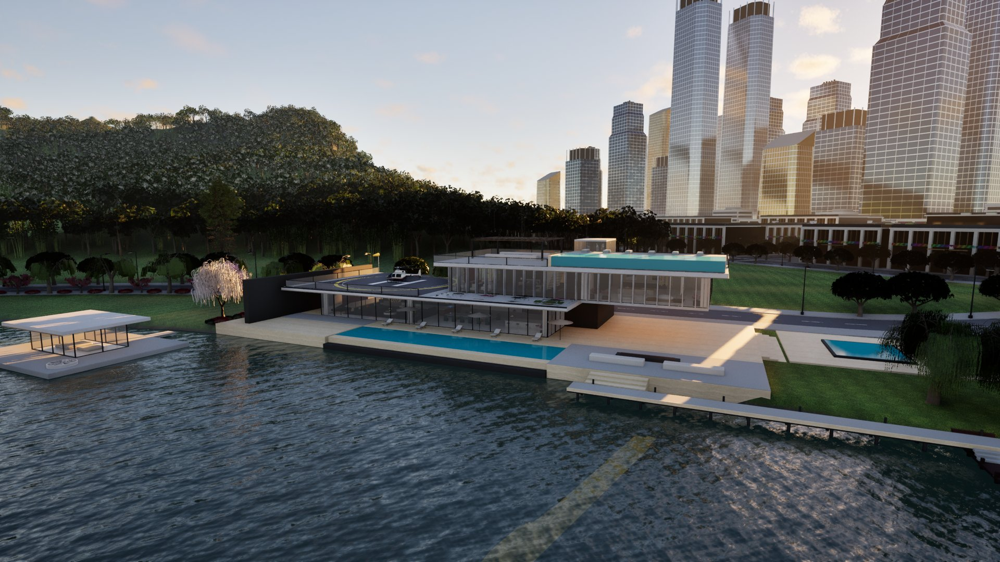
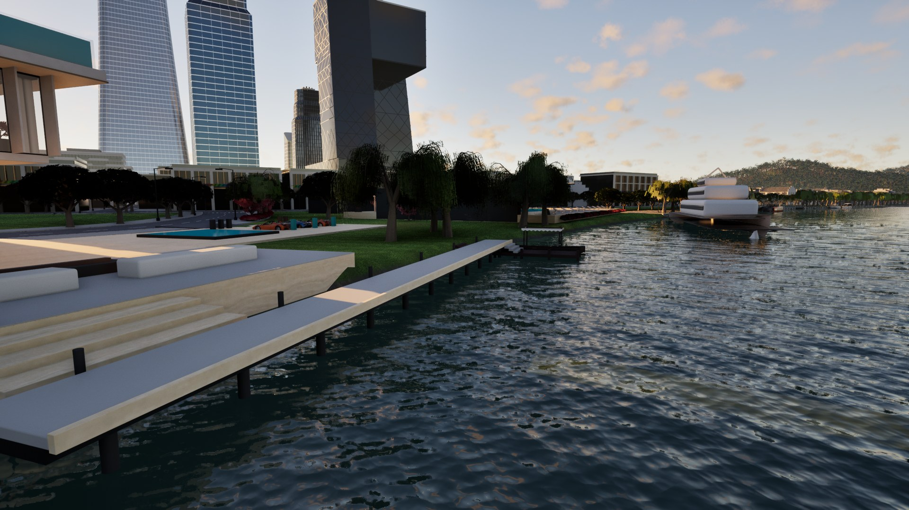
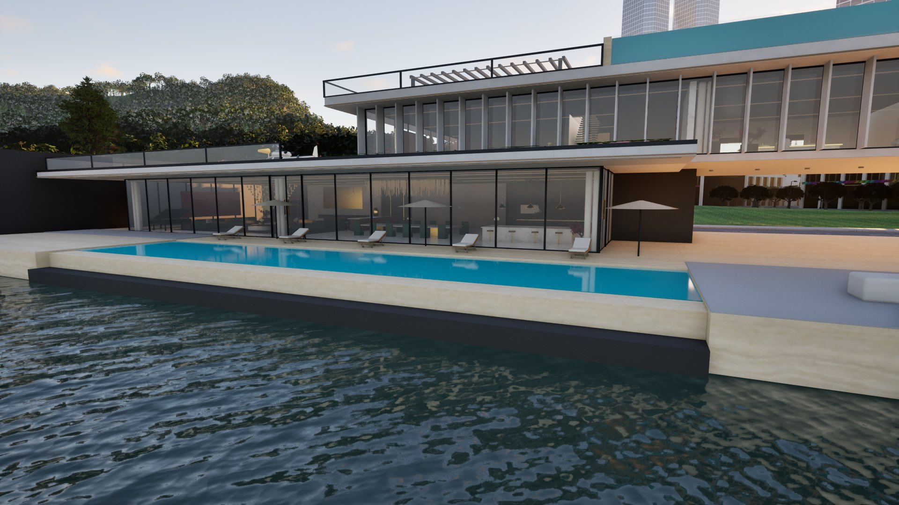

# NeonCity

[简体中文](README.md) | **English**

### One coastal world. Gameplay systems built to connect.

**Third-person exploration · Land, sea & air vehicles · City life · Physical interaction**

*A coastal open-world game project built with Unreal Engine 5 and C++.*

[Highlights](#highlights) · [Engineering highlights](#engineering-highlights) · [Screenshots](#screenshots) · [Explore the code](#explore-the-code) · [Download and run](#download-and-run)

**NeonCity is about more than a city to look at. It is about making its gameplay systems work together.**

Walk out of your home, drive to the coast, take a boat offshore, then explore beneath the surface: that is the player journey the project is working toward. The focus is not just adding vehicles or buildings, but connecting them through input, cameras, physical feedback and world state that persists after you leave.

> **Status: a single-player project in development, with public source code and development notes.** This repository showcases implementations, design decisions and work-in-progress visuals. It is not a finished commercial game or a complete, ready-to-play project. See [Download and run](#download-and-run) for what is included.

## Highlights

| Experience | What is being built | What makes it worth exploring |
| --- | --- | --- |
| **Explore by land, sea and air** | Controls and interactions for cars, off-road vehicles, boats, helicopters and fixed-wing aircraft | Entering, exiting, transferring control, camera behavior and feedback—not just making a vehicle move |
| **Water that affects gameplay** | An FFT ocean, water sampling, boat buoyancy, swimming and diving | Connecting visible waves to the water state used by characters and hulls |
| **Walk on moving decks** | Character movement, balance loss and departure velocity on dynamic surfaces | Letting hull motion affect the character instead of pinning them to the boat |
| **A foundation for city life** | Homes, garages, a phone, banking, fishing, missions and opportunity events | Connecting activities through shared interaction, economy and persistence systems |
| **Actions and consequences** | Character combat, vehicle weapons, collision damage, police and wanted-state systems | Building connections between systems rather than isolated demonstrations |

These areas have code implementations. **That does not mean every gameplay loop has passed final player-experience review.** The links below take you directly to the implementations and their supporting notes.

## Engineering highlights

The interesting part is **how the systems fit together**, not a claim that every underlying algorithm is original.

### 1. One ocean connects rendering and gameplay

The ocean runtime coordinates a shared fast Fourier transform (FFT) wave field, water queries and a CDLOD ocean mesh. Buoyancy and swimming consume water data through shared interfaces. Physical sampling uses budgeted asynchronous queries rather than reading an entire GPU texture back to the CPU every frame.

**Why it matters:** the ocean is more than a background material. Its state needs to be useful to gameplay without ignoring the cost of moving data between rendering and physics.

[Ocean runtime](Source/NeonCityOcean/) · [Water and swimming](Source/NeonCity/Water/) · [FFT port and validation notes](Docs/OceanFFTValidation.md)

### 2. Moving ground is a gameplay problem of its own

The dynamic-surface movement component handles movement bases, contact-point motion, balance loss and inherited velocity when a character leaves a surface. A short-time motion filter separates contact noise from meaningful acceleration, rather than hiding the problem by locking a boat's orientation or forcing the character's position every frame.

**Why it matters:** making a boat drivable and letting a character move naturally on its deck are different challenges. The latter brings character movement, collision and vehicle physics together.

[Dynamic-surface movement](Source/NeonCity/Physics/NeonCitySurfaceMovementComponent.cpp) · [Motion filter](Source/NeonCity/Physics/DynamicSurfaceMotionFilter.h) · [Marine vehicles](Source/NeonCity/Vehicles/Marine/)

### 3. Many activities, clear ownership of state

The save model separates player, economy, vehicles, properties, weapons, phone and world data, with version migration and handling for missing fields. The banking UI presents data and requests operations; the economy system owns the balances. Transfers do not create a second wallet inside the UI.

**Why it matters:** adding a feature also means handling older saves, repeated actions, restoration and consistency between systems.

[Persistence and restoration](Source/NeonCity/Core/Persistence/) · [Economy](Source/NeonCity/Economy/) · [Banking design and validation](Docs/BankingExperience.md)

### 4. Test the sequence, not just the function

The repository contains data-boundary tests and Unreal Editor Play In Editor (PIE) automation. Marine validation notes cover boarding, throttle, steering, slowing down, leaving the boat, swimming and reboarding. Other tests address input lifecycles, save restoration and cross-system regressions.

**Why it matters:** a system working on its own does not guarantee it still works after switching activities. Controls, animation, audio and visual quality also require hands-on review; automation does not replace it.

[Automation source](Source/NeonCity/Tests/) · [Marine interaction validation](Docs/MarineExperienceValidation.md)

## Screenshots

These are in-engine screenshots from development. They show the visual direction, not the quality of every area or a final release.

### Waterfront city

The skyline, waterfront paths and shoreline spaces form the transition between exploring the streets and heading out onto the water.

### A home by the water

Glass facades, pools, terraces and visible interiors define the residential scene. The aim is for a home to become a base for life in the world—not just a spawn point.

## Explore the code

**Here for the game?** Start with the screenshots and highlights.

**Here for the implementation?** Pick a system below, then consult the [architecture notes](Docs/Architecture.md). Linked development documents include both Chinese and English; they have not all been translated.

| Interested in… | Start here |
| --- | --- |
| Player control, input and general interaction | [Player](Source/NeonCity/Player/) / [Interaction](Source/NeonCity/Interaction/) |
| Cars, boats and aircraft | [Vehicles](Source/NeonCity/Vehicles/) / [Aircraft](Source/NeonCity/Aircraft/) |
| Ocean rendering integration, swimming and diving | [NeonCityOcean](Source/NeonCityOcean/) / [Water](Source/NeonCity/Water/) |
| Combat, physical interactions and vehicle weapons | [Combat](Source/NeonCity/Combat/) / [Physics](Source/NeonCity/Physics/) / [VehicleCombat](Source/NeonCity/VehicleCombat/) |
| AI, police and wanted states | [AI](Source/NeonCity/AI/) / [Police](Source/NeonCity/Police/) / [Wanted](Source/NeonCity/Wanted/) |
| Phone, banking, homes and activities | [Phone](Source/NeonCity/Phone/) / [Economy](Source/NeonCity/Economy/) / [Property](Source/NeonCity/Property/) / [Adventure](Source/NeonCity/Adventure/) |
| Navigation, missions and opportunity events | [Navigation](Source/NeonCity/Navigation/) / [Missions](Source/NeonCity/Missions/) / [Opportunities](Source/NeonCity/Opportunities/) |
| Cross-system persistence and regression checks | [Persistence](Source/NeonCity/Core/Persistence/) / [Tests](Source/NeonCity/Tests/) |

<strong>Technology and repository size</strong>

- **Engine and language:** Unreal Engine 5.8, C++, and Blueprint-facing interfaces.
- **Key technologies:** Enhanced Input, Chaos Vehicles, UMG / Slate, Niagara, RHI / RenderCore.
- **Modules:** `NeonCity` for gameplay, `NeonCityOcean` for the ocean runtime, and `NeonCityArtEditor` for editor tools.
- **Public source snapshot:** 989 `.h` / `.cpp` files and approximately 115,000 lines, including approximately 57,000 lines in test directories and 528 statically counted automation-test macro declarations.

These figures count tracked `.h` / `.cpp` files under `Source/` at the time of this README update, including template code, comments, blank lines and tests. Test declarations are not a count of tests passed in a fresh run. `Docs/` contains records from multiple development stages; check each document's date, scope and outstanding limitations.

## Download and run

**This repository is currently for browsing source and studying the implementation. It is not a complete runnable project distribution.**

| Included | Not included in this repository |
| --- | --- |
| C++ source, configuration and the project descriptor | Maps, Blueprints and art assets under `Content/` |
| Development notes and scoped validation records | The `Shaders/` directory referenced by the ocean runtime |
| The in-engine screenshots shown here | The complete runtime asset set, a packaged game and all required dependencies |

**Cloning this repository alone will not reproduce the pictured scenes or provide a complete runnable or packageable project.** The project descriptor also uses a machine-local engine GUID, so another environment would need to select the corresponding engine installation. Historical build results from the full local project are not evidence that this public snapshot can be built and run as-is.

### Origins and licensing

- The project extends the UE5 Third Person Template. The `Variant_*` directories are template content.
- The ocean and parts of the marine implementation include ports and adaptations of **Tidewater**. See the [FFT notes](Docs/OceanFFTValidation.md) and [reference-boat notes](Docs/MarineReferenceBoatValidation.md) for provenance and adaptation details. These algorithms are not presented as original NeonCity research.
- Some art uses third-party resources and is not distributed here. The repository does not currently include a project-wide `LICENSE`; public visibility should not be treated as unrestricted permission to reuse all code or assets.

## What comes next

- **Connected play:** improve transitions between walking, driving, boating, swimming and indoor activities.
- **Feedback and presentation:** keep refining animation, cameras, audio, UI and environmental detail.
- **World interactions:** deepen the connections between NPC reactions, activities, economy and persistence.
- **Validation and performance:** expand continuous-play and regression checks, with explicit resource budgets for the open world.

These are ongoing development directions, not completed features or promised release dates.

---

**Interested in UE5 open worlds, vehicle physics or connected gameplay systems? Star the repository to bookmark it and follow its progress.**

Ideas and specific feedback are welcome in [Issues](https://github.com/dinghaocheng738-cpu/NeonCity/issues). Which gameplay sequence would you like to see demonstrated, which system deserves a technical breakdown, or which interaction would you improve next?
