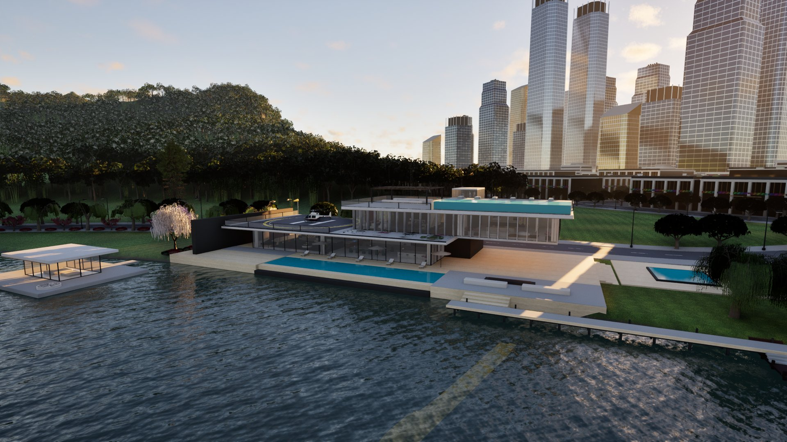
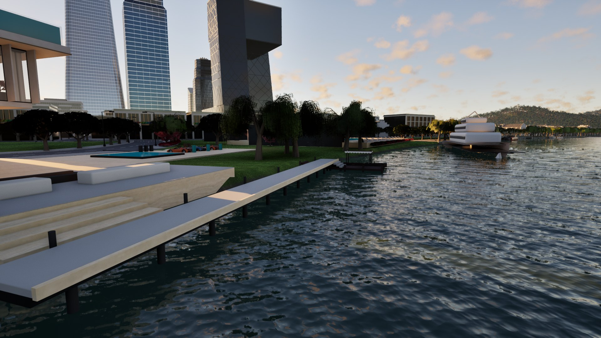
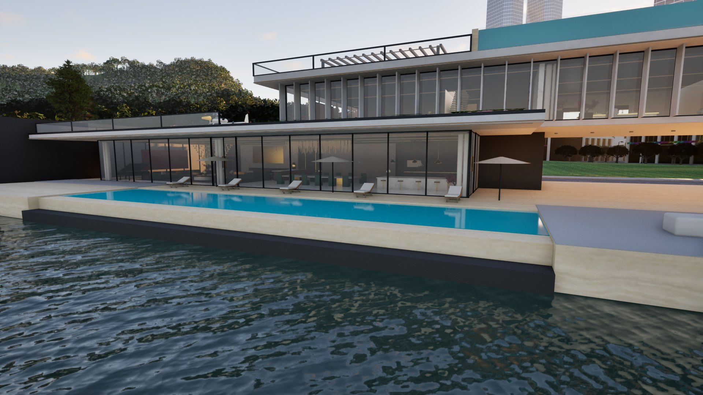

# NeonCity

**简体中文** | [English](README.en.md)

### 从城市街道到近海水下，一个持续构建中的 UE5 开放世界。

**第三人称探索 · 陆海空载具 · 城市生活 · 物理交互**

*A coastal open-world game project built with Unreal Engine 5 and C++.*

[项目亮点](#项目亮点) · [技术看点](#技术看点) · [画面预览](#画面预览) · [源码导览](#源码导览) · [下载与运行](#下载与运行)

**NeonCity 想做的，不只是一个能逛的城市，而是一个不同玩法能接起来的世界。**

从家中出门，驾车前往海岸，换船离开码头，再进入水下探索——这是项目围绕的体验方向。开发重点不仅是增加载具或建筑，也包括切换玩法时的输入、镜头、物理反馈，以及离开后仍能保留的世界状态。

> **当前定位：开发中的单机项目，公开源码与开发记录。** 这里展示的是现有实现、设计思路和阶段性画面，不是已完成的商业游戏，也不是下载即玩的完整工程。仓库范围见[下载与运行](#下载与运行)。

## 项目亮点

| 体验方向 | 项目在做什么 | 值得关注的地方 |
| --- | --- | --- |
| **陆、海、空探索** | 汽车、越野车、船只、直升机与固定翼的控制和交互实现 | 关注上下载具、控制权切换、镜头与反馈，而不只是“能移动” |
| **有物理反馈的海面** | FFT 海洋、水体采样、船舶浮力、游泳与潜水 | 把看到的波浪与角色、船体实际使用的水体状态联系起来 |
| **可活动的移动甲板** | 角色在动态表面上的移动、失衡与离开表面的速度处理 | 让船体运动影响角色，而不是把角色固定在船上 |
| **城市生活框架** | 住宅、车库、手机、银行、钓鱼、任务与机会事件 | 尝试用交互、经济和存档把分散活动连接起来 |
| **行动与后果** | 角色战斗、载具武器、碰撞伤害、警察与通缉相关系统 | 不同系统之间有状态与反馈联系，而非完全独立的演示 |

这些方向已有代码实现，**不表示每条玩法链路都已完成最终体验验收**。具体实现可以从下方入口直接阅读。

## 技术看点

项目的探索重点在于**系统如何协同**，而不是宣称每一项基础算法都是原创。

### 1. 同一片海，连接画面与玩法

海洋运行时组织共享的 FFT 波场、水体查询和 CDLOD 网格。船舶浮力、游泳等系统通过水体接口获得信息，物理采样采用有预算限制的异步查询，避免把整张 GPU 纹理每帧读回 CPU。

**为什么值得看：** 海面不只是背景材质；波浪状态要能被玩法使用，同时兼顾渲染与物理之间的数据传递成本。

[海洋运行时](Source/NeonCityOcean/) · [水体与游泳](Source/NeonCity/Water/) · [FFT 移植与验证记录](Docs/OceanFFTValidation.md)

### 2. 让角色真正面对“移动的地面”

动态表面移动组件处理运动基座、接触点运动、角色失衡与离开时的速度继承。短时间滤波用于区分接触噪声和真正的剧烈运动，而不是通过锁定船体姿态或逐帧强设角色位置来掩盖问题。

**为什么值得看：** “船能开”与“人能在运动的船上自然活动”是两类问题；后者需要把角色移动、碰撞和载具物理放在一起考虑。

[动态表面移动](Source/NeonCity/Physics/NeonCitySurfaceMovementComponent.cpp) · [运动滤波](Source/NeonCity/Physics/DynamicSurfaceMotionFilter.h) · [船舶系统](Source/NeonCity/Vehicles/Marine/)

### 3. 多种生活系统，共用清晰的状态边界

存档模型按玩家、经济、车辆、房产、武器、手机、世界等领域划分数据，并包含版本迁移和缺失字段处理。银行界面负责展示与发起操作，账户余额由经济系统统一管理，转账不会在 UI 内另建一套钱包。

**为什么值得看：** 增加玩法之外，也要处理旧存档、重复操作、状态恢复和系统间的一致性。

[存档与恢复](Source/NeonCity/Core/Persistence/) · [经济系统](Source/NeonCity/Economy/) · [银行设计与验证](Docs/BankingExperience.md)

### 4. 不只验证一个函数，也检查一段操作过程

仓库包含数据边界测试和 Unreal Editor PIE 自动化测试。船舶验证记录覆盖上船、推进、转向、减速、离船、游泳和重新登船等操作；其他测试涉及输入生命周期、存档恢复与系统回归。

**为什么值得看：** 单个系统能运行，不代表切换玩法后仍然正常。自动化之外，操控手感、动画、声音和画面仍需要人工实机检查。

[自动化测试源码](Source/NeonCity/Tests/) · [船舶操作验证记录](Docs/MarineExperienceValidation.md)

## 画面预览

以下为开发阶段实机截图，展示当前美术方向，不代表全部区域或最终品质。

### 滨水城市

城市天际线、滨水步道与近岸空间，构成街道和海上探索之间的过渡。

### 海边住宅

玻璃立面、泳池、露台与可见的室内空间，是住宅场景的重点；项目希望“家”不只是出生位置，也成为探索世界的生活据点。

## 源码导览

**第一次来？** 看截图和项目亮点即可。

**想研究实现？** 从一个感兴趣的系统开始，再查阅[架构文档](Docs/Architecture.md)。

| 想了解什么 | 从这里开始 |
| --- | --- |
| 玩家、输入与通用交互 | [Player](Source/NeonCity/Player/) / [Interaction](Source/NeonCity/Interaction/) |
| 汽车、船舶与飞行器 | [Vehicles](Source/NeonCity/Vehicles/) / [Aircraft](Source/NeonCity/Aircraft/) |
| 海洋渲染适配、游泳与潜水 | [NeonCityOcean](Source/NeonCityOcean/) / [Water](Source/NeonCity/Water/) |
| 战斗、物理与载具武器 | [Combat](Source/NeonCity/Combat/) / [Physics](Source/NeonCity/Physics/) / [VehicleCombat](Source/NeonCity/VehicleCombat/) |
| AI、警察与通缉 | [AI](Source/NeonCity/AI/) / [Police](Source/NeonCity/Police/) / [Wanted](Source/NeonCity/Wanted/) |
| 手机、银行、住宅与活动 | [Phone](Source/NeonCity/Phone/) / [Economy](Source/NeonCity/Economy/) / [Property](Source/NeonCity/Property/) / [Adventure](Source/NeonCity/Adventure/) |
| 导航、任务与机会事件 | [Navigation](Source/NeonCity/Navigation/) / [Missions](Source/NeonCity/Missions/) / [Opportunities](Source/NeonCity/Opportunities/) |
| 跨系统存档与回归检查 | [Persistence](Source/NeonCity/Core/Persistence/) / [Tests](Source/NeonCity/Tests/) |

<strong>技术栈与仓库规模</strong>

- **引擎与语言：** Unreal Engine 5.8、C++、Blueprint 交互接口。
- **主要技术：** Enhanced Input、Chaos Vehicles、UMG / Slate、Niagara、RHI / RenderCore。
- **模块划分：** `NeonCity` 游戏逻辑、`NeonCityOcean` 海洋运行时、`NeonCityArtEditor` 编辑器工具。
- **当前公开源码：** 989 个 `.h` / `.cpp` 文件，约 11.5 万行；其中测试目录约 5.7 万行，静态检出 528 处自动化测试宏声明。

统计范围为本次 README 更新时 `Source/` 内已跟踪的 `.h` / `.cpp`，包含模板代码、注释、空行和测试；测试声明数不是本次运行通过数。`Docs/` 保留多个开发阶段的记录，请注意各文档的日期、适用范围和未完成事项。

## 下载与运行

**这个仓库目前适合浏览源码和研究实现，不是完整的可运行工程包。**

| 已公开 | 尚未随仓库提供 |
| --- | --- |
| C++ 源码、配置、项目描述文件 | `Content/` 中的地图、蓝图与美术资源 |
| 开发文档与阶段性验证记录 | 海洋运行时引用的 `Shaders/` 目录 |
| README 中的实机截图 | 完整运行资源、打包游戏及其完整依赖 |

因此，**仅克隆本仓库不能复现截图中的场景，也不能完成完整运行或打包**。项目描述文件中的引擎关联还是本地 GUID，迁移到其他环境时也需要重新选择对应引擎。不要把文档中完整本地工程的历史构建结果理解为此公开仓库可直接构建运行。

### 来源与授权说明

- 项目基于 UE5 第三人称模板扩展；`Variant_*` 目录来自模板。
- 海洋与部分船舶实现包含对 **Tidewater** 的移植和适配，来源与适配过程见 [FFT 记录](Docs/OceanFFTValidation.md)及[参考船舶记录](Docs/MarineReferenceBoatValidation.md)，不作为项目原创算法宣传。
- 部分美术使用第三方资源，未随本仓库分发。当前仓库也尚未附完整项目的 `LICENSE`，请勿将“源码可见”理解为所有代码或资源均可不受限制地复用。

## 接下来关注什么

- **体验连贯性：** 减少步行、驾驶、乘船、游泳与室内活动之间的割裂。
- **反馈与表现：** 持续打磨动画、镜头、声音、UI 和场景细节。
- **世界联动：** 深化 NPC 反应、活动、经济与存档的连接。
- **验证与性能：** 扩大连续游玩和回归检查范围，明确开放世界的资源预算。

这些是持续迭代方向，不是已完成承诺或固定发布日期。

---

**如果你对 UE5 开放世界、载具物理或多系统玩法整合感兴趣，欢迎点一个 Star，收藏项目、关注后续变化。**

也欢迎通过 [Issues](https://github.com/dinghaocheng738-cpu/NeonCity/issues) 提出具体建议：你最想看哪段玩法演示、哪个系统的实现解析，或者哪个交互值得继续打磨？
